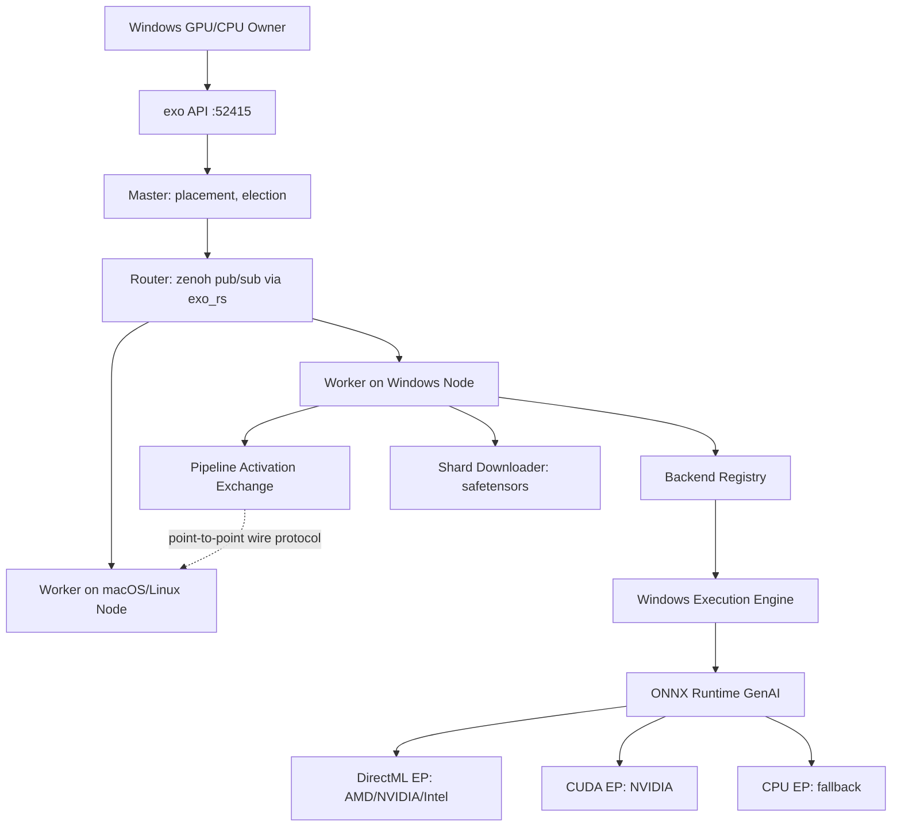
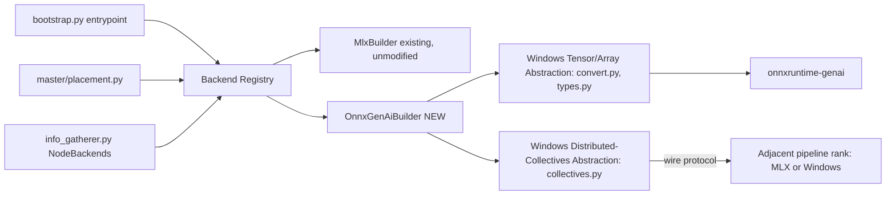
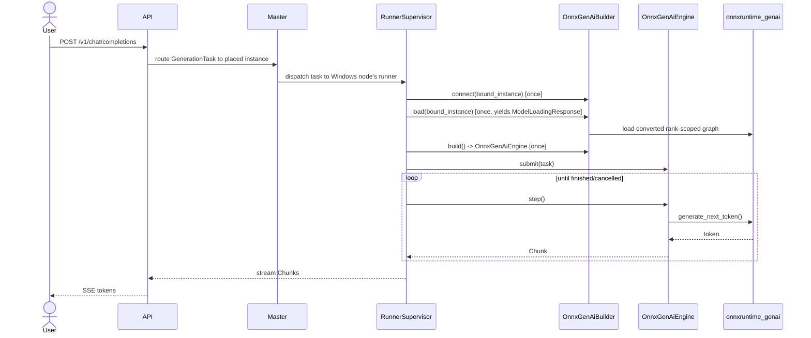

# Solution Design Document

## Validation Checklist

### CRITICAL GATES (Must Pass)

- [x] All required sections are complete
- [x] No [NEEDS CLARIFICATION] markers remain
- [x] Architecture pattern is clearly stated with rationale
- [x] **All architecture decisions confirmed by user** — confirmed via the classifier/scope decisions recorded in `README.md`'s Decisions Log for this spec.
- [x] Every interface has specification

### QUALITY CHECKS (Should Pass)

- [x] All context sources are listed with relevance ratings
- [x] Project commands are discovered from actual project files
- [x] Constraints → Strategy → Design → Implementation path is logical
- [x] Every component in diagram has directory mapping
- [x] Error handling covers all error types
- [x] Quality requirements are specific and measurable
- [x] Component names consistent across diagrams
- [x] A developer could implement from this design
- [x] Implementation examples use actual schema column names (not pseudocode) — n/a, no database schema; examples use actual type/field names from `shards.py`, `instances.py`
- [x] Complex queries include traced walkthroughs with example data — n/a, no SQL; the layer-range slicing algorithm below includes a traced walkthrough with concrete numbers instead
- [x] **MECE: Components** — each component has a single distinct responsibility, every PRD requirement maps to exactly one component
- [x] **MECE: Interfaces** — no duplicate interfaces serving the same path, all communication paths documented
- [x] **MECE: Data Models** — each entity owns a distinct slice of the domain, all required data is modeled
- [x] **MECE: Acceptance Criteria** — each EARS criterion is unique, every PRD criterion has a corresponding system-level criterion

---

## Output Schema

### SDD Status Report

| Field | Value |
|-------|-------|
| specId | 001-windows-inference-backend-abstraction |
| architecture | Registry-dispatched backend plugin architecture (see Solution Strategy) |
| validationPassed | 30 |
| validationPending | 0 |
| nextSteps | Proceed to Factory decomposition (manifest.md + units/ + scenarios/) |

### ArchitectureSummary

| Field | Value |
|-------|-------|
| pattern | Backend Registry + Plugin Engine (extends the existing `Engine`/`Builder` ABC seam in `engines/base.py`) |
| keyComponents | Backend Registry; Windows Execution Engine (ONNX Runtime GenAI); Windows Tensor/Array Abstraction (weight conversion + array wrapper); Windows Distributed-Collectives Abstraction (pipeline activation exchange + placement integration) |
| externalIntegrations | ONNX Runtime GenAI (`onnxruntime-genai`), DirectML execution provider, CUDA execution provider |

### ADR Status

| ID | Name | Status |
|----|------|--------|
| ADR-1 | Windows Inference Runtime | CONFIRMED |
| ADR-2 | Weight Conversion & Caching Strategy | CONFIRMED |
| ADR-3 | Pipeline Activation Transport | CONFIRMED |
| ADR-4 | Backend Selection Mechanism | CONFIRMED |
| ADR-5 | Initial Architecture Coverage | CONFIRMED |

---

## Constraints

CON-1 Windows dependency resolution must be added to `pyproject.toml`'s `[tool.uv] environments` (`pyproject.toml:188`, currently `["sys_platform == 'darwin'", "sys_platform == 'linux'"]`) and to the platform-specific `mlx`/`mlx-lm` source overrides (`pyproject.toml:81-111`) without breaking existing Darwin/Linux resolution; `basedpyright`'s `pythonPlatform = "Darwin"` (`pyproject.toml:152`) means new Windows-only modules must still strict-typecheck under a Darwin analysis pass, so they must avoid `sys.platform`-gated imports that basedpyright cannot resolve without stub coverage.

CON-2 Code style is fixed by AGENTS.md: strict exhaustive typing (never bypass the type checker), `Literal[...]` for enum-like sets, `typing.NewType` for primitives, Pydantic models `frozen=True`/`strict=True`, pure functions with injectable effect handlers, no abbreviations, `@final` and immutability wherever applicable. New Windows modules must follow the same conventions as `engines/mlx/`.

CON-3 The `Engine`/`Builder` ABC contract in `engines/base.py:16-60` is lifecycle-only (connect/load/build/warmup/submit/step/close/serve_prefill) and must not be broken — every existing MLX call site (`runner/runner.py:207-309`, `runner/bootstrap.py:40-105`) depends on this exact shape. The Windows backend must implement this contract as-is; it must not require changes to `Engine`/`Builder` themselves.

## Implementation Context

**IMPORTANT**: You MUST read and analyze ALL listed context sources to understand constraints, patterns, and existing architecture.

### Required Context Sources

#### Documentation Context

No `docs/patterns/` or `docs/interfaces/` directory exists in this repository for this domain; the codebase itself (via Code Context below) is the authoritative source. `README.md`'s "Hardware Accelerator Support" and "Environment Variables" sections (root `README.md`) document today's macOS/Linux-only acceleration story and are the baseline this design extends.

```yaml
- url: https://onnxruntime.ai/docs/genai/
  relevance: HIGH
  why: "ADR-1's chosen runtime; documents DirectML EP, CUDA EP, and the model-builder conversion tool this design relies on"
```

#### Code Context

```yaml
- file: src/exo/worker/engines/base.py
  relevance: CRITICAL
  why: "Engine/Builder ABCs (lines 16-60) are the exact seam the Windows backend must implement; lifecycle-only, no MLX types leak here"

- file: src/exo/worker/runner/bootstrap.py
  relevance: CRITICAL
  why: "Lines 40-105: entrypoint() hardcodes builder selection (image->MfluxBuilder, else->MlxBuilder). This is replaced by the Backend Registry lookup"

- file: src/exo/worker/runner/runner.py
  relevance: HIGH
  why: "Lines 207-309: runner state machine (ConnectToGroup->connect(), LoadModel->load()->build(), StartWarmup->warmup()) that every Builder/Engine, including the Windows one, must satisfy unchanged"

- file: src/exo/worker/runner/supervisor.py
  relevance: MEDIUM
  why: "Lines 181-274: one isolated AsyncProcess runner per local shard with multiprocessing channels — confirms the Windows engine runs in its own process per shard, same as MLX, so no in-process coexistence with MLX code is required"

- file: src/exo/worker/engines/mlx/builder.py
  relevance: HIGH
  why: "Reference implementation of the Builder/Engine contract (connect/load/build/close) the Windows OnnxGenAiBuilder mirrors structurally"

- file: src/exo/worker/engines/mlx/types.py
  relevance: MEDIUM
  why: "Shows the existing pattern of a thin typed wrapper (Model) around an untyped native library surface (mlx.nn.Module) — the Windows engine's types.py follows the same pattern for onnxruntime_genai objects"

- file: src/exo/shared/types/backends.py
  relevance: CRITICAL
  why: "Backend enum (MlxMetal, MlxCpu, MlxCuda, Vllm) gains 3 new Windows members; this enum is the capability key the Backend Registry dispatches on"

- file: src/exo/shared/types/worker/shards.py
  relevance: HIGH
  why: "Lines 10-84: Sharding enum, BaseShardMetadata, PipelineShardMetadata with half-open [start_layer, end_layer) ranges — the Windows Tensor/Array Abstraction converts exactly this layer range into a rank-scoped ONNX graph"

- file: src/exo/utils/info_gatherer/info_gatherer.py
  relevance: CRITICAL
  why: "Lines 372-383: NodeBackends.gather() is the exact site that must gain a Windows branch (parallel to the existing IS_DARWIN branch) probing DirectML/CUDA EP availability"

- file: src/exo/master/placement.py
  relevance: HIGH
  why: "Lines 46-54: INSTANCE_META_BACKENDS maps InstanceMeta to allowed Backend list and restricts MlxJaccl to Backend.MlxMetal (line 51-54); lines 127-172 validate tensor-sharding compatibility. The Windows Distributed-Collectives Abstraction adds a new InstanceMeta entry here"

- file: src/exo/shared/types/worker/instances.py
  relevance: HIGH
  why: "Lines 15-39: InstanceMeta enum and MlxRingInstance/MlxJacclInstance dataclasses (hosts_by_node, ephemeral_port) — the pattern the new OnnxPipelineInstance mirrors for Windows pipeline coordination"

- file: src/exo/worker/engines/mlx/auto_parallel.py
  relevance: HIGH
  why: "Lines 120-318: pipeline parallelism slices the layer list to [start_layer:end_layer) and wraps boundary layers for inter-rank activation exchange — the exact algorithm the Windows Tensor/Array Abstraction's graph-slicing step reproduces for ONNX graphs; lines 605-1610 show the per-architecture tensor-parallel sharding this design does NOT attempt to replicate on Windows in this phase"

- file: src/exo/worker/engines/mlx/disaggregated/adapter.py
  relevance: HIGH
  why: "Lines 1-24 (imports) and the file's array_to_bytes/bytes_to_array functions show the existing pattern of converting a tensor to/from a wire byte format for a BinaryIO stream (float16/float32/bfloat16) — the Windows Distributed-Collectives Abstraction's activation-exchange wire codec follows this exact pattern for numpy arrays instead of mx.array"

- file: src/exo/download/impl_shard_downloader.py
  relevance: MEDIUM
  why: "Lines 154-208: downloads safetensors shards and selects files matching a pipeline layer range — the Windows Tensor/Array Abstraction consumes this same already-downloaded safetensors data as its conversion input, no new download logic is needed"

- file: src/exo/worker/runner/llm_inference/batch_generator.py
  relevance: MEDIUM
  why: "Lines 8-45: runner-facing batching code imports MLX/MLX-LM directly, confirming the MLX-coupling leak extends past engines/mlx/ into runner/. The Windows engine does not reuse this module; it implements its own batching inside engines/onnx/ to avoid deepening the leak"

- file: pyproject.toml
  relevance: CRITICAL
  why: "Lines 47-72 (extras), 81-111 (platform source overrides), 184-189 (uv environments, Darwin/Linux only), 151-152 (basedpyright platform=Darwin) — every one of these needs a Windows-aware addition"
```

### Implementation Boundaries

- **Must Preserve**: The `Engine`/`Builder` ABC signatures in `engines/base.py`; the runner state machine in `runner.py:207-309`; every existing MLX code path and its current behavior/performance on macOS and Linux; the `BoundInstance`/`ShardMetadata`/`Backend` type contracts consumed by the master and by `AsyncProcess` runners.
- **Can Modify**: `bootstrap.py`'s builder-selection branch (becomes a registry lookup); `Backend` enum (additive new members); `NodeBackends.gather()` (additive Windows branch); `INSTANCE_META_BACKENDS` and `InstanceMeta`/`Instance` (additive new member + new instance dataclass); `pyproject.toml` (additive Windows markers/extras).
- **Must Not Touch**: `engines/mlx/**` internals (no behavior change to MLX code paths); `engines/image/**` (out of scope, see ADR-5 / requirements Won't Have); the Rust `networking`/`exo_rs` crates (cluster discovery/zenoh transport is reused as-is, not modified).

### External Interfaces

#### System Context Diagram



#### Interface Specifications

```yaml
inbound:
  - name: "OpenAI-Compatible Chat Completions API"
    type: HTTPS
    format: REST (JSON, SSE streaming)
    authentication: none (local API, unchanged from existing behavior)
    data_flow: "User chat requests routed to whichever node/backend (MLX or Windows) holds the target model instance; unchanged endpoint, new backend underneath"

  - name: "Instance Placement API (/instance, /instance/previews)"
    type: HTTPS
    format: REST (JSON)
    authentication: none
    data_flow: "Placement previews and instance creation now consider Windows nodes' reported Backend capability when selecting valid InstanceMeta/Sharding combinations"

outbound:
  - name: "ONNX Runtime GenAI native library"
    type: In-process native call (Python bindings over C++ runtime)
    format: onnxruntime_genai.Model / Generator API
    authentication: n/a (local library)
    data_flow: "Windows Execution Engine loads a converted model graph and drives token generation through this library"
    criticality: HIGH

  - name: "Pipeline Activation Exchange (rank-to-rank)"
    type: TCP (same transport pattern as the existing disaggregated prefill BinaryIO stream)
    format: length-prefixed binary tensor blob (mirrors worker/disaggregated/protocol.py's Header/TensorBlob wire format)
    authentication: none (intra-cluster, same trust boundary as existing zenoh cluster messages)
    data_flow: "Hidden-state activations for the boundary layer hand off between adjacent pipeline ranks, one or both of which may be Windows nodes"
    criticality: HIGH

data:
  - name: "Model Weight Cache (safetensors + converted ONNX artifacts)"
    type: Local filesystem, under the existing EXO_MODELS_DIRS / EXO_DEFAULT_MODELS_DIR configuration
    connection: Direct file I/O
    data_flow: "Converted per-rank ONNX Runtime GenAI graphs are cached alongside the existing downloaded safetensors, keyed by model_id + device_rank + world_size"
```

### Cross-Component Boundaries

- **API Contracts**: The public OpenAI/Claude/Ollama-compatible HTTP APIs and the `Engine`/`Builder` ABC are the two contracts that must not break across this design's components.
- **Team Ownership**: Single repository, no cross-team boundary; "components" below are implementation-sized slices for the Factory decomposition, not separate teams.
- **Shared Resources**: The model weight cache directory (existing `EXO_MODELS_DIRS`/`EXO_DEFAULT_MODELS_DIR`) is shared between the safetensors downloader and the new Windows conversion cache; the wire protocol module pattern (`worker/disaggregated/protocol.py`-style framing) is shared between the existing MLX disaggregated-prefill path and the new Windows pipeline activation exchange.
- **Breaking Change Policy**: Additive-only. `Backend`, `InstanceMeta`, and `Instance` are extended with new enum members/union members; no existing member is renamed or removed, so all pattern-matches on these types elsewhere in the codebase (e.g. `placement.py`'s `match progress:` style code) must be extended with new cases, not rewritten.

### Project Commands

```bash
# Core Commands (from AGENTS.md / pyproject.toml, unchanged by this feature)
Install: uv sync --extra mlx                 # macOS
         uv sync --extra mlx-cpu|mlx-cuda12|mlx-cuda13   # Linux
         uv sync --extra onnx-directml|onnx-cuda|onnx-cpu   # Windows (NEW, this spec)
Dev:     uv run exo
Test:    uv run pytest
Lint:    uv run ruff check
Types:   uv run basedpyright
Build:   cd dashboard && npm install && npm run build
Format:  nix fmt
```

## Solution Strategy

- **Architecture Pattern**: Backend Registry + Plugin Engine. `bootstrap.py`'s hardcoded `if bound_instance.is_image_model: ... else: MlxBuilder(...)` (`bootstrap.py:67-86`) becomes a lookup into a registry keyed by `Backend` capability (plus the existing `is_image_model` split), returning a `Builder` factory. The Windows backend is a new, independent implementation of the existing `Engine`/`Builder` ABCs (`engines/base.py:16-60`) — it does not need those ABCs to change, because they are already lifecycle-only and backend-agnostic.
- **Integration Approach**: The Windows backend is added as a new sibling package (`engines/onnx/`) to `engines/mlx/` and `engines/image/`, following the exact same shape (a `Builder` that connects/loads/builds, producing an `Engine` that warms up/submits/steps). It plugs into the existing per-shard `AsyncProcess` runner model (`supervisor.py:181-274`) unchanged — one Windows engine instance runs per isolated runner process, exactly like MLX today. Cluster discovery, election, routing, and placement (zenoh/exo_rs, `master/placement.py`) are reused as-is; only the `Backend` enum, `NodeBackends.gather()`, and `INSTANCE_META_BACKENDS` gain additive entries.
- **Justification**: This approach adds a new backend without touching any MLX code path (satisfies CON-3 / Must Not Touch), matches the project's existing multi-backend precedent (MLX already has two variants — Ring and JACCL — selected via `InstanceMeta`), and keeps the blast radius of this feature limited to registry/enum extension points rather than a rewrite of the runner or master.
- **Key Decisions**: (1) Use ONNX Runtime GenAI rather than raw ONNX Runtime, Vulkan, or a ported mlx-cuda (ADR-1); (2) convert safetensors to a rank-scoped ONNX graph lazily and cache it (ADR-2); (3) reuse the existing wire-blob transport pattern for pipeline activation hand-off instead of inventing new distributed collectives (ADR-3); (4) dispatch backends through a registry instead of hardcoded branches (ADR-4); (5) launch with a deliberately narrow architecture set and grow it later (ADR-5).

## Building Block View

### Components



### Directory Map

**Component**: Backend Registry
```
.
├── src/exo/worker/runner/
│   ├── bootstrap.py                 # MODIFY: replace hardcoded if/else (lines 67-86) with a registry lookup
│   └── backend_registry.py          # NEW: BACKEND_BUILDERS registry mapping (Backend, is_image_model) -> Builder factory
```

**Component**: Windows Execution Engine
```
.
├── src/exo/worker/engines/onnx/
│   ├── __init__.py                  # NEW
│   ├── builder.py                   # NEW: OnnxGenAiBuilder(Builder) - connect/load/build/close
│   ├── engine.py                    # NEW: OnnxGenAiEngine(Engine) - warmup/submit/step/close/serve_prefill
│   └── backend_detect.py            # NEW: probes DirectML/CUDA EP availability at runtime, used by connect()
```

**Component**: Windows Tensor/Array Abstraction
```
.
├── src/exo/worker/engines/onnx/
│   ├── types.py                     # NEW: thin typed wrapper around onnxruntime_genai.Model/Generator (mirrors mlx/types.py's Model wrapper)
│   └── convert.py                   # NEW: safetensors -> rank-scoped ONNX Runtime GenAI graph, on-disk cache under EXO_MODELS_DIRS
```

**Component**: Windows Distributed-Collectives Abstraction
```
.
├── src/exo/worker/engines/onnx/
│   └── collectives.py               # NEW: point-to-point activation exchange between adjacent pipeline ranks (wire codec + BinaryIO stream)
├── src/exo/shared/types/
│   ├── backends.py                  # MODIFY: add OnnxDirectMl, OnnxCuda, OnnxCpu to Backend enum
│   └── worker/instances.py          # MODIFY: add InstanceMeta.OnnxPipeline + OnnxPipelineInstance(BaseInstance)
├── src/exo/master/
│   └── placement.py                 # MODIFY: INSTANCE_META_BACKENDS gains OnnxPipeline -> [OnnxDirectMl, OnnxCuda, OnnxCpu]
└── src/exo/utils/info_gatherer/
    └── info_gatherer.py             # MODIFY: NodeBackends.gather() gains an IS_WINDOWS branch (parallel to IS_DARWIN, line 378)
```

**Component**: Windows Platform & Packaging (cross-cutting, not a Factory unit component but required by every unit above)
```
.
└── pyproject.toml                   # MODIFY: [tool.uv] environments adds "sys_platform == 'win32'"; new extras onnx-directml, onnx-cuda, onnx-cpu
```

### MECE Check: Components

- [x] Each component has a single, distinct responsibility (no overlap): Registry = dispatch only; Execution Engine = lifecycle + generation loop; Tensor/Array Abstraction = weight conversion + typed wrapper; Distributed-Collectives Abstraction = cross-rank activation exchange + placement/capability plumbing.
- [x] Every PRD requirement maps to exactly one component (no gaps, no ambiguity): Feature 1 (Installability) → Platform & Packaging; Feature 2 (GPU inference) → Execution Engine + Tensor/Array Abstraction; Feature 3 (CPU fallback) → Execution Engine (CPU EP is one of the three EPs it selects); Feature 4 (multi-device cluster) → Distributed-Collectives Abstraction.
- [x] No two components own the same domain logic.

### Interface Specifications

#### Interface Documentation References

No separate interface documentation files exist for this domain; all interfaces are specified inline below, grounded in the actual type definitions read from the codebase (Code Context above).

#### Internal API Changes

No new public HTTP endpoints are added. The existing endpoints below gain new valid values/behavior:

```yaml
Endpoint: Placement Preview (existing, behavior extended)
  Method: GET
  Path: /instance/previews
  Request:
    model_id: string (unchanged)
  Response:
    success:
      previews: PlacementPreview[]   # unchanged shape; `instance_meta` may now be "OnnxPipeline" and `sharding` may be offered for cycles containing Windows nodes
    error:
      error_code: string (unchanged)

Endpoint: Cluster State (existing, behavior extended)
  Method: GET
  Path: /state
  Response:
    success:
      # node entries for Windows nodes now report a Backend value of
      # "OnnxDirectMl" | "OnnxCuda" | "OnnxCpu" instead of being absent/unsupported
```

#### Application Data Models

```pseudocode
ENTITY: Backend (MODIFIED) — src/exo/shared/types/backends.py
  FIELDS (str Enum members):
    MlxMetal, MlxCpu, MlxCuda, Vllm   # existing
    + OnnxDirectMl   # NEW: GPU acceleration via DirectML EP (AMD/NVIDIA/Intel on Windows)
    + OnnxCuda       # NEW: GPU acceleration via CUDA EP (NVIDIA on Windows, higher throughput than DirectML for NVIDIA)
    + OnnxCpu        # NEW: CPU EP fallback on Windows (mirrors MlxCpu's role on Darwin/Linux)

ENTITY: InstanceMeta (MODIFIED) — src/exo/shared/types/worker/instances.py:15-17
  FIELDS:
    MlxRing, MlxJaccl   # existing
    + OnnxPipeline (NEW)   # identifies a Windows-backend pipeline-parallel instance

ENTITY: OnnxPipelineInstance (NEW) — src/exo/shared/types/worker/instances.py, alongside MlxRingInstance (line 28) / MlxJacclInstance (line 33)
  FIELDS:
    instance_id: InstanceId           # inherited from BaseInstance
    shard_assignments: ShardAssignments  # inherited from BaseInstance
    + hosts_by_node: dict[NodeId, list[Host]]   # NEW, same shape as MlxRingInstance.hosts_by_node — addresses for the activation-exchange listeners
    + ephemeral_port: int             # NEW, same shape as MlxRingInstance.ephemeral_port
  BEHAVIORS:
    shard(runner_id): ShardMetadata | None   # inherited, unchanged

ENTITY: Instance (MODIFIED, type alias) — src/exo/shared/types/worker/instances.py:39
  ~ Instance: MlxRingInstance | MlxJacclInstance | OnnxPipelineInstance (CHANGED — additive union member)
```

#### Integration Points

```yaml
# Inter-Component Communication
- from: Backend Registry
  to: Windows Execution Engine
  protocol: direct Python call (Builder factory invocation)
  data_flow: "bootstrap.py resolves the node's detected Backend + is_image_model to a concrete Builder class and instantiates it in-process, exactly as it does today for MlxBuilder"

- from: Windows Execution Engine
  to: Windows Tensor/Array Abstraction
  protocol: direct Python call
  data_flow: "OnnxGenAiBuilder.load() calls convert.py's conversion/cache-lookup function with the BoundInstance's PipelineShardMetadata (start_layer, end_layer, world_size) and gets back a ready-to-load ONNX Runtime GenAI model path"

- from: Windows Execution Engine (rank N)
  to: Windows Distributed-Collectives Abstraction / adjacent rank (N-1 or N+1, MLX or Windows)
  protocol: TCP, length-prefixed binary frames (same framing style as worker/disaggregated/protocol.py)
  data_flow: "Hidden-state activation tensor for the shard boundary is serialized to bytes and streamed to the next rank's listener, mirroring what auto_parallel.py's boundary-layer wrapping (lines 120-318) does in-process for MLX pipeline mode, but now across a process/node boundary via the wire codec instead of an in-memory mx.array hand-off"

# External System Integration
ONNX_Runtime_GenAI:
  doc: "https://onnxruntime.ai/docs/genai/"
  integration: "Python package (onnxruntime-genai + onnxruntime-directml or onnxruntime-gpu), loaded in-process by the Windows runner process; selects DirectML/CUDA/CPU execution provider per Backend value"
  critical_data: ["converted model graph + weights (per-rank)", "generation config (max_length, sampling params)", "KV cache state (managed internally by onnxruntime_genai.Generator)"]
```

### MECE Check: Interfaces & Data Models

- [x] No two interfaces serve the same consumer-to-provider path (no overlap).
- [x] All component-to-component and component-to-external communication paths are documented (no gaps).
- [x] Each data entity owns a distinct slice of the domain (no duplicate business data across entities): `Backend` = capability; `InstanceMeta`/`Instance` = coordination addressing; `ShardMetadata` (unchanged, reused) = layer assignment.
- [x] All data referenced in interfaces and acceptance criteria is modeled in an entity.

### Implementation Examples

**Purpose**: Clarify the two genuinely non-obvious mechanisms in this design: rank-scoped graph slicing, and the activation wire hand-off.

#### Example: Rank-Scoped Layer Slicing for ONNX Graph Conversion

**Why this example**: The half-open `[start_layer, end_layer)` convention from `PipelineShardMetadata` (`shards.py:56-62`) must be honored exactly, including the first/last-rank special cases (`is_first_layer`/`is_last_layer` properties, `shards.py:34-40`), or a Windows pipeline rank will load the wrong slice of the model and generate garbage.

```python
# convert.py — sketch, not final implementation
def convert_for_rank(model_id: ModelId, shard: PipelineShardMetadata) -> Path:
    """
    Traced walkthrough — a 32-layer model split 3 ways:
      shard A: start_layer=0,  end_layer=11, n_layers=32  -> is_first_layer=True,  is_last_layer=False
      shard B: start_layer=11, end_layer=22, n_layers=32  -> is_first_layer=False, is_last_layer=False
      shard C: start_layer=22, end_layer=32, n_layers=32  -> is_first_layer=False, is_last_layer=True

    For shard A: include the embedding table + layers[0:11]; exclude the LM head.
      Output of the graph = hidden state after layer 10, NOT logits.
    For shard B: include only layers[11:22]; exclude both embedding table and LM head.
      Input to the graph = hidden state from shard A; output = hidden state after layer 21.
    For shard C: include layers[22:32] + the LM head; exclude the embedding table.
      Input = hidden state from shard B; output = logits, as today's non-sharded model would produce.
    """
    cache_key = f"{model_id}-rank{shard.device_rank}-of-{shard.world_size}"
    cached = _cache_dir() / cache_key
    if cached.exists():
        return cached
    graph = _slice_onnx_graph(
        safetensors_dir=downloaded_path_for(model_id),
        start_layer=shard.start_layer,
        end_layer=shard.end_layer,
        include_embeddings=shard.is_first_layer,
        include_lm_head=shard.is_last_layer,
    )
    graph.save(cached)
    return cached
```

#### Example: Activation Hand-Off Wire Codec

**Why this pattern is important to document**: This deliberately reuses the existing `disaggregated/adapter.py` wire-codec shape (`array_to_bytes`/`bytes_to_array`, dtype-string mapping) rather than inventing a new protocol, so the same framing (`worker/disaggregated/protocol.py` `Header`/`write_header`/`write_done`) can carry either an MLX-array-derived blob or a numpy-array-derived blob.

```python
# collectives.py — sketch, not final implementation
def send_activation(stream: BinaryIO, hidden_state: np.ndarray, *, request_id: str) -> None:
    write_header(stream, Header(request_id=request_id, num_layers=1, dtype="float16", start_pos=0))
    write_kv_chunk(  # reused framing primitive; activation is treated as a single "chunk"
        stream,
        layer_idx=0,
        num_tokens=hidden_state.shape[0],
        n_heads=1,
        head_dim=hidden_state.shape[-1],
        dtype="float16",
        keys=hidden_state.astype(np.float16).tobytes(),
        values=b"",
    )
    write_done(stream, hidden_state.shape[0])
    stream.flush()
```

#### Test Examples as Interface Documentation

```python
# Example: pytest test as interface contract for convert.py, matching this repo's
# pytest-asyncio ("asyncio_mode = auto") test convention (pyproject.toml:249-253)
def test_convert_for_rank_first_shard_excludes_lm_head(tmp_path):
    shard = PipelineShardMetadata(
        model_card=SOME_TEST_MODEL_CARD,
        device_rank=0,
        world_size=3,
        start_layer=0,
        end_layer=11,
        n_layers=32,
    )
    graph_path = convert_for_rank(shard.model_card.model_id, shard)
    graph = load_onnx_graph_metadata(graph_path)
    assert graph.has_embeddings is True
    assert graph.has_lm_head is False
    assert graph.layer_count == 11
```

## Runtime View

### Primary Flow

#### Primary Flow: Single-Node Windows Chat Completion

1. User sends `POST /v1/chat/completions` with `model` pointing at a model instance placed entirely on their Windows node.
2. System (API/master) routes the `GenerationTask` to the Windows node's runner, unchanged from today's routing.
3. Runner process (already running `OnnxGenAiEngine` after `connect`/`load`/`build`/`warmup`) calls `submit()` then repeatedly `step()`, exactly as the MLX engine does.
4. `OnnxGenAiEngine.step()` drives `onnxruntime_genai.Generator.generate_next_token()` and yields `Chunk` objects with decoded text back through the same `Iterable[tuple[TaskId, Chunk | ...]]` contract MLX uses.
5. Response streams back to the user as SSE, identically to the macOS/Linux path.



### Error Handling

- **Invalid input**: Unchanged — request validation happens at the existing API layer before reaching any backend; the Windows backend never sees malformed requests.
- **GPU EP initialization failure** (DirectML/CUDA unavailable or driver too old): `OnnxGenAiBuilder.connect()` catches the runtime's initialization exception, logs a clear error (matching PRD Business Rule 2), and re-raises as a typed failure so the runner reports `RunnerTerminationError` (the existing mechanism in `bootstrap.py:18-37`) — the node is never silently left claiming GPU capability it does not have, because `NodeBackends.gather()` (the detection step) already only advertises a Backend value that passed its own probe.
- **Model architecture unsupported on Windows**: `convert.py` raises a typed `UnsupportedArchitectureError` before any placement is attempted; `master/placement.py`'s existing "no cycles found" style rejection path (mirroring the pattern at `placement.py:130-131,150-156`) is extended to also filter out cycles whose only Windows nodes cannot convert the requested architecture, so the user gets a placement-time rejection, not a runtime crash.
- **Network failure during activation exchange**: The activation-exchange stream reuses the existing `BinaryIO`/socket error semantics used by the MLX disaggregated-prefill client/server; a dropped connection surfaces as the generation task failing with a `CancelledResponse`/`FinishedResponse`-style terminal state, the same terminal-state shape `Engine.step()` already returns for MLX.
- **Business rule violation** (e.g., requesting tensor sharding on a Windows-only cycle): rejected at placement time by extending `place_instance`'s existing `Sharding.Tensor` validation block (`placement.py:133-156`) to also check that every node in the candidate cycle reports a Backend capable of tensor parallelism — Windows nodes do not, in this phase (see ADR-5/PRD Should Have), so such cycles are filtered out the same way memory-insufficient cycles are today.

### Complex Logic

```
ALGORITHM: Rank-Scoped ONNX Graph Conversion (convert.py)
INPUT: model_id, PipelineShardMetadata{start_layer, end_layer, n_layers, device_rank, world_size}
OUTPUT: path to a cached ONNX Runtime GenAI model directory for this exact rank

1. CACHE_LOOKUP: compute cache_key = f"{model_id}-rank{device_rank}-of-{world_size}"
   under the existing model storage roots (EXO_DEFAULT_MODELS_DIR / EXO_MODELS_DIRS)
   IF cache_key exists on disk: RETURN cached path (no conversion needed)
2. LOCATE_SOURCE: find the already-downloaded safetensors directory for model_id
   (produced by the existing shard downloader, impl_shard_downloader.py:154-208 — no new download logic)
3. SLICE_GRAPH:
   - include_embeddings = (start_layer == 0)              # is_first_layer, shards.py:35-36
   - include_lm_head    = (end_layer == n_layers)          # is_last_layer, shards.py:38-40
   - include only transformer layers in the half-open range [start_layer, end_layer)
4. BUILD: run the architecture-specific graph builder (initial set per ADR-5) against the
   sliced weight subset, producing an ONNX Runtime GenAI model directory
   (genai_config.json + .onnx + external weight data)
5. VALIDATE: load the produced graph once with onnxruntime_genai to confirm it initializes
   cleanly before returning it as usable (fail fast rather than fail at first generation)
6. CACHE_STORE: write the graph to the cache_key path; RETURN path
```

## Deployment View

### Single Application Deployment

- **Environment**: Client machine — the Windows node runs the same single-process-with-per-shard-subprocess `exo` binary as macOS/Linux (`uv run exo`), no server/cloud component changes.
- **Configuration**: New optional extras (`onnx-directml`, `onnx-cuda`, `onnx-cpu`) select which ONNX Runtime GenAI package variant is installed, mirroring how `mlx-cpu`/`mlx-cuda12`/`mlx-cuda13` already work on Linux (`pyproject.toml:62-72`). No new required environment variables; `EXO_MODELS_DIRS`/`EXO_DEFAULT_MODELS_DIR` are reused unchanged for the conversion cache.
- **Dependencies**: `onnxruntime-genai` plus one of `onnxruntime-directml` or `onnxruntime-gpu` (CUDA), installed via the new Windows-only `pyproject.toml` extras; no new external services.
- **Performance**: Target GPU tokens/second materially above CPU-only tokens/second on the same Windows machine (see Quality Requirements); first-load conversion latency is a one-time cost per (model, rank, world_size) tuple, amortized by the on-disk cache (ADR-2).

### Multi-Component Coordination

- **Deployment Order**: No ordering constraint beyond what already exists for multi-node exo clusters — nodes discover each other automatically (zenoh); a Windows node can join before or after macOS/Linux nodes.
- **Version Dependencies**: All ranks of a single pipeline-sharded instance (Windows and/or MLX) must agree on the wire protocol framing (`Header`/`TensorBlob` shape) — since this design reuses the existing framing module unchanged, this is automatically satisfied as long as all nodes run the same exo version, which is already a project-wide assumption (unversioned wire protocol).
- **Feature Flags**: None introduced; Windows capability is purely a function of what `NodeBackends.gather()` detects on that node, not a flag.
- **Rollback Strategy**: Because all changes are additive (new enum members, new optional package, new registry entries), rolling back to a prior exo version on a Windows node simply removes Windows support again with no data migration; non-Windows nodes are unaffected either way.
- **Data Migration Sequencing**: None — no database, no schema.

## Cross-Cutting Concepts

### Pattern Documentation

```yaml
- pattern: "Builder/Engine ABC lifecycle (engines/base.py)"
  relevance: CRITICAL
  why: "Existing pattern that the Windows backend must implement identically to MLX/image backends"

- pattern: "Per-shard isolated AsyncProcess runner (runner/supervisor.py)"
  relevance: HIGH
  why: "Existing pattern that already isolates backend-specific native libraries (MLX) into their own process; the Windows backend gets the same isolation for free, so onnxruntime-genai never needs to coexist in-process with mlx"

- pattern: "Wire tensor blob codec (worker/disaggregated/adapter.py + protocol.py) (NEW use, existing pattern)"
  relevance: HIGH
  why: "Existing pattern for streaming tensor data over a BinaryIO/socket boundary; reused for pipeline activation exchange instead of authoring a new protocol"
```

### System-Wide Patterns

- **Security**: No new attack surface — the activation-exchange transport operates within the same intra-cluster trust boundary as the existing zenoh messages and disaggregated-prefill stream; no new external-facing ports beyond what a multi-node exo cluster already opens.
- **Error Handling**: Fail-fast at connect()/load() time for capability mismatches (see Error Handling above), consistent with how MLX's `mx.distributed.init` already rejects invalid configurations (`utils_mlx.py:150-160`).
- **Performance**: The on-disk conversion cache (ADR-2) is the primary optimization — conversion is the expensive step, generation is not, so caching converted graphs (not raw weights) is what matters.
- **i18n/L10n**: Not applicable — no new user-facing text beyond existing log/error message conventions.
- **Logging/Auditing**: Windows backend uses the existing `loguru` logger passed into `bootstrap.entrypoint()` (`bootstrap.py:15,47-48`), following the same `logger.info`/`logger.warning` conventions already used in `builder.py`.

### Multi-Component Patterns

- **Communication Patterns**: Request-response within a single node (Builder/Engine calls); point-to-point streaming between adjacent pipeline ranks across nodes (activation exchange) — no broadcast/all-reduce pattern is introduced in this phase (tensor parallelism, which would need it, is Should Have and explicitly deferred, see ADR risk below).
- **Data Consistency**: Not applicable in the distributed-systems sense — pipeline-parallel generation is inherently sequential/lock-step per token (rank N must finish before rank N+1 can start on that token), matching how MLX pipeline mode already behaves.
- **Shared Code**: The wire framing module (`worker/disaggregated/protocol.py`-style `Header`/`TensorBlob`) is shared, unmodified, between the existing MLX disaggregated-prefill path and the new Windows activation exchange.
- **Service Discovery**: Unchanged — reuses existing zenoh-based automatic device discovery; no Windows-specific discovery mechanism.
- **Circuit Breakers**: Not introduced — matches the project's existing behavior of surfacing failures as terminal task states rather than retrying transparently.
- **Distributed Tracing**: Reuses the existing `EXO_TRACING_ENABLED` mechanism (documented in root `README.md`'s Environment Variables table) without modification.

## Architecture Decisions

- [x] ADR-1 Windows Inference Runtime: **ONNX Runtime GenAI** (`onnxruntime-genai`), using the DirectML execution provider for AMD/Intel/NVIDIA GPUs and the CUDA execution provider for NVIDIA GPUs, with the CPU execution provider as fallback.
  - Rationale: ONNX Runtime GenAI is a maintained, Microsoft-shipped layer purpose-built for exactly this problem (decoder-only LLM inference on Windows/DirectX hardware) — it already provides pre-built graph generation, quantized-weight support, and a "model builder" conversion tool for popular decoder architectures (the same architecture family exo already supports via MLX-LM: Llama-style dense transformers), plus first-class DirectML and CUDA execution-provider selection, which directly satisfies the epic's requirement to support both AMD (DirectML) and NVIDIA (CUDA or DirectML) without vendor-specific code.
  - Trade-offs: (a) Raw ONNX Runtime (no GenAI layer) was rejected — it would require exo to hand-author or export an ONNX graph per architecture with no KV-cache/sampling scaffolding, materially more engineering than reusing GenAI's scaffolding. (b) Vulkan compute was rejected — there is no packaged, general-purpose LLM inference runtime on Vulkan comparable to ONNX Runtime GenAI; exo would be building GPU kernels and an inference loop from scratch. (c) A ported mlx-cuda was rejected — it only ever targets NVIDIA/CUDA (the existing `pyproject.toml:83-95` mlx-cuda builds are Linux-only community forks already), so it cannot satisfy the AMD/DirectML half of the epic at all, and it is not an officially supported MLX target on Windows. (d) Accepted trade-off: tensor-parallel collective operations are not a first-class ONNX Runtime GenAI feature, which is why tensor parallelism is scoped as Should Have, not Must Have (see PRD).
  - User confirmed: Confirmed — recorded in `README.md`'s Decisions Log for this spec.

- [x] ADR-2 Weight Conversion & Caching Strategy: **Convert lazily on first load, cache the converted per-rank ONNX graph on disk** under the existing model storage roots, keyed by `model_id + device_rank + world_size`.
  - Rationale: exo already has a "download once, reuse forever" cache pattern for safetensors (`impl_shard_downloader.py`); mirroring it for the converted ONNX artifact avoids re-paying conversion cost on every node restart, and requires no new infrastructure (uses the existing `EXO_MODELS_DIRS`/`EXO_DEFAULT_MODELS_DIR` configuration).
  - Trade-offs: First use of a given (model, rank, world_size) combination pays a one-time conversion latency; if `world_size` changes (cluster topology changes), the cache key changes and the model reconverts — accepted, since topology changes are already relatively rare events (placement decisions), and reconversion correctness matters more than avoiding this cost.
  - User confirmed: Confirmed — recorded in `README.md`'s Decisions Log for this spec.

- [x] ADR-3 Pipeline Activation Transport: **Reuse the existing wire tensor-blob codec/framing** (`disaggregated/adapter.py` + `protocol.py`-style `Header`/`TensorBlob`) for rank-to-rank activation hand-off, rather than building a new distributed-collectives library.
  - Rationale: MLX's `mx.distributed` collectives are unavailable on the Windows/ONNX Runtime GenAI stack; exo already has a working, tested pattern for streaming a tensor across a process/node boundary over a `BinaryIO` (the disaggregated-prefill client/server). Pipeline parallelism only needs adjacent-rank point-to-point hand-off (no ring/all-reduce), so this existing simpler primitive is sufficient and avoids inventing new infrastructure.
  - Trade-offs: This transport is not optimized for the highest possible inter-node bandwidth (no RDMA, unlike the macOS Thunderbolt path) — accepted, since pipeline hand-off transfers one hidden-state vector per token, not the full weight tensors, so bandwidth pressure is much lower than model loading or KV-cache transfer.
  - User confirmed: Confirmed — recorded in `README.md`'s Decisions Log for this spec.

- [x] ADR-4 Backend Selection Mechanism: **Registry-based dispatch** — a `BACKEND_BUILDERS` mapping from `(Backend, is_image_model)` to a `Builder` factory, replacing `bootstrap.py`'s hardcoded `if/else` (`bootstrap.py:67-86`).
  - Rationale: The current hardcoded branch already has two arms (image vs. text) and would need a third (Windows) with this design; a registry keyed on capability scales to N backends without repeated `if/elif` chains, and is the natural extension point the codebase-mapping pass identified as "the natural seam."
  - Trade-offs: Adds one new small module (`backend_registry.py`) and one level of indirection versus a direct `if/else`; accepted because it is the standard, low-cost way to keep `bootstrap.py` from growing an unbounded chain as more backends are added.
  - User confirmed: Confirmed — recorded in `README.md`'s Decisions Log for this spec.

- [x] ADR-5 Initial Architecture Coverage: **Launch with Llama-family dense decoder architectures only** (the architecture family ONNX Runtime GenAI's model-builder tool has first-class support for, and the most common architecture in exo's existing model catalog), explicitly excluding MoE architectures (DeepSeek, Qwen-MoE, GLM, GPT-OSS, etc. — the architecture-specific sharding strategies in `auto_parallel.py:605-1610`) and the image/diffusion engine (`engines/image/**`) from this phase.
  - Rationale: `auto_parallel.py`'s per-architecture tensor-parallel sharding strategies are MLX-module-specific and cannot be reused as-is on any other backend; reproducing even pipeline support for every one of those architectures on ONNX Runtime GenAI in one phase is not realistic. A narrow, honest initial set (Must Have) with a documented growth path (Could Have) is preferable to promising broad parity and under-delivering.
  - Trade-offs: Some popular exo models (MoE architectures, image models) will not run on Windows at launch — accepted and explicitly called out in the PRD's Won't Have / Could Have sections so it is not mistaken for an oversight.
  - User confirmed: Confirmed — recorded in `README.md`'s Decisions Log for this spec.

## Quality Requirements

- **Performance**: A Windows node with a supported GPU must produce chat-completion tokens at a rate materially higher (target: at least 3x) than the same model/quantization run CPU-only (`OnnxCpu`) on the same machine, measured via the existing `bench/exo_bench.py` tool's `generation_tps` metric. Model conversion (first load only) must complete in a bounded, cached, one-time cost — not repeated per request or per process restart (ADR-2).
- **Usability**: Windows setup must require no more manual steps than the existing Linux "run from source" path (`uv sync --extra <name>`, `uv run exo`) — no manual DLL placement, no manual driver installation beyond the vendor's standard Windows GPU driver.
- **Security**: No new authentication surface is introduced; the activation-exchange stream and ONNX Runtime GenAI native library both operate within exo's existing intra-cluster and single-process trust boundaries respectively (see Cross-Cutting Concepts: Security).
- **Reliability**: GPU initialization failures must be detected at `connect()` time and reported as a typed error (not a silent CPU fallback that misrepresents capability, and not a crash) — see Error Handling. Generation success rate on Windows GPU nodes for architectures in the Must-Have set must match the existing macOS/Linux GPU generation success rate (tracked via the PRD's "Quality" KPI).

## Acceptance Criteria

Translate each critical PRD acceptance scenario into a system-level specification using EARS format.

**Main Flow Criteria: PRD/Feature 1 — Windows Installability**
- [x] WHEN a user runs the Windows dependency install command on a clean Windows 10/11 checkout, THE SYSTEM SHALL resolve and install all inference dependencies successfully with no platform-resolution error.
- [x] WHEN a user runs `uv run exo` after a successful Windows install, THE SYSTEM SHALL start the API and dashboard at `http://localhost:52415` without crashing due to a missing or unsupported backend.
- [x] THE SYSTEM SHALL report a `Backend` value of `OnnxCpu`, `OnnxDirectMl`, or `OnnxCuda` for every started Windows node, reflecting what was actually detected.

**Main Flow Criteria: PRD/Feature 2 — Windows GPU-Accelerated Single-Node Inference**
- [x] WHEN a chat completion request is served by a Windows node with a detected `OnnxDirectMl` or `OnnxCuda` backend, THE SYSTEM SHALL generate tokens using the corresponding GPU execution provider.
- [x] WHILE a Windows GPU instance is generating, THE SYSTEM SHALL report GPU memory/VRAM usage for that instance through the same node-info surface used for macOS/Linux GPU nodes.
- [x] THE SYSTEM SHALL select the CUDA execution provider over DirectML when both are available on an NVIDIA-equipped Windows node, per ADR-1's stated throughput rationale.

**Main Flow Criteria: PRD/Feature 3 — Windows CPU Fallback Inference**
- [x] WHEN a Windows node has no supported GPU execution provider, THE SYSTEM SHALL serve chat completion requests using the `OnnxCpu` backend and return correct generated tokens.
- [x] IF GPU execution-provider initialization fails during `connect()`, THEN THE SYSTEM SHALL report a typed error (not a silent capability misrepresentation) rather than crash the node.

**Main Flow Criteria: PRD/Feature 4 — Windows Node in a Multi-Device Cluster**
- [x] WHEN a Windows node and a macOS/Linux node are both started on the same network, THE SYSTEM SHALL discover both and reflect both in `/state`, unchanged from existing multi-node discovery behavior.
- [x] WHEN a pipeline-shardable model is placed across a cycle including a Windows node, THE SYSTEM SHALL offer that cycle as a valid `OnnxPipeline` placement in `/instance/previews`.
- [x] WHEN a chat completion is served against an `OnnxPipeline` placement, THE SYSTEM SHALL correctly hand off activations between adjacent ranks (Windows-to-Windows or Windows-to-MLX) via the wire codec and return correctly generated tokens.

**Error Handling Criteria: PRD/Feature 2, 3 — Error Handling**
- [x] IF a requested model architecture is not in the Windows-supported initial set, THEN THE SYSTEM SHALL reject placement on Windows-only cycles at preview/placement time, not at generation time.
- [x] IF the activation-exchange connection between two ranks drops mid-generation, THEN THE SYSTEM SHALL surface the affected task as a terminal failure state, not hang indefinitely.

**Edge Case Criteria: PRD/Feature 2, 4 — Edge Cases**
- [x] IF a requested model exceeds the detected Windows GPU's VRAM, THEN THE SYSTEM SHALL reject the placement the same way insufficient-memory placements are rejected today on macOS/Linux.
- [x] WHILE tensor sharding is requested for a cycle containing only Windows nodes, THE SYSTEM SHALL reject it (tensor parallelism on Windows is Should Have, not available in the Must-Have set) with the same "no valid cycles" rejection path used for other unsupported sharding combinations.

### MECE Check: Acceptance Criteria

- [x] Each EARS criterion specifies a unique system behavior (no two criteria verify the same thing).
- [x] Every PRD acceptance criterion has a corresponding EARS criterion (no gaps) — all 4 Must-Have PRD features are represented above.
- [x] Criteria collectively cover happy path, error handling, and edge cases for every component.

## Risks and Technical Debt

### Known Technical Issues

- The MLX-coupling leak identified in the codebase mapping pass extends beyond `engines/mlx/` into `runner/llm_inference/batch_generator.py` and `model_output_parsers.py` (both import `mlx`/`mlx_lm` directly). This design does not fix that leak — the Windows engine implements its own batching/output-parsing inside `engines/onnx/` rather than sharing that runner-level code, to avoid taking a hard MLX dependency into a Windows-only process. This is a known duplication, not resolved by this phase.
- `engines/image/**` (the diffusion/image engine) is a second, independent MLX coupling not addressed by this design at all (see ADR-5 / PRD Won't Have).

### Technical Debt

- Tensor parallelism on Windows is explicitly not attempted in this phase (Should Have in PRD) — `auto_parallel.py`'s per-architecture tensor-sharding strategies (`605-1610`) cannot be reused, and ONNX Runtime GenAI has no first-class collective-ops primitive for it. A future phase would need to either extend the activation-exchange transport into a real all-reduce, or accept a materially slower software-collective implementation.
- The conversion cache (ADR-2) has no eviction policy in this design — converted graphs accumulate on disk per (model, rank, world_size) tuple indefinitely, same open-ended growth characteristic the existing safetensors cache already has (out of scope to fix here, consistent with existing project behavior).

### Implementation Gotchas

- `is_deepseek_v4`/`base_model.startswith(...)`-style architecture special-casing already exists in `placement.py:142,157-166` for MLX-specific model quirks (DeepSeek V3.1 8-bit pipeline restriction, Gemma 4 single-node restriction) — the new Windows architecture-allowlist check must be added alongside these without conflicting with them; a model that is both Gemma-4-pipeline-restricted AND outside the Windows initial set must still be rejected for the Gemma reason on non-Windows cycles.
- `INSTANCE_META_BACKENDS`'s existing `MlxJaccl: [Backend.MlxMetal]` restriction (`placement.py:51-54`) shows the codebase already has precedent for an `InstanceMeta` being valid for only a strict subset of backends — the new `OnnxPipeline` entry must be written the same restrictive way (only Onnx* backends), not accidentally left open to MLX backends.
- ONNX Runtime GenAI's Python package name and DirectML/CUDA variant selection must be resolved per-Windows-GPU-vendor at `uv sync` time via `pyproject.toml` extras (mirroring the existing `mlx-cuda12`/`mlx-cuda13` extra-per-CUDA-version pattern at `pyproject.toml:63-72`), not detected at runtime — runtime detection only chooses which execution provider *within* an already-installed package to use.

## Glossary

### Domain Terms

| Term | Definition | Context |
|------|------------|---------|
| Backend | A named inference-capability value a node can report (e.g. `MlxMetal`, `OnnxCuda`) | Used by placement to match models/instances to capable nodes (`backends.py`) |
| Sharding | How a model is split across nodes: `Tensor` (split within a layer) or `Pipeline` (split by layer range) | `shards.py:10-12` |
| InstanceMeta | Identifies which distributed-coordination scheme a running instance uses (e.g. `MlxRing`, `OnnxPipeline`) | `instances.py:15-17` |

### Technical Terms

| Term | Definition | Context |
|------|------------|---------|
| ONNX Runtime GenAI | Microsoft's inference library layered on ONNX Runtime, purpose-built for decoder-LLM generation (KV cache, sampling, EP selection, model-builder conversion tooling) | ADR-1; the chosen Windows runtime |
| DirectML | A Windows GPU-acceleration API that works across AMD, NVIDIA, and Intel GPUs via DirectX 12 | ADR-1; the cross-vendor GPU execution provider |
| Execution Provider (EP) | ONNX Runtime's pluggable hardware-backend abstraction (e.g. DirectML EP, CUDA EP, CPU EP) | Selected at model-load time based on the node's detected `Backend` |
| Rank-scoped graph | An ONNX graph containing only the layer subset `[start_layer, end_layer)` assigned to one pipeline rank | `convert.py`'s conversion output; mirrors `PipelineShardMetadata` |

### API/Interface Terms

| Term | Definition | Context |
|------|------------|---------|
| `Chunk` | The streaming unit of generated output text the `Engine.step()` contract yields | `engines/base.py:37`, unchanged, reused by the Windows engine |
| `BoundInstance` | A model instance assignment bound to a specific runner/node | `engines/base.py:48,53`, unchanged, consumed identically by the Windows `Builder` |
