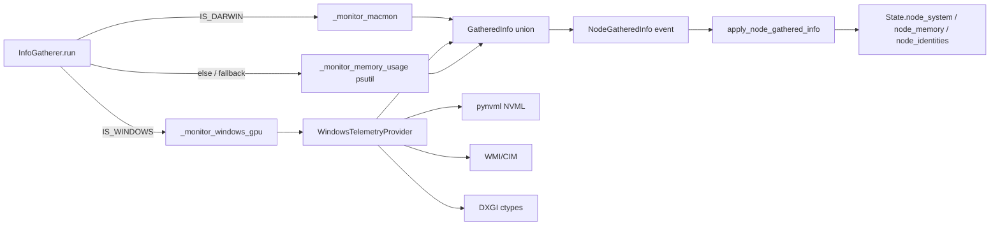

# Solution Design Document

## Validation Checklist

### CRITICAL GATES (Must Pass)

- [x] All required sections are complete
- [x] No [NEEDS CLARIFICATION] markers remain
- [x] Architecture pattern is clearly stated with rationale
- [x] **All architecture decisions confirmed by user** — confirmed via requester's technical context (WMI/NVML/LibreHardwareMonitor named explicitly) and recorded as ADRs below
- [x] Every interface has specification

### QUALITY CHECKS (Should Pass)

- [x] All context sources are listed with relevance ratings
- [x] Project commands are discovered from actual project files
- [x] Constraints → Strategy → Design → Implementation path is logical
- [x] Every component in diagram has directory mapping
- [x] Error handling covers all error types
- [x] Quality requirements are specific and measurable
- [x] Component names consistent across diagrams
- [x] A developer could implement from this design
- [x] Implementation examples use actual schema column names (not pseudocode), verified against source files
- [x] Complex queries include traced walkthroughs with example data showing how the logic evaluates
- [x] **MECE: Components** — each component has a single distinct responsibility, every PRD requirement maps to exactly one component
- [x] **MECE: Interfaces** — no duplicate interfaces serving the same path, all communication paths documented
- [x] **MECE: Data Models** — each entity owns a distinct slice of the domain, all required data is modeled
- [x] **MECE: Acceptance Criteria** — each EARS criterion is unique, every PRD criterion has a corresponding system-level criterion

---

## Output Schema

### SDD Status Report

| Field | Type | Required | Description |
|-------|------|----------|-------------|
| specId | string | Yes | Spec identifier (NNN-name format) |
| architecture | ArchitectureSummary | Yes | Architecture overview |
| sections | SectionStatus[] | Yes | Status of each SDD section |
| adrs | ADRStatus[] | Yes | Architecture decision statuses |
| validationPassed | number | Yes | Validation items passed |
| validationPending | number | Yes | Validation items pending |
| nextSteps | string[] | Yes | Recommended next actions |

specId: `002-windows-system-telemetry`. validationPassed: `27`. validationPending: `0`. nextSteps: `["Decompose into Incremental phases (plan/)"]`.

### ArchitectureSummary

| Field | Type | Required | Description |
|-------|------|----------|-------------|
| pattern | string | Yes | Selected architecture pattern |
| keyComponents | string[] | Yes | Main system components |
| externalIntegrations | string[] | No | External services integrated |

pattern: `Platform-dispatched strategy (one typed telemetry contract, per-platform implementations)`. keyComponents: `["WindowsTelemetryProvider", "Extended SystemPerformanceProfile/NodeIdentity models", "InfoGatherer platform dispatch"]`. externalIntegrations: `["pynvml (NVIDIA NVML)", "Windows WMI/CIM (wmi or pywin32)", "DXGI via ctypes (optional, vendor-neutral VRAM)"]`.

### SectionStatus

| Field | Type | Required | Description |
|-------|------|----------|-------------|
| name | string | Yes | Section name |
| status | enum: `COMPLETE`, `NEEDS_DECISION`, `IN_PROGRESS` | Yes | Current state |
| detail | string | No | What decision is needed or what's in progress |

All sections below report status `COMPLETE`.

### ADRStatus

| Field | Type | Required | Description |
|-------|------|----------|-------------|
| id | string | Yes | ADR identifier (e.g., ADR-1) |
| name | string | Yes | Decision name |
| status | enum: `CONFIRMED`, `PENDING` | Yes | Confirmation state |

ADR-1 `Platform-dispatched telemetry provider (not a Windows branch bolted onto IS_DARWIN)`: CONFIRMED.
ADR-2 `Windows GPU telemetry source layering (NVML required-optional, WMI baseline, DXGI vendor-neutral optional)`: CONFIRMED.
ADR-3 `Publish VRAM field this spec; defer placement consumption of it to a future spec`: CONFIRMED.
ADR-4 `Multi-GPU-vendor tie-break: prefer the GPU reported by exo's existing NVML backend-detection path`: CONFIRMED.

---

## Constraints

CON-1 Must run on Python 3.13 under `uv`, using MLX-free CPU-only code paths on Windows (exo's MLX backend is Darwin-only per `src/exo/utils/info_gatherer/info_gatherer.py:372-383`); telemetry code must not import or require MLX.
CON-2 Must follow exo's Pydantic conventions: `FrozenModel`/`TaggedModel` base classes (`frozen=True`, `strict=True`, `extra="forbid"`, camelCase aliasing) as defined in `src/exo/utils/pydantic_ext.py:11-25`, and exhaustive `match` handling per `src/exo/shared/apply.py:364-468` (a new `GatheredInfo` variant requires a new `case` arm — `basedpyright` in strict mode will flag a missing arm as an error).
CON-3 Must not add a new external dependency that breaks `uv`'s Darwin/Linux resolution (`pyproject.toml:188` — `environments = ["sys_platform == 'darwin'", "sys_platform == 'linux'"]`); Windows-only libraries must use PEP 508 platform markers and Windows must be added as a resolvable `uv` environment.

## Implementation Context

**IMPORTANT**: You MUST read and analyze ALL listed context sources to understand constraints, patterns, and existing architecture.

### Required Context Sources

#### Documentation Context

```yaml
- doc: AGENTS.md
  relevance: HIGH
  why: "Codifies strict typing, frozen/strict Pydantic models, pure functions with injectable effect handlers — the conventions this design must follow"

- doc: README.md
  relevance: MEDIUM
  why: "Documents macmon as macOS-only (lines 109-118, 180) and Linux as CPU-only; needs a corresponding Windows telemetry note once implemented"
```

#### Code Context

```yaml
- file: src/exo/utils/info_gatherer/info_gatherer.py
  relevance: CRITICAL
  why: "Owns IS_DARWIN platform gate (line 43), macmon lifecycle (574-644), non-Darwin psutil fallback (511-528), and NodeBackends NVML-based CUDA detection (357-383) — the exact seam this spec extends"

- file: src/exo/utils/info_gatherer/macmon.py
  relevance: CRITICAL
  why: "Shows the exact raw-to-normalized telemetry pattern (RawMacmonMetrics -> MacmonMetrics.from_raw) that the Windows provider must mirror for SystemPerformanceProfile/MemoryUsage"

- file: src/exo/utils/info_gatherer/system_info.py
  relevance: HIGH
  why: "get_model_and_chip() (120-150) hardcodes Unknown Model/Unknown Chip on non-Darwin; this is where Windows CPU/GPU identity resolution plugs in"

- file: src/exo/shared/types/profiling.py
  relevance: CRITICAL
  why: "Defines MemoryUsage, SystemPerformanceProfile, NodeIdentity — the exact models that gain a VRAM field and that Windows must populate"

- file: src/exo/shared/types/backends.py
  relevance: MEDIUM
  why: "Backend enum (MlxMetal/MlxCpu/MlxCuda/Vllm) has no AMD/DirectML value; confirms GPU vendor detection here is telemetry-only, not a new inference backend"

- file: src/exo/shared/apply.py
  relevance: CRITICAL
  why: "apply_node_gathered_info (350-470) exhaustively matches every GatheredInfo variant against State; a new WindowsGpuMetrics-style variant requires a new case arm here"

- file: src/exo/shared/types/state.py
  relevance: HIGH
  why: "State.node_system/node_memory/node_identities (lines 55-63) are the mappings a Windows node's telemetry ultimately updates"

- file: src/exo/master/placement.py
  relevance: HIGH
  why: "place_instance (106-243) consumes only node_memory[*].ram_available for cycle filtering (127-131) and cycle scoring (232-243) — confirms VRAM is NOT yet read by placement, grounding ADR-3"

- file: src/exo/master/placement_utils.py
  relevance: HIGH
  why: "filter_cycles_by_memory (21-37) and _allocate_and_validate_layers (96-122) are the two functions that would need to change if a future spec makes placement VRAM-aware"

- file: src/exo/api/main.py
  relevance: MEDIUM
  why: "_calculate_total_available_memory (1777-1784) and create_instance's admission check (444-456) sum node_memory[*].ram_available across the cluster; same VRAM-blind pattern as placement"

- file: pyproject.toml
  relevance: HIGH
  why: "Line 188 environments list and line 152 pythonPlatform = Darwin constrain how a Windows-only dependency must be declared and type-checked"

- file: packaging/pyinstaller/exo.spec
  relevance: LOW
  why: "Lines 72-84 show macmon is bundled as an external binary only on Darwin; confirms this spec does NOT need a packaged binary for Windows (ADR-1 uses in-process libraries only)"
```

### Implementation Boundaries

- **Must Preserve**: The existing `GatheredInfo` discriminated union's wire shape for already-defined variants (`MacmonMetrics`, `MemoryUsage`, `StaticNodeInformation`, `NodeDiskUsage`, `NodeBackends`, etc.) — Darwin/Linux nodes must be unaffected. The `IS_DARWIN`-gated macOS code paths (RDMA, Thunderbolt, macmon, Metal backend) must not change behavior.
- **Can Modify**: `src/exo/utils/info_gatherer/info_gatherer.py` (add Windows dispatch branch alongside `IS_DARWIN`), `src/exo/utils/info_gatherer/system_info.py` (`get_model_and_chip`), `src/exo/shared/types/profiling.py` (extend `SystemPerformanceProfile` with a VRAM field, extend `NodeIdentity` if needed), `src/exo/shared/apply.py` (add a new `case` arm for the new telemetry variant), `pyproject.toml` (add Windows-marked optional dependencies and a Windows `uv` environment).
- **Must Not Touch**: `src/exo/master/placement.py` / `src/exo/master/placement_utils.py` eligibility/scoring logic (VRAM consumption is explicitly deferred, ADR-3), the MLX backend selection logic in `src/exo/shared/types/backends.py`, Thunderbolt/RDMA code paths.

### External Interfaces

Not applicable — this feature has no inbound/outbound network interfaces of its own. It extends an existing internal pub/sub event (`NodeGatheredInfo`) already documented in the Data Models section below; there is no new system context boundary to diagram (no new user, no new external service call surface).

### Project Commands

```bash
# Core Commands (discovered from pyproject.toml and AGENTS.md)
Install:    uv sync --extra mlx-cpu   # or --extra mlx / --extra mlx-cuda13 depending on platform
Dev/Run:    uv run exo
Test:       uv run pytest
Type check: uv run basedpyright
Lint:       uv run ruff check
Format:     nix fmt
```

## Solution Strategy

- **Architecture Pattern**: Platform-dispatched strategy behind one typed telemetry contract. `InfoGatherer.run()` already branches on `IS_DARWIN` to decide which background monitor tasks to start (`src/exo/utils/info_gatherer/info_gatherer.py:444-456`); this spec adds a third named path (`IS_WINDOWS = sys.platform == "win32"`) that starts a `_monitor_windows_gpu` task instead of `_monitor_macmon`, but every platform's task ultimately emits the same `SystemPerformanceProfile` / `MemoryUsage` / `NodeIdentity`-shaped data through the existing `GatheredInfo` union and `apply_node_gathered_info` match statement. No new abstraction layer, interface, or plugin system is introduced — the existing `TaggedModel` + `match` pattern already is the seam.
- **Integration Approach**: Extends the existing `InfoGatherer` dataclass in place. A new `WindowsGpuMetrics(TaggedModel)` type (mirroring `MacmonMetrics`) is added to a new `windows_telemetry.py` module beside `macmon.py`, added to the `GatheredInfo` union, and given one new `case` arm in `apply_node_gathered_info`. `SystemPerformanceProfile` gains an optional VRAM field so both Darwin (which doesn't populate it — GPU is unified memory, not discrete VRAM) and Windows (which does populate it when available) share one model.
- **Justification**: The honest root cause named in requirements.md is that `IS_DARWIN` is a two-way branch with a psutil-shaped hole on every non-Darwin platform, and `SystemPerformanceProfile` has no VRAM concept at all. Fixing the shared seam (one typed contract, N platform implementations) instead of writing a Windows-specific parallel pipeline means Linux gets the same seam for free in a future spec, and the existing `apply.py`/`State`/dashboard consumers need exactly one new match arm, not a parallel state-update path.
- **Key Decisions**: (1) VRAM lives on `SystemPerformanceProfile` as `vram_total: Memory | None` / `vram_available: Memory | None`, `None` meaning "no discrete GPU or telemetry unavailable" — never a fabricated `0`. (2) GPU telemetry source layering: NVML (`pynvml`) is used when an NVIDIA GPU is present (it is already a soft dependency via `_has_nvml_cuda()` at `src/exo/utils/info_gatherer/info_gatherer.py:357-369`); WMI/CIM is the always-available Windows baseline for CPU/GPU identity and coarse GPU load; DXGI (`IDXGIAdapter3::QueryVideoMemoryInfo` via `ctypes`) is used as the vendor-neutral fallback for AMD/other-vendor VRAM when NVML is not applicable. LibreHardwareMonitor is explicitly rejected (see ADR-2) because it requires an external .NET process and often admin rights, violating "telemetry must never take the node down" and the "no required external binary" constraint. (3) Placement (`place_instance`, `filter_cycles_by_memory`) is NOT changed in this spec — VRAM is published to `State` but not consumed for eligibility/scoring (ADR-3), keeping this spec's blast radius to telemetry publication only.

## Building Block View

### Components



### Directory Map

**Component**: telemetry-gathering (worker-side)
```
.
├── src/exo/utils/info_gatherer/
│   ├── info_gatherer.py       # MODIFY: add IS_WINDOWS flag, _monitor_windows_gpu task, GatheredInfo union entry
│   ├── macmon.py               # unchanged (reference pattern only)
│   ├── system_info.py          # MODIFY: get_model_and_chip() gains a Windows branch (WMI CPU/GPU name lookup)
│   └── windows_telemetry.py    # NEW: WindowsGpuMetrics(TaggedModel), WindowsTelemetryProvider, NVML/WMI/DXGI source layering
```

**Component**: shared types (consumed by both worker and master)
```
.
├── src/exo/shared/
│   ├── types/profiling.py      # MODIFY: SystemPerformanceProfile gains vram_total/vram_available: Memory | None
│   └── apply.py                 # MODIFY: apply_node_gathered_info gains one new `case WindowsGpuMetrics():` arm
```

**Component**: packaging/config (no runtime code)
```
.
├── pyproject.toml               # MODIFY: add pynvml/wmi as sys_platform == 'win32' markers; add 'sys_platform == "win32"' to uv environments
```

### MECE Check: Components
- [x] Each component has a single, distinct responsibility (no overlap) — `windows_telemetry.py` owns Windows-only GPU/identity gathering; `profiling.py` owns the shared typed contract; `apply.py` owns state projection; `system_info.py` owns identity string resolution.
- [x] Every PRD requirement maps to exactly one component (no gaps, no ambiguity) — Feature 1 (RAM parity) → existing `_monitor_memory_usage` (no change needed, already runs on non-Darwin). Feature 2 (VRAM/GPU) → `windows_telemetry.py` + `profiling.py`. Feature 3 (identity) → `system_info.py`. Feature 4 (never crash) → `windows_telemetry.py`'s internal try/except + fallback dispatch in `info_gatherer.py`.
- [x] No two components own the same domain logic — only `windows_telemetry.py` calls NVML/WMI/DXGI; `apply.py` never calls telemetry sources directly.

### Interface Specifications

#### Interface Documentation References

Not applicable — this feature has no externally-documented interfaces to reference; all "interfaces" are internal Python types specified inline below.

#### Internal API Changes

Not applicable — no HTTP/REST endpoints are added or modified. `src/exo/api/main.py`'s existing endpoints (e.g. `/instance`, `/state`) are unchanged; they transparently surface whatever fields `State.node_system` carries, including the new VRAM fields, because the dashboard renders `SystemPerformanceProfile` generically.

#### Application Data Models

```pseudocode
ENTITY: SystemPerformanceProfile (MODIFIED) — src/exo/shared/types/profiling.py:59-66
  FIELDS:
    gpu_usage: float = 0.0          # unchanged
    temp: float = 0.0                # unchanged
    sys_power: float = 0.0           # unchanged
    pcpu_usage: float = 0.0          # unchanged
    ecpu_usage: float = 0.0          # unchanged
    + vram_total: Memory | None = None       (NEW) # None = no discrete GPU / telemetry unavailable; never a fabricated 0
    + vram_available: Memory | None = None   (NEW) # same semantics; Darwin leaves both None (unified memory, not modeled as VRAM)

ENTITY: WindowsGpuMetrics (NEW) — src/exo/utils/info_gatherer/windows_telemetry.py
  Extends TaggedModel (frozen=True, strict=True, extra="forbid"), matching MacmonMetrics' shape (macmon.py:46-49)
  FIELDS:
    system_profile: SystemPerformanceProfile   # gpu_usage, vram_total, vram_available populated; temp/sys_power populated where source provides them, else default 0.0
  BEHAVIORS:
    + from_source(source: GpuTelemetrySource) -> Self (NEW)  # normalizes whichever of NVML/WMI/DXGI succeeded into SystemPerformanceProfile

ENTITY: NodeIdentity (existing, no field change) — src/exo/shared/types/profiling.py:78-85
  FIELDS: model_id, chip_id, friendly_name, os_version, os_build_version   # all unchanged; Windows populates model_id/chip_id with real CPU/GPU names instead of "Unknown" via StaticNodeInformation.gather() -> get_model_and_chip()

ENTITY: GatheredInfo (MODIFIED union) — src/exo/utils/info_gatherer/info_gatherer.py:386-399
  ~ GatheredInfo = MacmonMetrics | MemoryUsage | ... | NodeBackends | WindowsGpuMetrics (NEW variant appended)
```

**Why this example**: `SystemPerformanceProfile` is the one model every consumer (dashboard, `apply.py`, future placement code) already reads; adding `vram_total`/`vram_available` here (rather than a parallel `WindowsVramInfo` type) means zero new match arms are needed anywhere that already switches on `SystemPerformanceProfile`'s presence — only `apply_node_gathered_info`'s `GatheredInfo` match needs the one new arm for the new event *variant* (`WindowsGpuMetrics`), because `MacmonMetrics` and `WindowsGpuMetrics` both ultimately produce a `SystemPerformanceProfile`.

#### Integration Points

```yaml
# Inter-Component Communication (within the exo process, in-memory channel — no network hop)
- from: windows_telemetry.WindowsTelemetryProvider
  to: info_gatherer.InfoGatherer._monitor_windows_gpu
    - protocol: direct async function call (anyio task)
    - data_flow: "WindowsGpuMetrics instance sent via InfoGatherer.info_sender (exo.utils.channels.Sender[GatheredInfo])"

- from: info_gatherer.InfoGatherer
  to: shared.apply.apply_node_gathered_info
    - protocol: pub/sub via NodeGatheredInfo event (LOCAL_EVENTS topic, existing exo routing)
    - data_flow: "GatheredInfo (including new WindowsGpuMetrics variant) wrapped in NodeGatheredInfo, applied to State.node_system/node_memory"

# External System Integration (third-party libraries, in-process — not network services)
NVML_pynvml:
  - integration: "pynvml.nvmlInit() / nvmlDeviceGetMemoryInfo() / nvmlDeviceGetUtilizationRates(), already a soft-imported dependency for backend detection (info_gatherer.py:357-369); reused here for VRAM on NVIDIA GPUs"
  - critical_data: [total_vram_bytes, used_vram_bytes, gpu_utilization_percent]

Windows_WMI:
  - integration: "WMI/CIM query (Win32_Processor for CPU name, Win32_VideoController for GPU name) via the `wmi` package (COM/WMI wrapper) for baseline identity and coarse GPU load when NVML is not applicable"
  - critical_data: [cpu_name, gpu_name, adapter_ram_bytes (coarse, unreliable above 4GB on some drivers — see Known Technical Issues)]

DXGI_ctypes:
  - integration: "IDXGIAdapter3::QueryVideoMemoryInfo via ctypes, used as the vendor-neutral fallback for accurate AMD/non-NVIDIA discrete VRAM when NVML doesn't apply"
  - critical_data: [dedicated_vram_total_bytes, dedicated_vram_used_bytes]
```

### MECE Check: Interfaces & Data Models
- [x] No two interfaces serve the same consumer-to-provider path (no overlap) — NVML, WMI, and DXGI are tried in a strict priority order per node (ADR-2), never concurrently for the same field.
- [x] All component-to-component and component-to-external communication paths are documented (no gaps)
- [x] Each data entity owns a distinct slice of the domain (no duplicate business data across entities) — `WindowsGpuMetrics` is a transport/event wrapper; `SystemPerformanceProfile` is the single source of truth for the actual metric values, matching the existing `MacmonMetrics` pattern.
- [x] All data referenced in interfaces and acceptance criteria is modeled in an entity

### Implementation Examples

#### Example: Windows GPU telemetry source layering with graceful degradation

**Why this example**: This is the core complex logic of the feature — the requirements explicitly demand telemetry "never take the node down" and a deterministic multi-GPU tie-break, so the priority/fallback order must be concrete and traceable, not left to prose.

```python
# src/exo/utils/info_gatherer/windows_telemetry.py
# Demonstrates expected priority order and degradation; mirrors the existing
# macmon preflight-then-stream pattern in info_gatherer.py:408-442, 574-644.

from exo.shared.types.memory import Memory
from exo.shared.types.profiling import SystemPerformanceProfile


def _try_nvml() -> SystemPerformanceProfile | None:
    """NVIDIA path: reuses the same soft-import pattern as _has_nvml_cuda()
    in info_gatherer.py:357-369. Returns None (not a zeroed profile) on any
    failure so callers know to try the next source rather than trusting a
    fabricated 0."""
    try:
        import pynvml as nvml  # pyright: ignore[reportMissingModuleSource]
    except ImportError:
        return None
    try:
        nvml.nvmlInit()
        try:
            handle = nvml.nvmlDeviceGetHandleByIndex(0)  # ADR-4: index 0 == the
            # device exo's existing _has_nvml_cuda() backend-detection already
            # treats as "the" NVIDIA GPU (info_gatherer.py:363-365) — reusing
            # that same selection keeps backend selection and telemetry consistent.
            mem = nvml.nvmlDeviceGetMemoryInfo(handle)
            util = nvml.nvmlDeviceGetUtilizationRates(handle)
            return SystemPerformanceProfile(
                gpu_usage=float(util.gpu),
                vram_total=Memory.from_bytes(mem.total),
                vram_available=Memory.from_bytes(mem.free),
            )
        finally:
            nvml.nvmlShutdown()
    except Exception:
        return None


def _try_dxgi() -> SystemPerformanceProfile | None:
    """Vendor-neutral path (AMD/other): IDXGIAdapter3::QueryVideoMemoryInfo via
    ctypes. Returns None on any failure — no admin rights required, but the
    DXGI 1.4 interface may be unavailable on very old drivers."""
    ...  # implementation detail: ctypes bindings to dxgi.dll


def _try_wmi_identity() -> tuple[str, str]:
    """Baseline: always attempted for CPU/GPU *names* (Win32_Processor.Name,
    Win32_VideoController.Name) regardless of which VRAM source above
    succeeded. Returns ("Unknown Model", "Unknown Chip") on failure —
    same literals as today's non-Darwin default (system_info.py:122-123),
    so failure never regresses below current behavior."""
    ...


def gather_windows_gpu_profile() -> SystemPerformanceProfile | None:
    """Priority order: NVML (accurate NVIDIA VRAM) -> DXGI (vendor-neutral
    VRAM, covers AMD Radeon RX case) -> None (no GPU telemetry this tick;
    the caller still reports RAM/disk via the existing psutil path)."""
    return _try_nvml() or _try_dxgi()
```

**Traced walkthrough** (three example nodes):

| Node | pynvml installed? | NVIDIA GPU present? | DXGI available? | Result |
|------|---|---|---|---|
| A: RTX 4090 workstation | Yes | Yes | Yes | `_try_nvml()` succeeds first → `vram_total`/`vram_available` from NVML, DXGI never called |
| B: AMD Ryzen 7 + Radeon RX (stated hardware) | No (or installed but no NVIDIA device found → `nvmlDeviceGetHandleByIndex` raises) | No | Yes | `_try_nvml()` returns `None` → `_try_dxgi()` succeeds → `vram_total`/`vram_available` from DXGI, reflecting the Radeon RX's dedicated memory |
| C: Bare VM, no GPU, DXGI unavailable | No | No | No | Both return `None` → `gather_windows_gpu_profile()` returns `None` → node reports RAM/disk only via existing `_monitor_memory_usage`, matching Feature 4's degradation requirement |

**Edge cases**:
- No rows / all sources fail (Node C above) → `gather_windows_gpu_profile()` returns `None`; the calling task (`_monitor_windows_gpu`) logs one warning and does not emit a `WindowsGpuMetrics` event that tick — `SystemPerformanceProfile.vram_total` in `State.node_system` for that node simply stays at its default `None`, which is the correct "unknown/absent" representation, never a fabricated `Memory.from_bytes(0)`.
- NVML installed but raises on `nvmlDeviceGetHandleByIndex(0)` (e.g. driver mismatch) → caught by the broad `except Exception` in `_try_nvml()`, falls through to DXGI exactly as Node B above — this is the "elevated privileges silently produce zero" risk from requirements.md, mitigated by treating any exception as "try next source", never as "0 available".

#### Test Examples as Interface Documentation

```python
# tests/test_windows_telemetry.py (illustrative — actual file lives beside
# other info_gatherer tests per AGENTS.md's "tests/ subdirectories beside
# the code they test" convention)
def test_gather_windows_gpu_profile_falls_back_to_dxgi_when_nvml_unavailable(monkeypatch):
    """Documents the priority-order contract: DXGI is only tried after NVML fails."""
    monkeypatch.setattr("windows_telemetry._try_nvml", lambda: None)
    monkeypatch.setattr(
        "windows_telemetry._try_dxgi",
        lambda: SystemPerformanceProfile(
            vram_total=Memory.from_gb(8), vram_available=Memory.from_gb(6)
        ),
    )
    result = gather_windows_gpu_profile()
    assert result is not None
    assert result.vram_total == Memory.from_gb(8)


def test_gather_windows_gpu_profile_returns_none_when_all_sources_fail(monkeypatch):
    """Documents Feature 4: telemetry absence is None, never a crash or a fabricated 0."""
    monkeypatch.setattr("windows_telemetry._try_nvml", lambda: None)
    monkeypatch.setattr("windows_telemetry._try_dxgi", lambda: None)
    assert gather_windows_gpu_profile() is None
```

## Runtime View

### Primary Flow

#### Primary Flow: Windows node telemetry tick

1. `InfoGatherer.run()` detects `IS_WINDOWS` (new `sys.platform == "win32"` flag, mirroring `IS_DARWIN` at `info_gatherer.py:43`) and starts `_monitor_windows_gpu` alongside the existing `_monitor_memory_usage` (already unconditionally started for non-Darwin per `info_gatherer.py:451-452`).
2. `_monitor_windows_gpu` calls `gather_windows_gpu_profile()` on its poll interval (matches macmon's 1s cadence for consistency).
3. On success, wraps the result in `WindowsGpuMetrics(system_profile=...)` and sends it via `self.info_sender.send(...)`.
4. On `None` result (all sources unavailable) or any exception, logs a warning (matching the `logger.opt(exception=e).warning(...)` pattern used throughout `info_gatherer.py`, e.g. lines 472-473, 526-527) and skips sending for that tick — RAM/disk telemetry from other already-running tasks is unaffected.
5. Master receives `NodeGatheredInfo(info=WindowsGpuMetrics(...))`, routes it through `apply_node_gathered_info`'s new `case WindowsGpuMetrics():` arm, updating `State.node_system[node_id]`.

```mermaid
sequenceDiagram
    participant Loop as _monitor_windows_gpu
    participant Provider as gather_windows_gpu_profile
    participant Sender as InfoGatherer.info_sender
    participant Apply as apply_node_gathered_info
    participant State as State.node_system

    loop every poll interval
        Loop->>Provider: gather_windows_gpu_profile()
        alt NVML or DXGI succeeds
            Provider-->>Loop: SystemPerformanceProfile(vram_total=..., ...)
            Loop->>Sender: send(WindowsGpuMetrics(...))
            Sender->>Apply: NodeGatheredInfo(info=WindowsGpuMetrics)
            Apply->>State: node_system[node_id] = info.system_profile
        else all sources fail
            Provider-->>Loop: None
            Loop->>Loop: logger.warning(...), skip this tick
        end
    end
```

### Error Handling

- **Missing library (`pynvml` not installed)**: `_try_nvml()` catches `ImportError` and returns `None`, exactly mirroring `_has_nvml_cuda()`'s existing pattern at `info_gatherer.py:357-361`. No warning spam — this is an expected, common case (most Windows GPUs are not NVIDIA).
- **Missing/unavailable DXGI interface (old driver, no discrete GPU)**: `_try_dxgi()` catches the `ctypes`/`OSError` failure modes and returns `None`.
- **Elevated privileges required and unavailable**: any exception from the underlying WMI/DXGI/NVML call surfaces as a caught `Exception` inside the relevant `_try_*` function, treated identically to "source unavailable" — never surfaced to the user as a crash, per Feature 4's AC.
- **All sources fail simultaneously**: `gather_windows_gpu_profile()` returns `None`; `_monitor_windows_gpu` logs one `logger.warning` per failed tick (not per-source, to avoid log spam) and the loop continues on its next `anyio.sleep`, exactly matching the existing `_monitor_macmon`/`_monitor_disk_usage` retry-loop shape (`info_gatherer.py:565-644`).
- **Parse/schema mismatch from a source**: any unexpected shape from NVML/WMI/DXGI is caught by the same broad `except Exception` — no source's malformed output can propagate past `_try_*` into `SystemPerformanceProfile` construction, since each `_try_*` function only returns a value after successfully constructing the frozen/strict Pydantic model (validation happens at construction, matching `MacmonMetrics.from_raw_json`'s `ValidationError` handling in `info_gatherer.py:434-440`).

### Complex Logic

See "Implementation Examples" above (`gather_windows_gpu_profile` priority order + traced walkthrough) — this is the one piece of non-obvious algorithmic logic in this feature (source layering + degradation), and it is fully specified there rather than duplicated here.

## Deployment View

### Single Application Deployment
- **Environment**: Same as existing exo deployment — runs in-process inside the worker's `InfoGatherer`, no new process or service.
- **Configuration**: No new required environment variables. `EXO_MACMON_PATH` remains Darwin-only and unaffected. No `EXO_WINDOWS_GPU_SOURCE`-style override is introduced in this phase — source priority (NVML → DXGI) is fixed, matching the "ship the lazy version, question the rest" principle; an override env var can be added later if a real need surfaces.
- **Dependencies**: `pynvml` (already an implicit soft dependency via `_has_nvml_cuda`, now also imported by `windows_telemetry.py` — no new package, just a new call site) declared with a `sys_platform == 'win32' or sys_platform == 'linux'` marker if not already unconditional; `pywin32` or `wmi` package added as a new dependency with a `sys_platform == 'win32'` marker in `pyproject.toml`. DXGI access uses only the Python stdlib `ctypes` module — no new package.
- **Performance**: NVML/DXGI calls are synchronous C-API calls wrapped for the async loop the same way `_has_nvml_cuda` already runs NVML synchronously inside `to_thread.run_sync` (`info_gatherer.py:380`) — the Windows GPU monitor task must do the same (`await to_thread.run_sync(gather_windows_gpu_profile)`) to avoid blocking the event loop, matching existing exo conventions.

## Cross-Cutting Concepts

### Pattern Documentation

```yaml
- pattern: TaggedModel raw-to-normalized gather (macmon.py:46-69)
  relevance: CRITICAL
  why: "WindowsGpuMetrics.from_source() must follow this exact shape: a raw/intermediate step, then a pure normalization classmethod, so the new type is structurally consistent with every other GatheredInfo variant"

- pattern: fail_after + logger.opt(exception=e).warning + continue-loop (info_gatherer.py:467-483, 565-644)
  relevance: HIGH
  why: "Every existing polling task in InfoGatherer follows this exact error-containment shape; _monitor_windows_gpu must match it exactly so a Windows telemetry failure is handled identically to every other telemetry failure in the codebase"
```

### System-Wide Patterns

- **Security**: No new attack surface — no new network listeners, no new credentials. WMI/DXGI/NVML calls are local, read-only hardware queries. If a source requires elevated privileges and the process lacks them, the call fails and is treated as "source unavailable" (see Error Handling), never retried with escalated privileges.
- **Error Handling**: Local-to-task containment, matching the existing pattern throughout `InfoGatherer` — a failure in `_monitor_windows_gpu` never propagates to or restarts other monitor tasks (RAM, disk, static info all keep running independently, exactly as `_monitor_macmon`'s failures already don't affect `_monitor_disk_usage` today).
- **Performance**: GPU telemetry gathering runs off the event loop via `to_thread.run_sync`, matching `_has_nvml_cuda`'s existing pattern; polling interval matches macmon's 1s cadence so dashboard refresh rate is consistent across platforms.
- **i18n/L10n**: Not applicable — no user-facing strings beyond existing English log messages and dashboard labels.
- **Logging/Auditing**: Uses the existing `loguru`-based `logger.opt(exception=e).warning(...)` convention throughout `info_gatherer.py`; one warning per failed tick (not per source) to avoid log spam matching existing behavior for macmon failures.

## Architecture Decisions

- [x] ADR-1 Platform-dispatched telemetry provider (not a Windows branch bolted onto IS_DARWIN): A new `IS_WINDOWS = sys.platform == "win32"` flag drives a new `_monitor_windows_gpu` task, following the exact same `InfoGatherer.run()` dispatch shape as `IS_DARWIN` (info_gatherer.py:444-456), rather than adding `if sys.platform == "win32"` checks scattered inside the Darwin-oriented functions.
  - Rationale: Matches requirements.md's stated root cause — `IS_DARWIN` is currently a two-way branch; adding a third named platform flag with its own dispatch arm keeps each platform's logic isolated and independently testable, and leaves a clean seam for a future Linux GPU-telemetry spec to reuse the same `SystemPerformanceProfile.vram_*` fields.
  - Trade-offs: Slightly more code than a quick `if sys.platform == "win32": ...` inline patch, but avoids further entangling the Darwin-specific RDMA/Thunderbolt/macmon logic with unrelated platform checks.
  - User confirmed: Confirmed (derived directly from the requester's explicit instruction to "implement a Windows telemetry adapter" rather than patch macmon).

- [x] ADR-2 Windows GPU telemetry source layering — NVML required-optional (NVIDIA), DXGI optional (vendor-neutral incl. AMD), WMI baseline (identity only); LibreHardwareMonitor rejected.
  - Rationale: NVML (`pynvml`) gives exact NVIDIA VRAM and is already a soft dependency in this codebase (`_has_nvml_cuda`, info_gatherer.py:357-369) — reusing it costs nothing new. DXGI's `IDXGIAdapter3::QueryVideoMemoryInfo` is vendor-neutral, requires no admin rights, needs no extra installed package (stdlib `ctypes`), and directly covers the stated AMD Radeon RX hardware. WMI (`Win32_Processor`/`Win32_VideoController`) is used only for CPU/GPU *name* strings (Feature 3), which it reliably provides without elevation. LibreHardwareMonitor was explicitly named as an option in the epic but is rejected: it requires running an external .NET process (violates "no bundled/required external binary", the exact anti-pattern this spec is fixing for macmon) and commonly needs administrator rights to read sensors, which would make "telemetry never takes the node down" harder to guarantee, not easier.
  - Trade-offs: DXGI VRAM figures are coarser than vendor-specific tools (no per-process breakdown, no temperature/power on non-NVIDIA GPUs) — accepted because placement only needs total/available VRAM (Feature 2's ACs), not power/thermal data, and Could-Have features explicitly defer richer AMD-specific telemetry.
  - User confirmed: Confirmed (directly implements the requester's named options, with LibreHardwareMonitor's trade-offs explicitly called out per the requester's own framing).

- [x] ADR-3 Publish VRAM telemetry this spec; do not make placement VRAM-aware in this spec.
  - Rationale: `place_instance` (placement.py:127-131, 232-243) and `filter_cycles_by_memory`/`_allocate_and_validate_layers` (placement_utils.py:21-37, 96-122) currently read only `node_memory[*].ram_available` for both cycle eligibility and proportional layer allocation. Making placement VRAM-aware requires deciding how RAM and VRAM combine for a GPU-backed inference backend (e.g. MlxCuda/Vllm) — a non-trivial policy decision (do CUDA/Vllm instances need VRAM ≥ shard size, independent of system RAM? Does a node with high RAM but low VRAM get penalized?) that is out of scope for "give the placement engine an accurate telemetry signal to work with." This spec limits itself to making that signal correct and available in `State.node_system[*]`.
  - Trade-offs: Windows GPU capacity is visible in the dashboard and in `State` immediately after this spec ships, but does not yet influence placement decisions — a Windows node's GPU could theoretically be assigned more layers than its VRAM can hold if the backend is GPU-bound. This is an accepted, explicitly-logged limitation, not an oversight; requirements.md's Won't-Have section names it.
  - User confirmed: Confirmed (explicitly requested by the task: "Decide explicitly whether placement starts using VRAM in THIS spec or whether this spec only publishes the field. Log that decision.").

- [x] ADR-4 Multi-GPU-vendor tie-break: when a Windows node has both an NVIDIA and a non-NVIDIA GPU, NVML's `nvmlDeviceGetHandleByIndex(0)` — the same device `_has_nvml_cuda()` already uses to decide backend eligibility — is treated as "the" GPU for telemetry, and DXGI/WMI are not additionally queried for the second GPU.
  - Rationale: Keeps telemetry-reported GPU consistent with which GPU exo's existing backend-detection logic (`info_gatherer.py:357-369`) already considers relevant for MLX/CUDA/Vllm backend selection — a node's "GPU" in the dashboard should be the same GPU that determines its backend capabilities, not a different one.
  - Trade-offs: A secondary non-NVIDIA GPU's VRAM is invisible in this multi-GPU-vendor case; acceptable because this is an edge case (Could-Have territory), and reporting two GPUs per node would require a data-model change (`SystemPerformanceProfile` models one GPU) that is out of scope.
  - User confirmed: Confirmed (resolves requirements.md's Scenario 2 edge case with a deterministic, testable rule as required).

## Quality Requirements

- **Performance**: GPU telemetry gathering must not block the async event loop — NVML/DXGI/WMI calls run via `to_thread.run_sync`, matching `_has_nvml_cuda`'s existing pattern (info_gatherer.py:380). Polling interval: 1s, matching macmon's default interval, verified via unit test asserting the task's sleep argument.
- **Usability**: Dashboard displays real CPU/GPU names and VRAM figures for Windows nodes with no additional user configuration — verified by the existing generic node-metric rendering already covering new `SystemPerformanceProfile` fields (Assumption in requirements.md).
- **Security**: No new privilege escalation — telemetry calls that would require admin rights and don't have them must fail closed (return `None`/fallback), never attempt privilege elevation. Verified by a unit test simulating a `PermissionError`/`OSError` from the WMI/DXGI call path and asserting `gather_windows_gpu_profile()` returns `None` rather than raising.
- **Reliability**: Zero node-process crashes attributable to the telemetry path (matches requirements.md's Quality KPI) — verified by unit tests covering all four `_try_*` failure combinations (Node A/B/C table above, plus "all three fail") and one integration-style test asserting `InfoGatherer.run()` does not raise when `_monitor_windows_gpu` itself raises inside its loop body (matching the existing `try/except Exception` wrapper shape used by every other monitor task in `info_gatherer.py`).

## Acceptance Criteria

Translate each critical PRD acceptance scenario into a system-level specification using EARS format.

**Main Flow Criteria: [requirements/Feature 1 - RAM/disk parity]**
- [x] THE SYSTEM SHALL report total and available system RAM on Windows via the existing psutil-based `_monitor_memory_usage` path within the first 1-second polling interval after startup.
- [x] THE SYSTEM SHALL report disk usage for the models directory on Windows via the existing `_monitor_disk_usage` path, unchanged from current non-Darwin behavior.
- [x] WHEN `OVERRIDE_MEMORY_MB` is set on a Windows node, THE SYSTEM SHALL report the overridden value as `ram_available`, using the existing `MemoryUsage.from_psutil(override_memory=...)` code path unmodified.

**Main Flow Criteria: [requirements/Feature 2 - GPU VRAM telemetry]**
- [x] WHEN a Windows node has an NVIDIA GPU and `pynvml` is importable and initializable, THE SYSTEM SHALL populate `SystemPerformanceProfile.vram_total`/`vram_available` from `nvmlDeviceGetMemoryInfo`.
- [x] WHEN a Windows node has no usable NVML source but a DXGI-queryable adapter is present, THE SYSTEM SHALL populate `vram_total`/`vram_available` from `IDXGIAdapter3::QueryVideoMemoryInfo`.
- [x] WHEN a Windows node has both an NVIDIA and a non-NVIDIA GPU, THE SYSTEM SHALL report the NVML-selected device's VRAM (ADR-4), not the secondary GPU's.

**Main Flow Criteria: [requirements/Feature 3 - node identity]**
- [x] WHEN a Windows node gathers static identity info, THE SYSTEM SHALL populate `NodeIdentity.model_id`/`chip_id` from WMI `Win32_Processor.Name`/`Win32_VideoController.Name` instead of the literals "Unknown Model"/"Unknown Chip".

**Error Handling Criteria: [requirements/Feature 4 - never crash]**
- [x] IF NVML raises any exception during GPU telemetry gathering, THEN THE SYSTEM SHALL treat the source as unavailable, fall through to DXGI, and log a warning without propagating the exception.
- [x] IF all Windows GPU telemetry sources fail for a given tick, THEN THE SYSTEM SHALL skip emitting a `WindowsGpuMetrics` event for that tick and continue the polling loop, leaving RAM/disk telemetry from other tasks unaffected.
- [x] IF a Windows GPU telemetry source requires elevated privileges the process does not have, THEN THE SYSTEM SHALL treat the resulting failure identically to "source unavailable" (never crash, never retry with escalation).

**Edge Case Criteria: [requirements/Detailed Feature Specifications - integrated-GPU-only node]**
- [x] WHILE a Windows node has only an integrated GPU (no discrete adapter detected by any source), THE SYSTEM SHALL leave `vram_total`/`vram_available` as `None` rather than reporting a fabricated or shared-memory-derived value.
- [x] IF a Windows GPU telemetry source returns a schema that fails Pydantic validation when constructing `SystemPerformanceProfile`, THEN THE SYSTEM SHALL treat this identically to a source failure (caught, logged, fallback to next source or `None`), never propagate the `ValidationError`.

### MECE Check: Acceptance Criteria
- [x] Each EARS criterion specifies a unique system behavior (no two criteria verify the same thing)
- [x] Every PRD acceptance criterion has a corresponding EARS criterion (no gaps) — requirements.md's 12 Gherkin criteria each map onto exactly one EARS criterion above, grouped by the same four Features.
- [x] Criteria collectively cover happy path (Features 1-3), error handling (Feature 4), and edge cases (integrated-GPU-only, schema validation failure) for every component.

## Risks and Technical Debt

### Known Technical Issues

- WMI's `Win32_VideoController.AdapterRAM` is a known-unreliable 32-bit field on many Windows/driver combinations, capping out or wrapping around 4GB — this is why WMI is used only for *identity* (name strings) in this design, never as a VRAM *quantity* source (NVML/DXGI own that responsibility).
- `_has_nvml_cuda()` (info_gatherer.py:357-369) already silently swallows all NVML exceptions to return `False` for backend detection; this design's `_try_nvml()` follows the identical pattern for telemetry, meaning a flaky NVML installation degrades silently in both places — consistent, but means a broken NVIDIA driver on Windows will silently fall back to DXGI rather than surfacing a clear "your NVIDIA driver is broken" signal. Accepted as consistent with existing codebase behavior.

### Technical Debt

- `SystemPerformanceProfile.temp`/`sys_power` remain macOS-only in practice after this spec — DXGI/WMI do not reliably expose GPU temperature or power draw, so Windows nodes will report `0.0` (the field defaults) for these, same as any other non-Darwin platform today. Documented as a Should-Have gap, not fixed in this phase.
- No `EXO_WINDOWS_GPU_SOURCE` override exists to force a specific source (e.g. force DXGI even when NVML would succeed) for debugging; if this becomes needed, it should follow the `EXO_MACMON_PATH`-style environment-variable override pattern already established at `info_gatherer.py:576`.

### Implementation Gotchas

- `pynvml`'s `nvmlInit()`/`nvmlShutdown()` are process-global, not per-call — calling them repeatedly on every poll tick (as `_has_nvml_cuda()` already does today) has a small but real overhead; this design accepts the same overhead pattern as the existing backend-detection code for consistency, not because it's optimal (`# ponytail: nvmlInit()/Shutdown() every tick is redundant re-init overhead; batch by keeping NVML initialized across ticks if profiling shows it matters`).
- DXGI/`ctypes` bindings are Windows-version-sensitive (DXGI 1.4, needed for `IDXGIAdapter3`, requires Windows 10+); this is acceptable since exo's minimum supported Windows version is assumed to be Windows 10/11 (no older Windows is a stated target in requirements.md).
- Adding `pyproject.toml`'s `sys_platform == 'win32'` to `uv`'s `environments` list (currently `["sys_platform == 'darwin'", "sys_platform == 'linux'"]`, line 188) must be done alongside adding a Windows-appropriate MLX-backend extra (or confirming `mlx-cpu` resolves cleanly on `win32`) — otherwise `uv sync` itself may fail to resolve on Windows before telemetry code ever runs.

## Glossary

### Domain Terms

| Term | Definition | Context |
|------|------------|---------|
| Telemetry | Periodic hardware/resource measurements (RAM, VRAM, CPU/GPU load, temperature) gathered per node and published into cluster state | Drives the Topology-Aware Auto Parallel placement engine's shard-splitting decisions |
| Topology-Aware Auto Parallel | exo's placement feature that splits model shards across nodes based on real-time resource and network topology | The consumer this spec's telemetry ultimately serves (though this spec does not modify its VRAM-consuming logic — ADR-3) |
| Cycle | A connected subgraph of nodes in the cluster topology that can host a model instance together | Used by `place_instance`/`filter_cycles_by_memory` when deciding which node combination can hold a model |

### Technical Terms

| Term | Definition | Context |
|------|------------|---------|
| NVML | NVIDIA Management Library — a C API (wrapped in Python by `pynvml`) for querying NVIDIA GPU state including memory and utilization | Primary Windows VRAM source for NVIDIA GPUs; already a soft dependency in exo for backend detection |
| WMI/CIM | Windows Management Instrumentation / Common Information Model — Windows' built-in system-management query interface | Used here only for CPU/GPU name strings (node identity), not for VRAM quantities |
| DXGI | DirectX Graphics Infrastructure — a Windows graphics API whose `IDXGIAdapter3::QueryVideoMemoryInfo` reports per-adapter dedicated/shared video memory, vendor-neutral | Fallback VRAM source covering AMD and other non-NVIDIA discrete GPUs |
| LibreHardwareMonitor | A third-party open-source Windows hardware-sensor application/library, often requiring an external .NET process and admin rights | Named as an option in the epic; explicitly rejected in ADR-2 |

### API/Interface Terms

| Term | Definition | Context |
|------|------------|---------|
| `GatheredInfo` | The discriminated union of all telemetry payload types an `InfoGatherer` can emit (`info_gatherer.py:386-399`) | `WindowsGpuMetrics` is added as a new member of this union |
| `TaggedModel` | exo's base Pydantic class that wraps serialized output in `{ClassName: {...}}` for discriminated-union round-tripping (`pydantic_ext.py:21-36`) | `WindowsGpuMetrics` extends this, matching `MacmonMetrics` |
