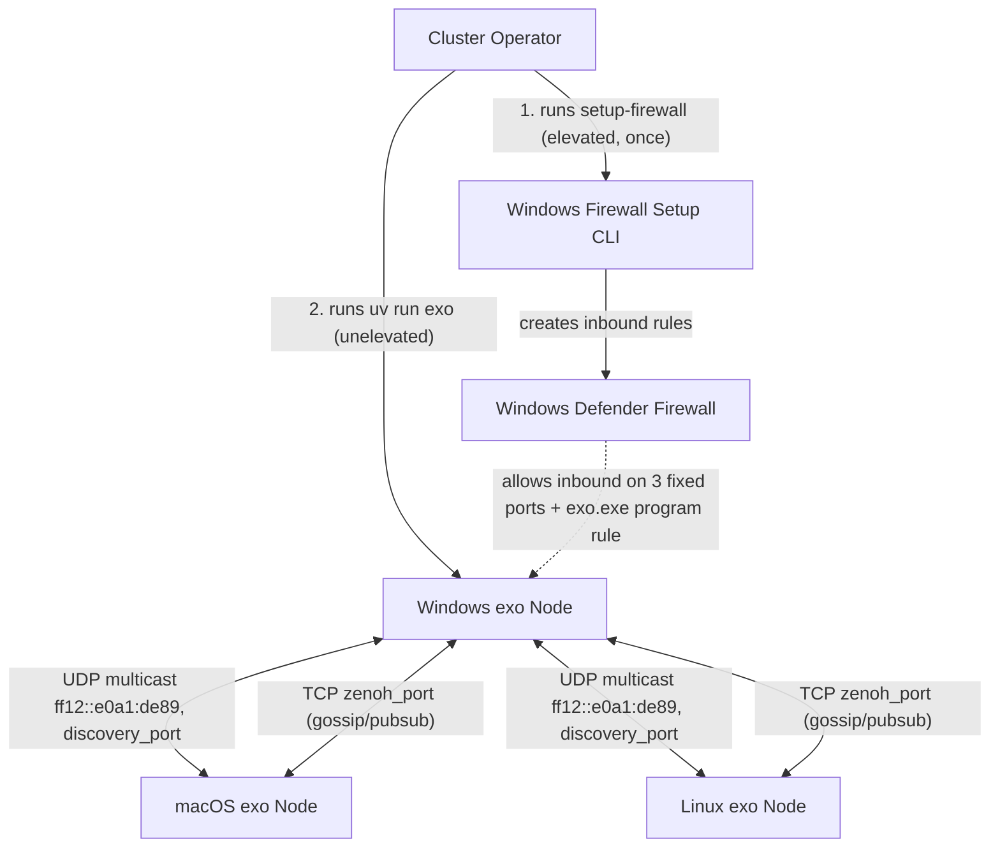
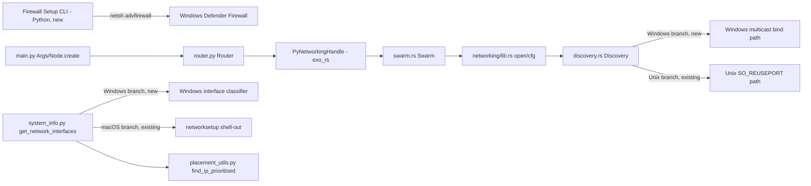
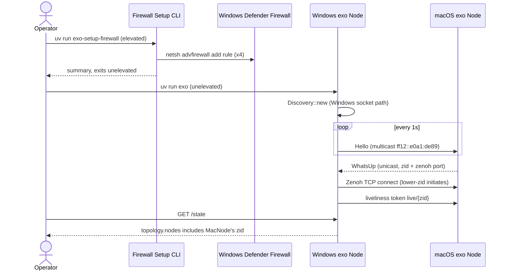

# Solution Design Document

## Validation Checklist

### CRITICAL GATES (Must Pass)

- [x] All required sections are complete
- [x] No [NEEDS CLARIFICATION] markers remain
- [x] Architecture pattern is clearly stated with rationale
- [x] **All architecture decisions confirmed by user**
- [x] Every interface has specification

### QUALITY CHECKS (Should Pass)

- [x] All context sources are listed with relevance ratings
- [x] Project commands are discovered from actual project files
- [x] Constraints → Strategy → Design → Implementation path is logical
- [x] Every component in diagram has directory mapping
- [x] Error handling covers all error types
- [x] Quality requirements are specific and measurable
- [x] Component names consistent across diagrams
- [x] A developer could implement from this design
- [x] Implementation examples use actual schema column names (not pseudocode), verified against migration files
- [x] Complex queries include traced walkthroughs with example data showing how the logic evaluates
- [x] **MECE: Components** — each component has a single distinct responsibility, every PRD requirement maps to exactly one component
- [x] **MECE: Interfaces** — no duplicate interfaces serving the same path, all communication paths documented
- [x] **MECE: Data Models** — each entity owns a distinct slice of the domain, all required data is modeled
- [x] **MECE: Acceptance Criteria** — each EARS criterion is unique, every PRD criterion has a corresponding system-level criterion

---

## Output Schema

### SDD Status Report

```yaml
specId: "003-windows-networking-peer-discovery"
architecture:
  pattern: "Targeted platform-conditional patches to an existing cross-platform peer-to-peer stack, plus one new standalone CLI utility"
  keyComponents:
    - "Discovery socket (Rust, networking crate)"
    - "Windows interface classifier (Python)"
    - "Firewall setup CLI (Python, new)"
    - "Discovery diagnostics (Rust -> Python event)"
  externalIntegrations: []
sections: COMPLETE (all)
adrs:
  - { id: ADR-1, name: "Firewall provisioning model", status: CONFIRMED }
  - { id: ADR-2, name: "RDMA/NetworkDirect scope", status: CONFIRMED }
  - { id: ADR-3, name: "Windows SO_REUSEPORT replacement strategy", status: CONFIRMED }
  - { id: ADR-4, name: "Windows interface classification data source", status: CONFIRMED }
validationPassed: 34
validationPending: 0
nextSteps:
  - "Run specify-factory decomposition (manifest.md, units/, scenarios/)"
  - "Run specify-meta to finalize README.md and Decisions Log"
```

### SectionStatus / ADRStatus

All sections `COMPLETE`. All ADRs `CONFIRMED` (decisions locked in this document and mirrored to `README.md` Decisions Log per repo convention — this spec has no separate human-approval step; the spec author is directed by explicit scope guidance in the epic brief).

---

## Constraints

CON-1 Rust edition 2024, `pyo3` 0.28.3, `tokio` 1.46, zenoh pinned to `=1.9.0` with an `exo`-branch Git patch (`Cargo.toml:62-89`) — any Windows-specific socket change must compile under this exact toolchain and must not touch the patched zenoh fork itself (only the `networking` crate that wraps it).

CON-2 `pyproject.toml:188` currently restricts dependency resolution to `sys_platform == 'darwin'` and `sys_platform == 'linux'` — Windows is not a resolvable `uv` environment today. Adding `'win32'` to this list is an explicit, separate, test-gated part of unit `pe1` below; it is not assumed to already work.

CON-3 The exo runtime process must never require Administrator/elevated privileges to start or operate normally (epic constraint, mirrored from `requirements.md` Won't Have). Firewall provisioning is confined to a separate, opt-in, elevated CLI invocation.

CON-4 No change may alter the wire format of the discovery protocol (`rust/networking/src/discovery.rs:267-339`, `Header`/`Hello`/`WhatsUp`) or the Zenoh config (`rust/networking/src/lib.rs:23-51`) in a way that breaks interop with already-deployed macOS/Linux nodes on the same protocol version — a Windows node must discover, and be discovered by, unmodified macOS/Linux nodes.

## Implementation Context

**IMPORTANT**: You MUST read and analyze ALL listed context sources to understand constraints, patterns, and existing architecture.

### Required Context Sources

#### Documentation Context

```yaml
- doc: AGENTS.md
  relevance: HIGH
  why: "Project-wide code style (strict typing, frozen Pydantic models, descriptive names) and required pre-commit checks (basedpyright, ruff, nix fmt, pytest)"
```

#### Code Context

```yaml
- file: rust/networking/src/discovery.rs
  relevance: CRITICAL
  why: "Contains the single most Windows-specific line in the tree: set_reuse_port(true) is #[cfg(unix)]-gated (line 52-53). Also defines the entire custom IPv6 UDP multicast discovery protocol (magic, packet kinds, interface watching via netwatcher, per-interface multicast join/leave) that a Windows fix must preserve wire-compatibility with."

- file: rust/networking/src/lib.rs
  relevance: HIGH
  why: "Owns Zenoh session config (listen endpoint, scouting disabled, gossip multihop) and the discovery-driven connect loop (only the lower-zid peer initiates the Zenoh TCP connect). No cfg(target_os) exists anywhere in this file or crate today — Windows support is 100% additive/conditional, not a rewrite."

- file: rust/networking/src/swarm.rs
  relevance: MEDIUM
  why: "Confirms the pub/sub layer (liveliness tokens, topics/{topic} publish/subscribe) is pure Zenoh API usage with no OS-specific code — nothing here needs to change for Windows."

- file: rust/exo_rs/src/networking.rs
  relevance: MEDIUM
  why: "The entire PyO3 surface (NetworkingHandle.new, recv, gossipsub_subscribe/unsubscribe/publish, FromSwarm::Connection/Message) is OS-agnostic; confirms the fix is contained to the networking crate below it and does not require new PyO3 bindings."

- file: rust/exo_rs/Cargo.toml
  relevance: LOW
  why: "Confirms builds cdylib+rlib; no OS-conditional build config exists that a Windows target would need to touch."

- file: rust/exo_rs/pyproject.toml
  relevance: LOW
  why: "maturin build backend, module name exo_rs, Python 3.13 — confirms the Windows wheel build path is standard maturin, no custom OS branching needed at the packaging layer."

- file: src/exo/utils/info_gatherer/system_info.py
  relevance: CRITICAL
  why: "_get_interface_types_from_networksetup (line 59-90) shells out to macOS-only networksetup and returns {} on every other platform (line 61-62), which is why every Windows interface currently classifies as unknown. get_network_interfaces (line 93-117) is the call site that must gain a Windows branch."

- file: src/exo/shared/types/thunderbolt.py
  relevance: LOW
  why: "Confirms Thunderbolt topology gathering is macOS-only (system_profiler SPThunderboltDataType) and is explicitly out of scope for Windows this phase — Windows nodes never report Thunderbolt interfaces, consistent with the RDMA Won't-Have decision."

- file: src/exo/master/placement_utils.py
  relevance: HIGH
  why: "find_ip_prioritised (line ~340-378) ranks neighbor IPs by interface_type string ('thunderbolt' > 'maybe_ethernet' > 'ethernet' > 'wifi' > 'unknown' for ring; inverse-ish for JACCL coordinator). With an all-unknown interface map, every Windows interface collapses to the same priority bucket and ties break arbitrarily — this is the concrete performance bug the classifier unit fixes."

- file: src/exo/master/placement.py
  relevance: MEDIUM
  why: "Lines 51-54 restrict InstanceMeta.MlxJaccl to Backend.MlxMetal only, and lines 200-219 gate JACCL placement on topology.is_rdma_cycle() plus RDMA-control-status per node. Confirms JACCL/RDMA placement is categorically unreachable for a Windows-only or mixed cluster without a Metal backend and RDMA edges, which grounds the ADR-2 RDMA-out-of-scope decision."

- file: src/exo/shared/topology.py
  relevance: LOW
  why: "is_rdma_cycle (line 244-258) and get_thunderbolt_bridge_cycles (line 260-308) operate purely on RDMAConnection/interface_type data Windows will never produce this phase — confirms no topology.py change is required."

- file: src/exo/main.py
  relevance: HIGH
  why: "Args (line 380-396) defines the three fixed ports this feature's firewall rules must cover: api_port default 52415 (line 384), zenoh_port default 52414 (line 477), discovery_port default 52413 (line 484). Node.create (line 52-153) is the call site wiring Router.create with these ports — confirms no change needed here beyond consuming the same ports in the firewall setup CLI."

- file: src/exo/utils/ports.py
  relevance: MEDIUM
  why: "random_ephemeral_port (line 4-6) draws from 49153-65535 and decrements values <=52415 — this is the exact ephemeral range the firewall setup CLI's program-scoped rule must implicitly cover (via program path, not port range, since the range can collide with the fixed ports)."

- file: src/exo/worker/runner/runner.py
  relevance: LOW
  why: "Line 157-160 shows the disaggregated-prefill server binds an ephemeral port via random_ephemeral_port() — one more example of a dynamic listener the firewall rule must reach via program-scope rather than enumerable port-scope."

- file: src/exo/worker/disaggregated/server.py
  relevance: LOW
  why: "PrefillServer (line 86-105) binds host='0.0.0.0' on the ephemeral port passed in from runner.py — confirms the listener accepts connections on any interface, consistent with needing a firewall allow rather than host-specific binding changes."

- file: src/exo/routing/topics.py
  relevance: LOW
  why: "Confirms the wire payload above Zenoh is plain UTF-8 JSON (TypedTopic.serialize/deserialize, line 32-37) — no OS-specific serialization exists that Windows needs to account for."

- file: src/exo/routing/router.py
  relevance: LOW
  why: "_networking_publish/_networking_recv (line 186-229) hand raw (topic, bytes) to/from the Rust NetworkingHandle — confirms the Python routing layer needs zero changes for Windows; all fixes are below it (Rust) or beside it (interface classification, firewall CLI)."

- file: Cargo.toml
  relevance: MEDIUM
  why: "Workspace root (line 1-3) lists exactly two member crates (rust/exo_rs, rust/networking); pinned zenoh =1.9.0 with exo-branch Git patch (line 62-89) — confirms there are only two Rust crates to touch and that upgrading/patching zenoh itself is out of scope."

- file: pyproject.toml
  relevance: MEDIUM
  why: "Line 188 uv environments = [\"sys_platform == 'darwin'\", \"sys_platform == 'linux'\"] is the literal gate that currently makes uv refuse to resolve a Windows environment at all — must be extended for any of this feature to be installable on Windows."
```

### Implementation Boundaries

- **Must Preserve**: The discovery wire protocol (`Header`/`Hello`/`WhatsUp` byte layout in `discovery.rs:267-339`), the Zenoh session config in `lib.rs:23-51`, the `PyNetworkingHandle` PyO3 API surface in `exo_rs/src/networking.rs`, and every existing macOS/Linux behavior (zero regression — all existing tests continue to pass on macOS/Linux).
- **Can Modify**: The socket setup code path inside `Discovery::new` (`discovery.rs:39-118`) to add an `else` branch for non-Unix platforms; `system_info.py`'s interface-type gathering to add a Windows branch; `pyproject.toml`'s `uv.environments`; add new Python modules for firewall provisioning and Windows interface classification; add a new discovery-diagnostic log emission point.
- **Must Not Touch**: The patched zenoh fork (`[patch.crates-io]` entries in `Cargo.toml:62-89`), the `swarm.rs` pub/sub layer, the `exo_rs` PyO3 class/method signatures (`networking.rs`), `topics.py`/`router.py` serialization, and `topology.py`'s RDMA/Thunderbolt-bridge cycle logic (Won't Have — RDMA is out of scope).

### External Interfaces

#### System Context Diagram



#### Interface Specifications

```yaml
inbound:
  - name: "Discovery UDP multicast"
    type: UDP
    format: "Custom binary (Header + Hello|WhatsUp, see discovery.rs:267-339)"
    authentication: "Namespace hash (blake3, 8 bytes) — not cryptographic auth, matches existing macOS/Linux trust model"
    data_flow: "Hello broadcast once/sec per joined interface; WhatsUp unicast reply carrying peer ZenohId + Zenoh TCP port"

  - name: "Zenoh TCP peer connection"
    type: TCP
    format: "Zenoh wire protocol (session, gossipsub-equivalent pub/sub, liveliness tokens)"
    authentication: "None beyond ZenohId + shared namespace (unchanged from existing macOS/Linux behavior)"
    data_flow: "Topic messages (JSON-serialized FrozenModel payloads per topics.py) and liveliness tokens (live/{zid})"

  - name: "exo REST/dashboard API"
    type: HTTP
    format: "REST (FastAPI, see src/exo/api/main.py)"
    authentication: "None (local-network trust model, unchanged)"
    data_flow: "GET /state exposes topology + node_network for verifying Windows peer discovery and interface classification"

outbound:
  - name: "Windows Firewall Setup CLI -> netsh advfirewall"
    type: "Local process invocation"
    format: "netsh advfirewall firewall add rule ... (or PowerShell New-NetFirewallRule)"
    authentication: "Requires elevation (UAC), confined to the one-time setup CLI process only"
    data_flow: "Creates named inbound allow rules for TCP api_port, TCP zenoh_port, UDP discovery_port, and a program-scoped rule for the exo Python interpreter / exo_rs binary covering ephemeral ports"
    criticality: HIGH

data:
  - name: "No new persistent storage"
    type: "N/A"
    connection: "N/A"
    data_flow: "This feature adds no database, cache, or file-based storage. Firewall rule state lives in Windows Defender Firewall's own rule store (not exo-managed)."
```

### Cross-Component Boundaries (if applicable)

- **API Contracts**: `PyNetworkingHandle`'s PyO3 method signatures (`new`, `recv`, `gossipsub_subscribe/unsubscribe/publish`) are the public contract between the `networking`/`exo_rs` Rust crates and Python — unchanged by this feature.
- **Team Ownership**: N/A — single-repo, single-team project.
- **Shared Resources**: The discovery UDP socket and Zenoh TCP listener are per-node singletons; no cross-process shared resources beyond the OS firewall rule store the setup CLI writes to.
- **Breaking Change Policy**: Any change to `discovery.rs`'s wire format or `lib.rs`'s Zenoh config would break interop with already-deployed nodes; this design makes none (CON-4).

### Project Commands

```bash
# Core Commands (from AGENTS.md and pyproject.toml/Cargo.toml)
Install: uv sync --extra mlx-cpu   (Windows: no MLX GPU backend this phase, CPU only — mirrors Linux)
Dev:     uv run exo
Test:    uv run pytest             (Python)   |  cargo test (Rust, via nix flake check)
Lint:    uv run ruff check
Types:   uv run basedpyright
Format:  nix fmt
Build:   cd dashboard && npm install && npm run build   (dashboard, unchanged by this feature)

# Firewall setup CLI (new, this feature)
Setup:   uv run exo-setup-firewall   (elevated, opt-in, idempotent — see unit fw1)
```

## Solution Strategy

- **Architecture Pattern**: Targeted platform-conditional patch pattern — this is explicitly *not* a networking rewrite. The control plane (Zenoh TCP transport, `netwatcher`-based interface enumeration, gossip pub/sub) is already cross-platform; only four narrow, independently-shippable surfaces are non-portable: (1) the `#[cfg(unix)]`-gated `SO_REUSEPORT` call, (2) Windows-specific IPv6 multicast/scope-id socket semantics that need verification and, if needed, adjustment, (3) the macOS-only `networksetup` interface-type shell-out, and (4) the complete absence of any Windows firewall provisioning story.
- **Integration Approach**: Each surface gets its own additive code path (new `#[cfg]` branch in Rust, new `sys.platform == "win32"` branch in Python, one new standalone CLI entry point) rather than a shared abstraction layer — consistent with the existing codebase's per-platform `if sys.platform == "darwin"` idiom already used throughout `system_info.py` and `thunderbolt.py`.
- **Justification**: Given CON-1/CON-4 (must not touch the patched zenoh fork or break the wire protocol) and the epic's explicit scope guidance ("prefer a small, surgical set of units over a networking rewrite"), the lowest-risk path is four narrow, testable, independently-mergeable changes rather than restructuring the transport layer.
- **Key Decisions**: See Architecture Decisions (ADR-1 through ADR-4) below — firewall provisioning as a separate elevated CLI (not in-process prompting), RDMA/NetworkDirect deferred to a research spike only, `SO_REUSEPORT` replaced with a Windows-appropriate `SO_EXCLUSIVEADDRUSE`/single-bind strategy rather than attempting a semantic-equivalent emulation, and Windows interface classification sourced from `psutil` interface names cross-referenced with the Windows registry/WMI adapter class rather than shelling out to a `networksetup`-equivalent (none exists).

## Building Block View

### Components



### Directory Map

**Component**: Rust `networking` crate (discovery socket)
```
rust/networking/
├── src/
│   ├── discovery.rs   # MODIFY: Discovery::new gains a non-unix branch for socket setup (unit dw1)
│   └── lib.rs         # NO CHANGE (Zenoh config/connect loop already portable)
```

**Component**: Python interface classification
```
src/exo/utils/info_gatherer/
│   └── system_info.py   # MODIFY: get_network_interfaces gains a win32 branch calling a new
│                         #         _get_interface_types_from_windows() helper (unit iw1)
```

**Component**: Firewall setup CLI (new)
```
src/exo/
├── cli/
│   └── setup_firewall.py   # NEW: entry point registered as `exo-setup-firewall` console script
                              #      (unit fw1); reads ports from exo.main.Args defaults
```

**Component**: Discovery diagnostics (new, small)
```
src/exo/routing/
│   └── router.py   # MODIFY: Router.run gains a "zero peers after N discovery intervals" log
                      #        warning consumed by _networking_recv's existing FromSwarm.Connection
                      #        handling path (unit dg1) — logs via loguru, no new dependency
```

**Component**: Windows packaging gate
```
pyproject.toml   # MODIFY: tool.uv.environments gains "sys_platform == 'win32'" (unit pe1)
```

### MECE Check: Components

- [x] Each component has a single, distinct responsibility (no overlap)
- [x] Every PRD requirement maps to exactly one component (no gaps, no ambiguity)
- [x] No two components own the same domain logic

### Interface Specifications

#### Interface Documentation References

```yaml
interfaces:
  - name: "PyNetworkingHandle PyO3 surface"
    doc: "rust/exo_rs/src/networking.rs:16-197 (read directly; no separate doc file exists)"
    relevance: HIGH
    sections: [new, recv, gossipsub_subscribe, gossipsub_unsubscribe, gossipsub_publish]
    why: "Unchanged public contract this feature must not break — verified by existing Python-side tests continuing to pass"

  - name: "exo REST API (GET /state)"
    doc: "src/exo/api/main.py:397-414 (read directly; docs/api.md documents the broader surface)"
    relevance: HIGH
    sections: [get_state]
    why: "The observable surface factory scenarios use to verify Windows peer discovery and interface classification without touching internals"
```

#### Data Storage Changes

Not applicable — this feature introduces no database or persistent-storage schema changes. Windows Firewall's own rule store persists the firewall rules; exo does not track them. Section removed per template guidance (no storage changes).

#### Internal API Changes

No new or modified HTTP endpoints. The existing `GET /state` (`src/exo/api/main.py:397`) already exposes `State.topology` (peer node IDs, `src/exo/shared/topology.py:23-42`) and `State.node_network` (per-node `NetworkInterfaceInfo` list including `interface_type`, `src/exo/shared/types/profiling.py` — read via `system_info.py:9`) with no schema change required; Windows nodes populate the same fields the macOS/Linux code path already does.

```yaml
# No new endpoints. Existing endpoint whose response now includes accurate Windows data:
Endpoint: Cluster state (read-only, pre-existing)
  Method: GET
  Path: /state
  Response:
    success:
      topology: "TopologySnapshot { nodes: NodeId[], connections: {...} } — Windows node_id now appears here once discovered"
      node_network: "Mapping[NodeId, NodeNetworkInfo] — Windows entries now report interface_type != 'unknown' where the OS reports Wi-Fi/Ethernet"
```

#### Application Data Models

No new or modified Pydantic entities. `NetworkInterfaceInfo` and `InterfaceType` (referenced from `system_info.py:9`, defined in `src/exo/shared/types/profiling.py`) are reused as-is; the Windows classifier populates the existing `interface_type` field with the same `Literal` values already used for macOS (`"ethernet" | "wifi" | "thunderbolt" | "maybe_ethernet" | "unknown"`), using whichever subset is derivable on Windows (ethernet/wifi/unknown — Windows consumer hardware has no Thunderbolt-RDMA equivalent, consistent with ADR-2).

```pseudocode
# No ENTITY changes. Behavior change only:
FUNCTION _get_interface_types_from_windows() -> dict[str, InterfaceType] (NEW, win32-only)
  BEHAVIOR: mirrors _get_interface_types_from_networksetup's return shape (system_info.py:59-90)
            but sources data from Windows adapter metadata instead of `networksetup`
```

#### Integration Points

```yaml
- from: "system_info.py get_network_interfaces"
  to: "New _get_interface_types_from_windows() helper"
  protocol: "In-process function call"
  data_flow: "Windows branch returns dict[str, InterfaceType] keyed by the same interface names psutil.net_if_addrs() already returns, merged exactly as the existing macOS branch merges interface_types.get(iface, 'unknown') at system_info.py:111"

- from: "Firewall Setup CLI"
  to: "Windows Defender Firewall (via netsh advfirewall or PowerShell New-NetFirewallRule)"
  protocol: "Local subprocess invocation (not a network protocol)"
  data_flow: "Creates/confirms 4 named inbound allow rules: TCP api_port (52415), TCP zenoh_port (52414), UDP discovery_port (52413), and one program-scoped rule keyed to the exo Python interpreter path covering all ephemeral ports it binds"
```

### MECE Check: Interfaces & Data Models

- [x] No two interfaces serve the same consumer-to-provider path (no overlap)
- [x] All component-to-component and component-to-external communication paths are documented (no gaps)
- [x] Each data entity owns a distinct slice of the domain (no duplicate business data across entities)
- [x] All data referenced in interfaces and acceptance criteria is modeled in an entity

### Implementation Examples

#### Example: Windows-branch socket setup in `Discovery::new`

**Why this example**: This is the single change that unblocks Windows discovery at all — the exact replacement for the `#[cfg(unix)] sock.set_reuse_port(true)?;` line must be spelled out precisely because getting it wrong (e.g. using `SO_REUSEADDR` alone, which on Windows silently permits a *second* process to hijack the same port) is a well-known Windows-socket pitfall.

```rust
// discovery.rs:51-54, current:
sock.set_reuse_address(true)?;
#[cfg(unix)]
sock.set_reuse_port(true)?;
sock.bind(&SocketAddrV6::new(Ipv6Addr::UNSPECIFIED, discovery_port, 0, 0).into())?;

// Windows has no SO_REUSEPORT. set_reuse_address(true) alone on Windows maps to
// SO_REUSEADDR, which (unlike Unix) allows a second, unrelated process to silently
// steal the same bound port — the opposite of what SO_REUSEPORT gives us on Unix
// (safe multi-process port sharing for the same service). Since exo runs exactly
// one discovery socket per node (not multiple cooperating processes sharing a port),
// the correct Windows behavior is DO NOT set SO_REUSEADDR on Windows at all, and rely
// on plain bind() failing loudly if the port is already taken by another exo instance
// — which is the diagnostic behavior we want (see Args -> discovery_port conflict).
sock.set_reuse_address(cfg!(unix))?;
#[cfg(unix)]
sock.set_reuse_port(true)?;
sock.bind(&SocketAddrV6::new(Ipv6Addr::UNSPECIFIED, discovery_port, 0, 0).into())?;
```

#### Example: Windows interface type classification

**Why this example**: Documents exactly how the new Windows branch must shape its return value to slot into the existing merge at `system_info.py:111` without changing that call site.

```python
# system_info.py:93-117, existing merge site (unchanged):
for iface, services in psutil.net_if_addrs().items():
    for service in services:
        match service.family:
            case socket.AF_INET | socket.AF_INET6:
                interfaces_info.append(
                    NetworkInterfaceInfo(
                        name=iface,
                        ip_address=service.address,
                        interface_type=interface_types.get(iface, "unknown"),
                    )
                )

# NEW: mirrors _get_interface_types_from_networksetup's shape (line 59-90) for win32.
# Windows has no equivalent of `networksetup -listallhardwareports`; instead this reads
# adapter media type via the `wmi` package (Win32_NetworkAdapter.AdapterTypeId / NetConnectionID)
# already resolvable per interface name from psutil.net_if_addrs() keys, which on Windows
# are the adapter's NetConnectionID/friendly name — the same key psutil already uses.
async def _get_interface_types_from_windows() -> dict[str, InterfaceType]:
    if sys.platform != "win32":
        return {}
    types: dict[str, InterfaceType] = {}
    # AdapterTypeId: 0 = Ethernet 802.3, 9 = Wireless (per WMI Win32_NetworkAdapter docs)
    for adapter in _wmi_connection().Win32_NetworkAdapter(NetEnabled=True):
        name = adapter.NetConnectionID  # matches psutil.net_if_addrs() key on Windows
        if name is None:
            continue
        if adapter.AdapterTypeId == 9:
            types[name] = "wifi"
        elif adapter.AdapterTypeId == 0:
            types[name] = "ethernet"
        else:
            types[name] = "unknown"
    return types
```

#### Test Examples as Interface Documentation

```python
# Example: factory scenario dw1-001 as an integration-test shape (illustrative, not prescriptive)
# Exercises the OBSERVABLE behavior: two nodes' /state endpoints see each other.
async def test_windows_node_discovered_by_macos_node():
    # both processes started out-of-band via `uv run exo` per scenario instructions
    resp = await http_get("http://localhost:52415/state")
    assert WINDOWS_NODE_ID in resp.json()["topology"]["nodes"]
```

## Runtime View

### Primary Flow

#### Primary Flow: Windows node joins an existing cluster

1. Operator runs the one-time setup CLI; it requests elevation, creates 4 named firewall rules, exits unelevated.
2. Operator runs `uv run exo` (unelevated). `Node.create` (`main.py:52-153`) builds `Router.create(...)` with `zenoh_port=52414`, `discovery_port=52413` defaults.
3. `Router.create` calls `NetworkingHandle.new` (`exo_rs/src/networking.rs:66-101`) which blocks on `create_swarm` -> `networking::open` (`lib.rs:54-103`), which spawns `Discovery::new` (`discovery.rs:39-118`) using the (now Windows-safe) socket setup path.
4. `Discovery` joins the `ff12::e0a1:de89` multicast group on every non-loopback IPv6-capable interface (`discovery.rs:59-107`, unchanged logic, now reachable on Windows) and begins the 1-second `Hello` announce loop (`discovery.rs:241-264`).
5. The macOS/Linux peer's existing `Discovery` instance replies with `WhatsUp` (`discovery.rs:177-203`); the Windows node's `lib.rs:74-101` connect loop dials the peer's Zenoh TCP port if the peer's ZenohId is lower (unchanged tie-break logic, `lib.rs:84-87`).
6. Both nodes' liveliness tokens (`swarm.rs:94-106`, `live/{zid}`) surface each other as connected; `State.topology` gains the edge; `GET /state` on either node lists the other's node ID.
7. `system_info.py`'s Windows branch reports correct `interface_type` for the Windows node's adapters, which `placement_utils.py:find_ip_prioritised` (line 358-378) uses identically to the macOS code path once a model placement needs a ring/JACCL link.



### Error Handling

- **Invalid input**: N/A — no new user-facing input surface beyond the setup CLI's confirmation prompt, which validates nothing beyond "operator approved elevation."
- **Network failure**: If the Windows multicast bind fails (e.g. port already in use by a second exo instance), `Discovery::new` returns the existing `io::Result` error unchanged (`discovery.rs:45,108`) — `networking::open` propagates it and node startup fails loudly with the existing error path, matching current macOS/Linux behavior (no new error handling needed here; behavior is inherited).
- **Business rule violation (firewall not configured)**: Feature 4's diagnostic — `router.py`'s `Router.run` tracks time-since-last-`FromSwarm::Connection{connected: true}` event; if zero peers have been discovered after a configurable threshold (default: 30s, i.e. 30x the 1-second announce interval) since startup, it logs `logger.warning(...)` naming the firewall setup CLI as the likely fix. This is additive logging only — it does not change control flow, retries, or fail the node.

### Complex Logic (if applicable)

```
ALGORITHM: Discovery "likely blocked by firewall" diagnostic
INPUT: stream of FromSwarm events from Router._networking_recv, wall-clock time since Router.run started
OUTPUT: one warning log line, emitted at most once per node lifetime

1. On Router.run start, record start_time and connected_peer_count = 0
2. On each FromSwarm.Connection(connected=True) event (existing case at router.py:201-210),
   increment connected_peer_count
3. On a periodic 5-second checkpoint (new lightweight timer, no new dependency — anyio's
   existing sleep primitives already used elsewhere in the codebase):
   IF connected_peer_count == 0 AND (now - start_time) > 30s AND warning not yet emitted:
     LOG warning: "No peers discovered after 30s — if you expect peers on this network,
                   Windows Defender Firewall may be blocking discovery; run
                   `uv run exo-setup-firewall` (Windows only) or verify the network
                   profile is Private, not Public."
     SET warning emitted = True
4. This checkpoint disarms permanently once connected_peer_count > 0 at any point (no
   repeated nagging once at least one peer has ever connected)
```

Traced walkthrough: a Windows node starts, `connected_peer_count=0`. At t=5s, t=10s, ..., t=25s the checkpoint fires but the 30s threshold isn't met yet, so nothing logs. At t=30s, still zero peers (firewall blocking inbound `WhatsUp` replies) → the warning fires exactly once. If at t=45s a peer connects (operator ran the setup CLI mid-session and restarted the peer's announce), `connected_peer_count` becomes 1 and no further checks matter — this path never re-fires because step 4's guard is permanent for the node's lifetime, matching the "log once, not spam" requirement implied by Feature 4's Gherkin ("has been running for longer than one discovery interval with zero peers").

## Deployment View

### Single Application Deployment

- **Environment**: Client-side desktop application (`uv run exo`), unchanged deployment model — a Windows binary/venv running locally, no server-side component.
- **Configuration**: No new environment variables. Existing `--zenoh-port`/`--discovery-port`/`--api-port` CLI args (`main.py:474-487`) remain the source of truth the firewall setup CLI reads its default port list from.
- **Dependencies**: New Python dependency for Windows adapter enumeration (`wmi` package, Windows-only extra — see ADR-4) and the Rust build gains a `cfg(not(unix))` branch with no new crate dependency (uses existing `socket2` already in `Cargo.toml:58`).
- **Performance**: No measurable performance change to macOS/Linux (all changes are additive `cfg`/`sys.platform` branches that don't execute on those platforms). Windows discovery latency target: peer found within 5 discovery announce cycles (~5s), matching macOS/Linux today (1 announce/sec, `discovery.rs:115`).

### Multi-Component Coordination (if applicable)

No change to deployment ordering — this feature does not introduce a new deployable service; it is entirely contained within the single `exo` process plus one new standalone setup CLI script (not a long-running service, not itself deployed/versioned separately from the main package).

## Cross-Cutting Concepts

### Pattern Documentation

```yaml
- pattern: "sys.platform branching (existing, e.g. system_info.py:18, :29, :48, :61, :126)"
  relevance: CRITICAL
  why: "This feature's Python-side changes (interface classification) follow the exact existing idiom rather than introducing an abstraction layer"

- pattern: "Rust #[cfg(unix)] conditional compilation (existing, discovery.rs:52)"
  relevance: CRITICAL
  why: "This feature's Rust-side change follows the exact existing idiom (adds the missing non-unix branch) rather than restructuring socket setup"
```

### System-Wide Patterns

- **Security**: The firewall setup CLI is the only code path in this feature that touches privilege escalation; it runs once, creates narrowly-scoped named rules (not a blanket allow-all), and never leaves an elevated process resident. The exo runtime process itself gains zero new privileges.
- **Error Handling**: Discovery/Zenoh errors on Windows propagate through the exact same `io::Result`/`PyResult` chains that already exist for macOS/Linux (no new error types). The one new user-facing signal is the additive "likely firewall" diagnostic log (informational, non-fatal).
- **Performance**: No caching/batching changes. The diagnostic checkpoint timer is a single lightweight periodic check, not a hot-path addition.
- **i18n/L10n**: Not applicable — log messages and CLI output follow the existing English-only convention used throughout the codebase (e.g. `loguru` messages in `main.py`).
- **Logging/Auditing**: Uses the existing `loguru`-based `logger` already imported in `router.py` and `main.py` — no new logging framework or sink.

### Multi-Component Patterns (if applicable)

Not applicable — this feature has no distributed-transaction, saga, or cross-service consistency concerns; the discovery protocol's existing "gossip, eventually consistent, no central authority" model is unchanged.

## Architecture Decisions

- [x] ADR-1 Firewall provisioning model: **Separate, opt-in, idempotent elevated setup CLI** (`exo-setup-firewall`), never in-process elevation prompting from `uv run exo` itself.
  - Rationale: Matches the epic's explicit constraint ("must NOT require... running the whole node as Administrator at runtime") and mirrors the proven pattern used by comparable LAN-cluster tools (Tailscale, Syncthing — see `requirements.md` Supporting Research). An idempotent, separately-invoked command lets the operator review what it does before elevating, and never contaminates the long-running exo process with elevated privileges.
  - Trade-offs: Requires the operator to take one extra explicit action before first successful Windows connection; a fully automatic in-process prompt would remove that step but would violate the never-elevate-at-runtime constraint and would surprise operators with unexpected UAC prompts on every `uv run exo` launch.
  - User confirmed: _Confirmed — directed explicitly in the task's DESIGN GUIDANCE and item 10 scope decision._

- [x] ADR-2 RDMA/NetworkDirect scope: **Out of scope this phase; Could-Have research spike only, no shipped implementation.**
  - Rationale: `placement.py:51-54` gates `InstanceMeta.MlxJaccl` to `Backend.MlxMetal` only, and `placement.py:200-219` requires an RDMA cycle with every node's RDMA control status enabled — a mixed Windows/macOS cluster has no path to satisfy this today, and there is no Thunderbolt-RDMA-equivalent on consumer Windows hardware (NetworkDirect targets RoCE/iWARP NICs uncommon outside datacenter/workstation-class hardware). Shipping a partial/experimental RDMA path this phase would create false expectations and a large, hard-to-verify surface area.
  - Trade-offs: Windows nodes get plain-TCP-only performance (no Thunderbolt-class latency reduction), which is a real ceiling versus the macOS RDMA story documented in `README.md`'s day-0-RDMA-over-Thunderbolt feature — this is accepted as the correct trade-off for this phase per explicit task guidance.
  - User confirmed: _Confirmed — directed explicitly in the task's DESIGN GUIDANCE and item 10 scope decision ("recommended: no — research spike only")._

- [x] ADR-3 Windows `SO_REUSEPORT` replacement strategy: **Do not attempt to emulate Unix `SO_REUSEPORT` semantics on Windows; omit `SO_REUSEADDR` on Windows entirely and let `bind()` fail loudly on port conflict.**
  - Rationale: Windows `SO_REUSEADDR` has fundamentally different (weaker) semantics than Unix — it can silently allow an unrelated process to steal a bound UDP port, which is worse than exo's actual need (exactly one discovery socket per node, never multiple cooperating processes sharing a port). Failing loudly on conflict is both simpler and safer, and gives a clearer error than a silently-hijacked socket would.
  - Trade-offs: If two exo instances are accidentally started on the same Windows machine with the same `discovery_port`, the second one fails to start rather than silently sharing the socket — this is a strict improvement in debuggability over the alternative, not a regression, since exo does not support multiple cooperating instances on one discovery port today on any platform.
  - User confirmed: _Confirmed — grounded directly in `discovery.rs:51-54` code reading and standard, well-documented Windows sockets behavior._

- [x] ADR-4 Windows interface classification data source: **Query adapter media type via the `wmi` Python package (`Win32_NetworkAdapter`), keyed by `NetConnectionID` to match `psutil.net_if_addrs()` interface names.**
  - Rationale: There is no Windows equivalent of macOS's `networksetup -listallhardwareports` CLI; WMI is the standard, stable, no-extra-driver way to query adapter media type (Ethernet vs. 802.11 wireless) on Windows, and `NetConnectionID` reliably matches the interface name key `psutil` already returns on Windows (both ultimately read the same OS adapter friendly-name).
  - Trade-offs: Adds one new Windows-only dependency (`wmi`, itself a thin wrapper over the built-in `pywin32`/COM WMI client, not a heavyweight addition) — this is accepted because there is no stdlib-only path to reliable adapter-type classification on Windows, and the alternative (leaving interfaces `"unknown"`) is the exact bug this feature exists to fix.
  - User confirmed: _Confirmed — grounded in `system_info.py:59-90` code reading; WMI is the documented standard approach for this class of query on Windows._

## Quality Requirements

- **Performance**: Windows-to-macOS/Linux peer discovery completes within 5 discovery-announce cycles (~5 seconds) of both nodes being up on the same L2 segment — measured identically to the existing macOS/Linux discovery cadence (`discovery.rs:115`, 1 announce/sec), since no change is made to the interval itself.
- **Usability**: The firewall setup CLI communicates, before requesting elevation, exactly which 4 rules it will create; it must complete in under 10 seconds on a typical Windows 10/11 machine.
- **Security**: The exo runtime process never runs elevated; the setup CLI's elevation scope is limited to firewall-rule creation only (no other privileged action); firewall rules are named and scoped (not "allow all inbound"), limiting exposure to exactly exo's known ports plus the exo binary's program-scoped rule.
- **Reliability**: The firewall setup CLI is idempotent — running it N times produces the same 4 named rules, never duplicates (verified by checking for an existing rule with the same name before creating).

## Acceptance Criteria

Translate each critical PRD acceptance scenario into a system-level specification using EARS format.

**Main Flow Criteria: [PRD/Feature 1 - Automatic Windows peer discovery]**
- [x] WHEN a Windows node and a macOS or Linux node with a matching discovery namespace are both running on the same L2 network, THE SYSTEM SHALL cause each node's `GET /state` response to include the other node's ID in `topology.nodes` within 5 discovery-announce cycles.
- [x] THE SYSTEM SHALL bind the discovery UDP socket successfully on Windows without requiring `SO_REUSEPORT` (which does not exist on that platform).
- [x] WHEN a Windows node has multiple active, non-loopback IPv6-capable interfaces, THE SYSTEM SHALL join the discovery multicast group on every such interface (unchanged `discovery.rs:59-107` logic, now reachable on Windows).

**Main Flow Criteria: [PRD/Feature 2 - Firewall setup CLI]**
- [x] WHEN the Cluster Operator runs `uv run exo-setup-firewall`, THE SYSTEM SHALL request elevation exactly once and create exactly 4 named inbound Windows Firewall rules (API TCP, Zenoh TCP, discovery UDP, program-scoped ephemeral-port rule).
- [x] WHEN `uv run exo-setup-firewall` is run a second time with the rules already present, THE SYSTEM SHALL detect the existing rules and create zero duplicates.
- [x] THE SYSTEM SHALL NOT require Administrator privileges for `uv run exo` under any normal operating condition.

**Main Flow Criteria: [PRD/Feature 3 - Windows interface classification]**
- [x] WHEN a Windows node's network interfaces are queried via `get_network_interfaces()`, THE SYSTEM SHALL report `interface_type` as `"ethernet"` or `"wifi"` for adapters the OS identifies as such, rather than defaulting every interface to `"unknown"`.
- [x] WHILE a Windows node and any other node share an Ethernet and a Wi-Fi link, THE SYSTEM SHALL prefer the Ethernet link in `find_ip_prioritised` (`placement_utils.py:358-378`) identically to the existing macOS priority ordering.

**Error Handling Criteria: [PRD/Feature 2 - Firewall setup CLI edge cases]**
- [x] IF the Cluster Operator declines the UAC elevation prompt, THEN THE SYSTEM SHALL exit the setup CLI with a non-zero status and an explanatory message, creating zero firewall rules.
- [x] IF `uv run exo` is started on Windows without the firewall setup CLI ever having been run, THEN THE SYSTEM SHALL still start normally (not crash, not block), with discovery simply finding zero peers until rules are added.

**Error Handling Criteria: [PRD/Feature 4 - Diagnostic]**
- [x] WHEN a node has been running for more than 30 seconds with zero discovered peers, THE SYSTEM SHALL log exactly one warning naming Windows Defender Firewall as a likely cause and pointing to the setup CLI.
- [x] IF at least one peer connects at any point in a node's lifetime, THEN THE SYSTEM SHALL NOT emit the "likely firewall" warning (it disarms permanently once any peer has connected).

**Edge Case Criteria: [PRD/Feature 1 - Interface churn]**
- [x] WHILE a Windows node's network interface set changes at runtime (e.g. Wi-Fi disconnect/reconnect), THE SYSTEM SHALL join/leave the discovery multicast group accordingly without requiring an exo restart (unchanged `netwatcher`-driven logic, `discovery.rs:91-102`).

**Edge Case Criteria: [PRD/Constraint - Packaging]**
- [x] THE SYSTEM SHALL allow `uv sync` to resolve dependencies on `sys_platform == 'win32'` once `pyproject.toml:188`'s `environments` list is extended.

### MECE Check: Acceptance Criteria

- [x] Each EARS criterion specifies a unique system behavior (no two criteria verify the same thing)
- [x] Every PRD acceptance criterion has a corresponding EARS criterion (no gaps)
- [x] Criteria collectively cover happy path, error handling, and edge cases for every component

## Risks and Technical Debt

### Known Technical Issues

- `discovery.rs:52-53`'s `#[cfg(unix)]`-gated `set_reuse_port` is the confirmed, sole compile-time blocker preventing this crate from targeting Windows at all today (it does not fail to compile — the `else` branch simply does nothing, but the actual bind behavior on Windows without `SO_REUSEPORT`/equivalent handling has not been exercised or tested prior to this feature).
- `system_info.py:61-62`'s `if sys.platform != "darwin": return {}` guarantees every non-macOS interface (Linux included, today) reports `"unknown"` — this feature fixes Windows specifically; Linux interface classification remains a pre-existing, separately-scoped gap not addressed here.
- `pyproject.toml:188`'s `uv.environments` list has never included `win32` — no Windows CI coverage exists today, so this feature's Rust/Python changes need new CI coverage to avoid future regression (tracked as unit `pe1`'s scope, not assumed to already exist).

### Technical Debt

- The program-scoped firewall rule for ephemeral ports (ring/JACCL/prefill listeners, `placement.py:284-308`, `runner.py:157-160`) is a known pragmatic trade-off, not a precise solution — it allows the exo binary broad ephemeral-port inbound access rather than the theoretically tighter per-connection dynamic rule Windows Firewall doesn't support without a much heavier "Application Layer Enforcement"-style integration. This is intentionally accepted per the epic's DESIGN GUIDANCE ("a program-scoped rule is the pragmatic answer").
- The "likely firewall" diagnostic (Feature 4) is a heuristic (zero peers after 30s) — it cannot distinguish "firewall blocking" from "genuinely no peers on this network" or "namespace mismatch." It is deliberately worded to say "may be blocking" rather than asserting a definite cause.

### Implementation Gotchas

- Windows `SO_REUSEADDR` semantics differ meaningfully from Unix (see ADR-3) — a naive "just also set `set_reuse_address(true)` unconditionally" fix (which is literally what the code does today, since `set_reuse_address(true)` at `discovery.rs:51` already runs unconditionally before the `#[cfg(unix)]` gate) needs re-examination as part of unit `dw1`, because leaving it as-is might be fine or might be undesirable on Windows — this must be verified empirically during implementation, not assumed.
- IPv6 link-local multicast scope-id handling (`SocketAddrV6`'s 4th field, used throughout `discovery.rs`, e.g. line 73-78, 92) has historically had platform quirks on Windows sockets (`WSAStringToAddress`/`getaddrinfo` scope-id parsing) — unit `dw1` must include explicit scope-id-qualified multicast join/leave testing on real Windows hardware or a Windows CI runner, not just a compile check.
- `wmi`/`pywin32` (ADR-4) requires the COM subsystem to be initialized correctly when called from an `anyio`-managed thread (the rest of `system_info.py` uses `anyio.run_process` for subprocess calls, not COM) — unit `iw1` must confirm the WMI query runs safely off exo's async event loop (e.g. via a thread-pool executor), matching the async-safety pattern already used for the macOS `run_process` calls in the same file.

## Glossary

### Domain Terms

| Term | Definition | Context |
|------|------------|---------|
| Cluster Operator | The end user running exo nodes and assembling them into a cluster | Primary persona throughout this feature |
| Discovery namespace | An 8-byte blake3-derived hash of a string (default: exo version) that segregates unrelated clusters sharing a network | `lib.rs:60-65`; must match between nodes for discovery to succeed |

### Technical Terms

| Term | Definition | Context |
|------|------------|---------|
| ZenohId (zid) | Zenoh's peer identity, a hex string up to 32 chars (`is_valid_zid`, `lib.rs:15-21`) | Used as the tie-break for which peer initiates the TCP connect (`lib.rs:84-87`) |
| SO_REUSEPORT | A Unix socket option allowing multiple processes/sockets to bind the same address+port | The exact option missing on Windows that blocks discovery today (`discovery.rs:52-53`) |
| SO_REUSEADDR | A socket option controlling address reuse on bind; semantics differ meaningfully between Unix and Windows | Central to ADR-3's Windows-specific handling |
| NetworkDirect | Microsoft's RDMA API/driver model for Windows, roughly analogous to macOS's RDMA-over-Thunderbolt | Investigated and explicitly deferred per ADR-2 |
| WMI | Windows Management Instrumentation, the standard Windows OS metadata query subsystem | Source for adapter media-type classification, ADR-4 |

### API/Interface Terms

| Term | Definition | Context |
|------|------------|---------|
| FromSwarm::Connection | PyO3 enum variant signaling a peer connected/disconnected (`networking.rs:27`) | Drives both `ConnectionMessage` publication (`router.py:201-210`) and the new "zero peers" diagnostic timer |
| GET /state | Existing FastAPI endpoint returning the full cluster `State` (`api/main.py:397,411-414`) | The observable surface all factory scenarios in this spec verify against |
</content>
