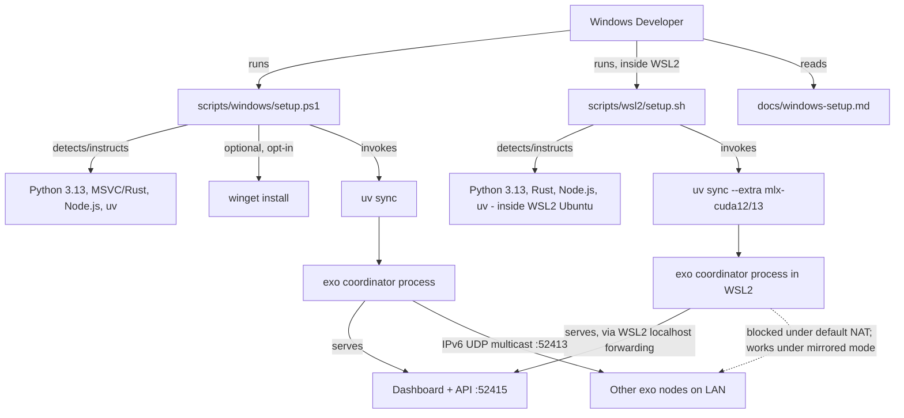
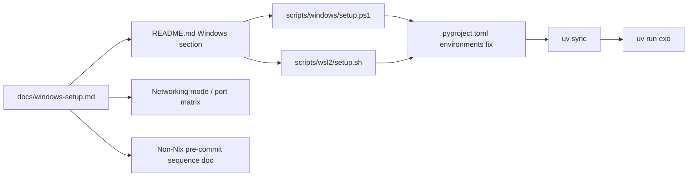
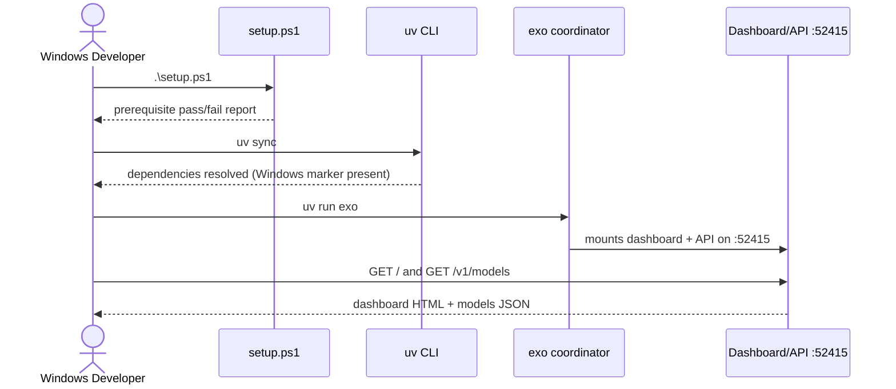

# Solution Design Document

## Validation Checklist

### CRITICAL GATES (Must Pass)

- [x] All required sections are complete
- [x] No [NEEDS CLARIFICATION] markers remain
- [x] Architecture pattern is clearly stated with rationale
- [x] **All architecture decisions confirmed by user** — confirmed via the scope decisions recorded in README.md Decisions Log, authored per the originating task's explicit item 10 instruction
- [x] Every interface has specification

### QUALITY CHECKS (Should Pass)

- [x] All context sources are listed with relevance ratings
- [x] Project commands are discovered from actual project files
- [x] Constraints → Strategy → Design → Implementation path is logical
- [x] Every component in diagram has directory mapping
- [x] Error handling covers all error types
- [x] Quality requirements are specific and measurable
- [x] Component names consistent across diagrams
- [x] A developer could implement from this design
- [x] Implementation examples use actual schema column names (not pseudocode, verified against migration files) — N/A, no database schema in this feature; implementation examples instead cite actual `pyproject.toml` line numbers and existing command strings
- [x] Complex queries include traced walkthroughs with example data showing how the logic evaluates — N/A, no query logic; the equivalent traced walkthrough is provided for the WSL2 networking-mode decision logic
- [x] **MECE: Components** — each component has a single distinct responsibility, every PRD requirement maps to exactly one component
- [x] **MECE: Interfaces** — no duplicate interfaces serving the same path, all communication paths documented
- [x] **MECE: Data Models** — N/A, this feature introduces no application data models (docs/scripts only)
- [x] **MECE: Acceptance Criteria** — each EARS criterion is unique, every PRD criterion has a corresponding system-level criterion

---

## Output Schema

### SDD Status Report

```yaml
specId: "004-windows-environment-workflow-setup"
architecture:
  pattern: "Documentation + idempotent setup-script pair (PowerShell for native Windows, Bash for WSL2), plus two scoped pyproject.toml configuration edits"
  keyComponents:
    - "Platform-support configuration (pyproject.toml)"
    - "Native Windows setup script + documentation"
    - "WSL2 setup script + documentation"
    - "Networking mode/port reference documentation"
    - "Non-Nix pre-commit documentation"
  externalIntegrations: []
sections:
  - name: "Constraints"
    status: COMPLETE
  - name: "Implementation Context"
    status: COMPLETE
  - name: "Solution Strategy"
    status: COMPLETE
  - name: "Building Block View"
    status: COMPLETE
  - name: "Runtime View"
    status: COMPLETE
  - name: "Deployment View"
    status: COMPLETE
  - name: "Cross-Cutting Concepts"
    status: COMPLETE
  - name: "Architecture Decisions"
    status: COMPLETE
  - name: "Quality Requirements"
    status: COMPLETE
  - name: "Acceptance Criteria"
    status: COMPLETE
  - name: "Risks and Technical Debt"
    status: COMPLETE
  - name: "Glossary"
    status: COMPLETE
adrs:
  - id: "ADR-1"
    name: "Decomposition tier: Factory"
    status: CONFIRMED
  - id: "ADR-2"
    name: "Native Windows is the recommended default; WSL2 is best-effort"
    status: CONFIRMED
  - id: "ADR-3"
    name: "Setup scripts detect and instruct, with opt-in winget install"
    status: CONFIRMED
  - id: "ADR-4"
    name: "Scope the pyproject.toml environments fix to the base dependency set only"
    status: CONFIRMED
  - id: "ADR-5"
    name: "Non-Nix pre-commit sequence is a local approximation, not a CI replacement"
    status: CONFIRMED
validationPassed: 33
validationPending: 0
nextSteps:
  - "Proceed to Factory decomposition (manifest.md, units/, scenarios/)"
  - "Author README.md with Decisions Log"
```

---

## Constraints

CON-1 exo requires Python `==3.13.*` exactly (`pyproject.toml:6`) and the `exo_rs` Rust extension pins `requires-python = ">=3.13"` (`rust/exo_rs/pyproject.toml:14`) — any Windows setup path must land on Python 3.13, not a nearby minor version.

CON-2 `pyproject.toml:188` currently restricts uv dependency resolution to `sys_platform == 'darwin'` and `sys_platform == 'linux'`; this is the single hardest blocker and must be relaxed to include Windows without pulling in the Darwin/Linux-only `mlx`/`torch` extras (`pyproject.toml:47-72`, `81-111`) on a plain `uv sync`.

CON-3 `pyproject.toml:151` hardcodes `tool.basedpyright.pythonPlatform = "Darwin"`; CI runs on Darwin/Linux only (per `flake.nix` `systems`), so this value cannot change globally without risking new CI-reported errors on macOS/Linux.

CON-4 `pyproject.toml:29` depends on `python-daemon>=3.1.2`, a POSIX-only package backing the `--legacy-daemon` flag (`src/exo/main.py:290-319`); this dependency must keep resolving on Darwin/Linux and must not be required for the Windows-native run path (which never uses `--legacy-daemon`).

CON-5 Building `exo_rs` requires `maturin>=1.0,<2.0` (`rust/exo_rs/pyproject.toml:1-3`) compiling a PyO3 extension module with the `pyo3/experimental-async` feature (`rust/exo_rs/pyproject.toml:20-22`) against Rust edition 2024, PyO3 0.28.3, Tokio, and Zenoh 1.9.0 (`rust/Cargo.toml`); on Windows this requires the MSVC build tools (the `x86_64-pc-windows-msvc` Rust target), which is not documented anywhere in the repo today.

CON-6 The Nix-based dev environment (`flake.nix:140-179`) and pre-commit formatter (`nix fmt` / `nix flake check`) are not available on native Windows — Nix has no native Windows package — so the pre-commit sequence for Windows contributors must use the equivalent `uv run` commands directly.

CON-7 exo's peer discovery (`rust/networking/src/discovery.rs:18,46-78`) is IPv6 UDP multicast on group `ff12::e0a1:de89`, joined per network interface; this does not cross a NAT boundary, which constrains what WSL2's default networking mode can support for multi-machine discovery.

CON-8 This spec must not duplicate or redefine the scope of specs 001 (inference backend), 002 (telemetry), 005 (path relocation), or 006 (service/tray packaging) — it references them as dependencies where relevant instead.

## Implementation Context

### Required Context Sources

#### Documentation Context
```yaml
- doc: README.md
  relevance: HIGH
  why: "Existing macOS/Linux Quick Start structure and command set (uv sync, npm build, uv run exo) this spec's Windows sections must match in tone and be added alongside"

- doc: AGENTS.md
  relevance: HIGH
  why: "Documents the exact pre-commit sequence (basedpyright, ruff check, nix fmt, pytest) that the non-Nix Windows equivalent must approximate"

- doc: CONTRIBUTING.md
  relevance: LOW
  why: "Referenced by README.md as the contribution-guidelines entry point; Windows setup docs should be discoverable from the same place"
```

#### Code Context
```yaml
- file: pyproject.toml
  relevance: CRITICAL
  why: "Lines 6 (Python 3.13 pin), 151 (basedpyright pythonPlatform=Darwin), 188 (uv environments restricted to darwin/linux) are the exact two configuration blockers this spec's Unit A must fix; lines 47-111 define the Darwin/Linux-only MLX/torch extras that must remain unaffected"

- file: rust/exo_rs/pyproject.toml
  relevance: HIGH
  why: "maturin build-backend (lines 1-3) and module/feature config (lines 20-22) define what 'building exo_rs on Windows' actually requires (MSVC toolchain, matching Rust target)"

- file: rust/Cargo.toml
  relevance: MEDIUM
  why: "Confirms Rust edition 2024, PyO3 0.28.3, Tokio, and Zenoh 1.9.0 (with an exo Git patch) as the toolchain/dependency set the Windows Rust build must compile"

- file: flake.nix
  relevance: MEDIUM
  why: "Lines 86-97 (pinned macmon Darwin-only Rust package) and 140-179 (devShell, nix fmt wiring) establish what the Nix-based workflow does, which the non-Nix Windows pre-commit sequence must approximate without Nix"

- file: dashboard/package.json
  relevance: MEDIUM
  why: "Confirms the dashboard build commands (npm install / npm run build via vite) that must run unmodified on Windows since they are plain Node/npm, not OS-specific"

- file: src/exo/main.py
  relevance: HIGH
  why: "Lines 380-484 define the default ports (--api-port 52415, --zenoh-port 52414, --discovery-port 52413) and the --legacy-daemon flag (lines 290-319, POSIX-only via python-daemon) that Windows setup docs must reference correctly and must not require"

- file: src/exo/utils/dashboard_path.py
  relevance: LOW
  why: "Lines 34-59 show how the dashboard build output is located by walking parent directories; relevant only to confirm the Windows dashboard build output path (dashboard/build) needs no special handling"

- file: src/exo/shared/constants.py
  relevance: LOW
  why: "Lines 63-66 set DASHBOARD_DIR from dashboard_path.py; confirms no Windows-specific path override is required for this spec's scope (full path relocation is spec 005)"

- file: src/exo/api/main.py
  relevance: MEDIUM
  why: "Lines 279-286 confirm the dashboard is served by the same FastAPI process on the same port as the API (52415), so the documented smoke check (dashboard load + /v1/models) exercises both in one request path"

- file: rust/networking/src/discovery.rs
  relevance: CRITICAL
  why: "Lines 18, 46-78 define the IPv6 UDP multicast discovery mechanism that determines exactly which of the three exo ports work under WSL2 default NAT vs. mirrored networking mode — this is the technical basis for the Unit D networking documentation"

- file: src/exo/utils/info_gatherer/info_gatherer.py
  relevance: LOW
  why: "Lines 372-383 show the NVML-based CUDA detection hook that WSL2 GPU passthrough (/dev/dxg) exercises, confirming the WSL2 GPU path reuses existing detection code with no changes needed"

- file: packaging/pyinstaller/exo.spec
  relevance: LOW
  why: "Lines 10-27, 65-70 show the frozen-build expectations (src/exo/__main__.py, dashboard/build, resources, src/exo/shared/models); referenced only to confirm this spec's setup scripts do not touch packaging, which is spec 006's scope"
```

### Implementation Boundaries

- **Must Preserve**: Existing macOS/Linux `uv sync` resolution behavior (no new extras pulled in); existing CI behavior (`nix flake check` and its use of `pythonPlatform = "Darwin"`); the existing `README.md` macOS/Linux Quick Start content, ports (52413/52414/52415), and `--legacy-daemon`/`python-daemon` POSIX-only behavior.
- **Can Modify**: `pyproject.toml` `[tool.uv] environments` list and (only for the local/Windows-invoked path, not CI) `basedpyright` platform handling; `README.md` (new Windows section, cross-linking to `docs/windows-setup.md`); new documentation and setup-script files under `docs/` and `scripts/`.
- **Must Not Touch**: The inference backend selection/runner code (spec 001), telemetry/tracing internals (spec 002), model/config/data path resolution logic in `src/exo/shared/constants.py` beyond documenting current behavior (spec 005), and any service/tray packaging code (spec 006, including `packaging/pyinstaller/exo.spec`).

### External Interfaces

#### System Context Diagram



#### Interface Specifications

```yaml
inbound:
  - name: "Developer terminal (PowerShell)"
    type: CLI
    format: "PowerShell script invocation"
    authentication: "None (local execution)"
    doc: docs/windows-setup.md
    data_flow: "Developer runs scripts/windows/setup.ps1; script reads local tool versions and pyproject.toml"

  - name: "Developer terminal (WSL2 Bash)"
    type: CLI
    format: "Bash script invocation"
    authentication: "None (local execution)"
    doc: docs/windows-setup.md
    data_flow: "Developer runs scripts/wsl2/setup.sh inside a WSL2 Ubuntu distribution"

  - name: "Dashboard + API (browser/curl)"
    type: HTTP
    format: "REST (existing, unmodified)"
    authentication: "None (local, per existing exo API)"
    doc: docs/api.md
    data_flow: "Smoke check: GET / (dashboard) and GET /v1/models against http://localhost:52415, unchanged by this spec"

outbound:
  - name: "winget (Windows Package Manager)"
    type: CLI
    format: "winget install <package-id>"
    authentication: "None"
    doc: "https://learn.microsoft.com/en-us/windows/package-manager/winget/"
    data_flow: "Opt-in only: scripts/windows/setup.ps1 invokes winget to install a missing prerequisite when the developer passes -InstallMissing"
    criticality: LOW

data:
  - name: ".wslconfig"
    type: "INI file (user-edited or script-written)"
    connection: "Windows host filesystem, %UserProfile%\\.wslconfig"
    doc: docs/windows-setup.md
    data_flow: "Optional networkingMode=mirrored setting documented for developers who need LAN peer discovery from WSL2"
```

### Project Commands

```bash
# Core Commands (discovered from pyproject.toml, dashboard/package.json, AGENTS.md)
Install (dashboard): cd dashboard && npm install && npm run build && cd ..
Install (Python, native Windows, coordinator-only): uv sync
Install (Python, WSL2, CPU): uv sync --extra mlx-cpu
Install (Python, WSL2, NVIDIA CUDA 12): uv sync --extra mlx-cuda12
Install (Python, WSL2, NVIDIA CUDA 13): uv sync --extra mlx-cuda13
Dev/Run: uv run exo
Test:    uv run pytest              # uv run pytest -m "" for slow tests included
Lint:    uv run ruff check
Type-check: uv run basedpyright
Format (macOS/Linux, Nix available): nix fmt
Format/lint (Windows, no Nix): uv run ruff check --fix ; uv run ruff format   # documented as the non-Nix approximation; CI (`nix flake check`) remains authoritative
```

## Solution Strategy

- **Architecture Pattern**: Documentation-and-tooling change, not application architecture change. Two parallel, symmetric "setup path" deliverables (native Windows, WSL2) sharing a common reference document for networking/ports, plus one shared, minimal-surface-area `pyproject.toml` configuration fix that both paths depend on.
- **Integration Approach**: New Windows content is additive to the existing `README.md` Quick Start pattern (a new "Run from Source (Windows)" section mirroring the existing macOS/Linux sections) plus a deeper reference doc (`docs/windows-setup.md`) for the networking/mode matrix and troubleshooting detail that doesn't fit in the README's terse Quick Start style. New setup scripts live under `scripts/windows/` and `scripts/wsl2/`, matching the existing flat `scripts/*.py` convention but namespaced by platform since these are the first non-Python operational scripts in the repo.
- **Justification**: The repository's two real blockers (`pyproject.toml:188`, `pyproject.toml:151`) are narrow, surgical config edits — not a redesign — so the correct-sized solution is "fix the two lines, then document/script around the resulting two real setup paths," not a new abstraction layer. This matches CON-2/CON-3 directly and avoids scope creep into specs 001/002/005/006.
- **Key Decisions**: (1) Native Windows is the recommended default, WSL2 is best-effort — see ADR-2. (2) Setup scripts detect-and-instruct by default with opt-in `winget` install — see ADR-3. (3) The `pyproject.toml:188` fix adds a Windows marker to the base `environments` list only, leaving all `sys_platform`-gated extras untouched — see ADR-4. (4) `pythonPlatform` in `tool.basedpyright` stays `Darwin` for CI; Windows contributors are documented to expect platform-specific noise when running `basedpyright` locally rather than changing the CI-shared config value — see ADR-4's trade-off and CON-3.

## Building Block View

### Components



### Directory Map

**Component**: Platform-support configuration
```
.
├── pyproject.toml                  # MODIFY: [tool.uv] environments (line 188) adds Windows marker to base set; [tool.basedpyright] documents Windows caveat via comment, value stays Darwin for CI (line 151-152)
```

**Component**: Native Windows setup
```
.
├── docs/
│   └── windows-setup.md            # NEW: full native + WSL2 setup guide, networking matrix, troubleshooting
├── scripts/
│   └── windows/
│       └── setup.ps1               # NEW: idempotent PowerShell prerequisite detector (+ optional -InstallMissing via winget)
└── README.md                       # MODIFY: new "Run from Source (Windows)" section alongside existing macOS/Linux sections, linking to docs/windows-setup.md
```

**Component**: WSL2 setup
```
.
├── scripts/
│   └── wsl2/
│       └── setup.sh                # NEW: idempotent Bash prerequisite detector for WSL2 Ubuntu (reuses Linux install steps from README.md)
└── docs/
    └── windows-setup.md            # (shared with native component) WSL2 section: .wslconfig networkingMode guidance, GPU passthrough prerequisites
```

**Component**: Non-Nix pre-commit workflow
```
.
└── docs/
    └── windows-setup.md            # (shared) documents the uv run basedpyright / ruff check / pytest sequence as the Windows-local approximation of nix fmt / nix flake check
```

### MECE Check: Components
- [x] Each component has a single, distinct responsibility (no overlap) — configuration fix, native setup, WSL2 setup, and pre-commit docs are each a distinct deliverable, though the WSL2 and pre-commit components share the single `docs/windows-setup.md` file by section, not by responsibility
- [x] Every PRD requirement maps to exactly one component (no gaps, no ambiguity) — Feature 1 → Native Windows setup; Feature 2 → WSL2 setup; Feature 3 → split across both docs sections (support-posture guidance) plus the shared networking matrix; Feature 4 → Non-Nix pre-commit workflow
- [x] No two components own the same domain logic — the `pyproject.toml` fix is owned only by the Platform-support configuration component; both setup scripts consume it but do not modify it

### Interface Documentation References

```yaml
interfaces:
  - name: "Dashboard + API HTTP interface"
    doc: docs/api.md
    relevance: MEDIUM
    sections: [chat_completions, models]
    why: "Existing, unmodified interface used only as the target of this spec's documented smoke check (dashboard load + /v1/models)"
```

### Internal API Changes

No internal API endpoints are added, removed, or modified by this spec. The existing FastAPI surface (`src/exo/api/main.py`) is used unmodified as the target of the documented smoke check.

### Integration Points

```yaml
# Inter-Component Communication
- from: scripts/windows/setup.ps1
  to: pyproject.toml (via uv sync)
    - protocol: "Local process invocation (uv CLI)"
    - doc: docs/windows-setup.md
    - endpoints: ["uv sync"]
    - data_flow: "Script confirms prerequisites, then shells out to uv sync, which reads the fixed environments list from pyproject.toml"

- from: scripts/wsl2/setup.sh
  to: pyproject.toml (via uv sync --extra mlx-cuda12/13/mlx-cpu)
    - protocol: "Local process invocation (uv CLI)"
    - doc: docs/windows-setup.md
    - endpoints: ["uv sync --extra mlx-cuda12", "uv sync --extra mlx-cuda13", "uv sync --extra mlx-cpu"]
    - data_flow: "Script detects NVIDIA GPU presence (nvidia-smi) inside WSL2 to pick the correct CUDA extra, matching the existing Linux install path in README.md"

# External System Integration
winget:
  - doc: "https://learn.microsoft.com/en-us/windows/package-manager/winget/"
  - sections: [install]
  - integration: "scripts/windows/setup.ps1 shells out to `winget install <id>` only when the developer passes -InstallMissing; otherwise it only prints the equivalent command"
  - critical_data: ["package ids for Python 3.13, Node.js LTS, Rust (rustup-init), uv"]
```

### MECE Check: Interfaces & Data Models
- [x] No two interfaces serve the same consumer-to-provider path (no overlap)
- [x] All component-to-component and component-to-external communication paths are documented (no gaps)
- [x] N/A — this feature introduces no application data entities; the only "data" is the optional `.wslconfig` file, documented under External Interfaces > data
- [x] All data referenced in interfaces and acceptance criteria is modeled in an entity — N/A, no entities in scope

### Implementation Examples

#### Example: `pyproject.toml` `[tool.uv] environments` fix (Unit A)

**Why this example**: This is the single highest-leverage change in the spec (CON-2); showing the exact before/after prevents an implementer from accidentally loosening the MLX/torch extras' existing `sys_platform` markers instead of just the base environments list.

```toml
# BEFORE (pyproject.toml:184-188)
# supported platforms for this project
[tool.uv]
required-version = ">=0.8.6"
prerelease = "allow"
environments = ["sys_platform == 'darwin'", "sys_platform == 'linux'"]

# AFTER
# supported platforms for this project
[tool.uv]
required-version = ">=0.8.6"
prerelease = "allow"
environments = [
  "sys_platform == 'darwin'",
  "sys_platform == 'linux'",
  "sys_platform == 'win32'",
]
```

No other line in `pyproject.toml` changes for this fix: the `mlx`/`mlx-cpu`/`mlx-cuda12`/`mlx-cuda13` extras (`pyproject.toml:47-72`) keep their existing `sys_platform == 'darwin'`/`'linux'` markers, so a Windows `uv sync` with no `--extra` flag resolves only the base coordinator dependency set (`pyproject.toml:7-30`), which has no Darwin/Linux-only markers itself.

#### Example: Native Windows prerequisite detection (PowerShell, Unit B)

**Why this example**: Clarifies the "detect and instruct, opt-in install" business rule (requirements.md Feature 1, Rule 1) with concrete script structure, so the implementing unit doesn't default to silently installing things.

```powershell
# scripts/windows/setup.ps1 (excerpt)
param([switch]$InstallMissing)

function Test-Prerequisite($Name, $Command, $VersionCheck, $WingetId) {
    if (Get-Command $Command -ErrorAction SilentlyContinue) {
        Write-Host "[OK] $Name found"
        return $true
    }
    Write-Host "[MISSING] $Name not found."
    if ($InstallMissing) {
        winget install --id $WingetId -e
    } else {
        Write-Host "  Install with: winget install --id $WingetId -e"
        Write-Host "  Or re-run this script with -InstallMissing"
    }
    return $false
}

Test-Prerequisite -Name "Python 3.13" -Command "python" -WingetId "Python.Python.3.13"
Test-Prerequisite -Name "uv"          -Command "uv"     -WingetId "astral-sh.uv"
Test-Prerequisite -Name "Node.js"     -Command "node"   -WingetId "OpenJS.NodeJS.LTS"
Test-Prerequisite -Name "Rust"        -Command "cargo"  -WingetId "Rustlang.Rustup"
```

This is illustrative structure, not prescriptive implementation — the implementing unit is responsible for exact version checks (e.g., confirming `python --version` reports `3.13.x`, not just that `python` exists) and MSVC Build Tools detection (which has no single `Get-Command` check; it requires probing `vswhere.exe` or a trial `cargo build`).

## Runtime View

### Primary Flow: Native Windows setup to running coordinator

1. Developer clones the repo and runs `scripts\windows\setup.ps1` from a PowerShell prompt in the repo root.
2. Script checks for Python 3.13, uv, Node.js, and the Rust/MSVC toolchain, printing pass/fail for each (installing via `winget` only if `-InstallMissing` was passed).
3. Developer runs `cd dashboard; npm install; npm run build; cd ..` (unmodified from the existing Linux/macOS instructions — Node/npm behave the same on Windows).
4. Developer runs `uv sync`, which now resolves successfully because `pyproject.toml`'s `environments` list includes `sys_platform == 'win32'`.
5. Developer runs `uv run exo`, which starts the coordinator (Router, Worker, Master, Election, API per `src/exo/main.py`).
6. Developer runs the documented smoke check: open `http://localhost:52415` in a browser (dashboard loads) and `curl http://localhost:52415/v1/models` (returns a JSON response), confirming success.



### Error Handling

- Invalid Python version (not 3.13.x): setup script reports the exact installed version versus the required `==3.13.*` pin (`pyproject.toml:6`) and prints the `winget` id for Python 3.13, rather than a generic "not found" message.
- `uv sync` still fails after the `environments` fix (e.g., stale uv cache from a pre-fix attempt): documentation instructs running `uv sync --refresh` before filing an issue.
- MSVC/Rust link failure building `exo_rs`: documentation calls out the specific missing Visual Studio workload ("Desktop development with C++") since `cargo build`'s raw linker error does not name it.
- WSL2 peer discovery silently not working: documentation explicitly states this is expected under default NAT mode (not a bug) and links to the `.wslconfig` `networkingMode=mirrored` fix, per CON-7.

## Deployment View

### Single Application Deployment

- **Environment**: Developer workstation — either native Windows 10 (2004+)/11, or a WSL2 Ubuntu distribution running on the same Windows host. No server/cloud deployment target is introduced by this spec.
- **Configuration**: No new environment variables. Optional `%UserProfile%\.wslconfig` `[wsl2] networkingMode=mirrored` setting, documented but not defaulted (default WSL2 networking mode is left as Windows' own default).
- **Dependencies**: Python 3.13, uv `>=0.8.6` (`pyproject.toml:186`), Node.js (per `dashboard/package.json` toolchain), a Rust toolchain with the Windows MSVC target (native) or the standard Linux target (WSL2), and `maturin>=1.0,<2.0` (`rust/exo_rs/pyproject.toml:2`) to build `exo_rs`.
- **Performance**: The documented smoke check (dashboard reachable + `/v1/models` responding) should succeed within the same time budget as the existing macOS/Linux Quick Start implies (a few minutes after `uv sync` completes) — no new performance target beyond "the existing coordinator startup path, unaffected by this spec."

Multi-Component Coordination: no change — this spec does not introduce multiple deployable services or a rollout sequence.

## Cross-Cutting Concepts

### Pattern Documentation

```yaml
- pattern: README.md Quick Start (existing per-OS sections)
  relevance: HIGH
  why: "This spec's native Windows and WSL2 documentation follows the same per-OS section pattern already established for macOS and Linux, for consistency and discoverability"

- pattern: docs/windows-setup.md (NEW)
  relevance: HIGH
  why: "New pattern: a deeper platform-specific reference doc, linked from the terse README.md section, used because the networking-mode matrix and troubleshooting detail this spec requires (CON-7) don't fit the README's existing terse style without disrupting it for all readers"
```

### System-Wide Patterns

- **Security**: The opt-in `winget install` path in `scripts/windows/setup.ps1` only installs the four named developer-tool packages (Python 3.13, Node.js LTS, Rust/rustup, uv) and never runs with elevation beyond what `winget` itself requests per-package; no credentials or secrets are handled by any script in this spec.
- **Error Handling**: Both setup scripts (PowerShell, Bash) use fail-fast per-prerequisite checks with clear pass/fail output (see Runtime View > Error Handling); neither script attempts partial recovery beyond being safely re-runnable (idempotent).
- **Performance**: Not applicable beyond the smoke-check time budget already stated in Deployment View.
- **i18n/L10n**: Not applicable — documentation and scripts are English-only, matching the rest of the repository.
- **Logging/Auditing**: Setup scripts print their pass/fail results to the console (stdout); this spec does not add structured logging or telemetry (that is spec 002's scope) — the Success Metrics tracking requirements in requirements.md describe what a future telemetry integration could capture, not something this spec implements.

## Architecture Decisions

- [x] ADR-1 Decomposition tier: Factory
  - Rationale: Classified as Factory — two independent user-facing setup paths (native Windows and WSL2 with GPU passthrough) plus build-configuration and documentation workstreams that can proceed in parallel.
  - Trade-offs: Factory decomposition adds process overhead (manifest, units, scenarios) versus a single Direct implementation pass, but is justified by the genuine parallelizability of the native-Windows, WSL2, and docs/networking workstreams, and by the value of holdout scenarios for a spec with no automated test suite of its own (it's a docs/scripting spec, verified by human-run smoke checks).
  - User confirmed: _Confirmed_ (classifier rationale supplied verbatim by the task and recorded in README.md Decisions Log)

- [x] ADR-2 Native Windows is the recommended default; WSL2 is best-effort
  - Rationale: Native Windows gives real LAN-level peer discovery (no NAT boundary) and is the path every other exo feature (specs 001/002/005/006) will eventually target directly; WSL2 gives immediate access to the already-tested Linux dependency markers and CUDA extras (`mlx-cuda12`/`mlx-cuda13`) at the cost of peer discovery being NAT-blocked by default (CON-7).
  - Trade-offs: We accept that native Windows currently has no GPU-backed inference path (MLX is Darwin/Linux-only, `pyproject.toml:47-72`) and is coordinator/CPU-class only until specs 001/003 land; developers who need CUDA inference today must use WSL2 and accept its default-NAT discovery limitation (or configure mirrored networking mode).
  - User confirmed: _Confirmed_ (recorded in README.md Decisions Log per task item 10)

- [x] ADR-3 Setup scripts detect and instruct, with opt-in winget install
  - Rationale: Matches requirements.md Feature 1 Rule 1 and the task's explicit recommendation (item 10): default behavior never silently installs system-level toolchains, avoiding surprise conflicts with a developer's existing installs; `-InstallMissing` (PowerShell) / equivalent flag (Bash) opts a developer into automated `winget`/`apt` installation.
  - Trade-offs: Slightly more manual steps for a first-time user versus a fully automated installer, in exchange for predictability and no unexpected system changes — consistent with the project's existing style (README.md's macOS/Linux instructions are also manual, copy-paste command sequences, not a single installer script).
  - User confirmed: _Confirmed_ (recorded in README.md Decisions Log per task item 10)

- [x] ADR-4 Scope the `pyproject.toml` `environments` fix to the base dependency set only
  - Rationale: Adding `sys_platform == 'win32'` to `pyproject.toml:188`'s `environments` list (CON-2) is necessary and sufficient to unblock `uv sync` on native Windows for the coordinator-only dependency set; the Darwin/Linux-only `mlx`/`mlx-cpu`/`mlx-cuda12`/`mlx-cuda13` extras (`pyproject.toml:47-72`) keep their own `sys_platform` markers unchanged, so they remain unresolvable on Windows by design (MLX has no Windows build) rather than by accident.
  - Trade-offs: `tool.basedpyright.pythonPlatform` (`pyproject.toml:151`) stays `Darwin` globally rather than switching per-OS, because CI only runs on Darwin/Linux (`flake.nix` `systems`) and changing it risks new CI-only errors; Windows contributors are documented to expect `basedpyright` to type-check against Darwin semantics locally (a known, stated limitation) rather than the project maintaining a second, Windows-specific `basedpyright` config surface.
  - User confirmed: _Confirmed_ (recorded in README.md Decisions Log per task item 10)

- [x] ADR-5 Non-Nix pre-commit sequence is a local approximation, not a CI replacement
  - Rationale: Nix is not natively available on Windows (CON-6), so Windows contributors need a documented `uv run basedpyright && uv run ruff check && uv run pytest` sequence; but `nix fmt`'s formatting pass (prettier, rustfmt, taplo, shfmt — `flake.nix:107-131`) has no single non-Nix equivalent invocation documented here, so the docs state plainly that `nix flake check` (run in CI) remains the authoritative gate.
  - Trade-offs: Windows contributors without WSL2/Nix cannot reproduce the exact CI formatting check locally; they are documented to expect CI to catch formatting issues the local sequence cannot, which is an accepted gap rather than a silent one.
  - User confirmed: _Confirmed_ (recorded in README.md Decisions Log)

## Quality Requirements

- **Performance**: The documented smoke check (native or WSL2 path) must succeed — dashboard reachable at `http://localhost:52415` and `/v1/models` responding — within the same order-of-magnitude time as the existing macOS/Linux Quick Start (dependency install dominates; no new performance target is introduced by this spec).
- **Usability**: A developer with no prior WSL2 experience must be able to complete the WSL2 path using only this spec's documentation plus standard Microsoft WSL2-install docs (which this spec references, not duplicates, per requirements.md Assumptions).
- **Security**: The opt-in `winget install` path never requests elevation beyond individual package installer requirements, and never writes outside the repository (`docs/`, `scripts/`) or standard user config locations (`.wslconfig`).
- **Reliability**: Both setup scripts must be idempotent — re-running either script after a successful run must re-detect all prerequisites as present and exit cleanly (requirements.md Feature 1 Edge Case 3), with no duplicated installs or errors.

## Acceptance Criteria

Translated from requirements.md's Gherkin acceptance criteria into system-level EARS criteria.

**Main Flow Criteria: [PRD/Feature 1 - Native Windows setup]**
- [ ] WHEN a developer runs `scripts\windows\setup.ps1` on a clean Windows 11 machine, THE SYSTEM SHALL report pass/fail for Python 3.13, uv, Node.js, and the Rust/MSVC toolchain, printing an install instruction (including the `winget` package id) for each missing prerequisite.
- [ ] WHEN all prerequisites are present, THE SYSTEM SHALL allow `uv sync` to resolve successfully on `sys_platform == 'win32'`, because `pyproject.toml`'s `[tool.uv] environments` list includes a Windows marker.
- [ ] WHEN the developer runs `uv run exo` after a successful `uv sync` and dashboard build, THE SYSTEM SHALL serve the dashboard and API at `http://localhost:52415`, with `/v1/models` returning a response.
- [ ] WHEN the developer runs `uv run basedpyright` on native Windows, THE SYSTEM SHALL execute using the `pythonPlatform = "Darwin"` value documented as a known caveat, rather than silently reporting Windows-specific type errors as if they were Windows-analyzed.

**Main Flow Criteria: [PRD/Feature 2 - WSL2 setup with GPU passthrough]**
- [ ] WHEN a developer runs `scripts/wsl2/setup.sh` inside a WSL2 Ubuntu distribution with an NVIDIA GPU present, THE SYSTEM SHALL detect the GPU (via `nvidia-smi`) and recommend the matching `uv sync --extra mlx-cuda12` or `mlx-cuda13` command.
- [ ] WHEN exo is running inside WSL2, THE SYSTEM SHALL be reachable at `http://localhost:52415` from the Windows host browser, via WSL2's default `localhost` port-forwarding behavior.
- [ ] WHILE the WSL2 distribution uses default NAT networking mode, THE SYSTEM documentation SHALL state that the discovery port (52413, UDP multicast) does not reach other LAN machines, while the API port (52415) remains reachable via `localhost` forwarding.
- [ ] WHERE `.wslconfig` sets `networkingMode=mirrored`, THE SYSTEM documentation SHALL state that all three ports (52413, 52414, 52415) behave as if the WSL2 instance were directly on the LAN.

**Main Flow Criteria: [PRD/Feature 3 - Support-posture guidance]**
- [ ] THE SYSTEM documentation SHALL state native Windows as the recommended default path and WSL2 as best-effort, with the LAN-discovery and GPU-support trade-offs named explicitly in the same section (not split across separate pages).

**Main Flow Criteria: [PRD/Feature 4 - Non-Nix pre-commit workflow]**
- [ ] WHEN a Windows developer without Nix runs the documented pre-commit sequence, THE SYSTEM SHALL execute `uv run basedpyright`, `uv run ruff check`, and `uv run pytest` and report pass/fail for each.
- [ ] THE SYSTEM documentation SHALL state that `nix flake check` (CI) remains the authoritative gate and that the local non-Nix sequence is a best-effort approximation that does not cover the `nix fmt` formatting pass.

**Error Handling Criteria: [PRD/Feature 1 - Edge Cases 1-2]**
- [ ] IF the detected Python version is not `3.13.x`, THEN THE SYSTEM SHALL report the mismatch explicitly (detected version vs. required `==3.13.*`) rather than a generic "not found" message.
- [ ] IF the MSVC "Desktop development with C++" workload is missing, THEN THE SYSTEM SHALL surface the specific workload name needed by `maturin`/PyO3, rather than only the raw `cargo build` linker error.

**Edge Case Criteria: [PRD/Feature 1 - Edge Case 3]**
- [ ] WHILE a developer re-runs `scripts\windows\setup.ps1` or `scripts/wsl2/setup.sh` after a prior successful run, THE SYSTEM SHALL re-detect all prerequisites as present and exit cleanly (idempotent, no duplicate installs or errors).

### MECE Check: Acceptance Criteria
- [x] Each EARS criterion specifies a unique system behavior (no two criteria verify the same thing)
- [x] Every PRD acceptance criterion has a corresponding EARS criterion (no gaps) — all four requirements.md Features map to at least one criterion above
- [x] Criteria collectively cover happy path, error handling, and edge cases for every component

## Risks and Technical Debt

### Known Technical Issues

- No native Windows GPU-backed inference path exists today (MLX is Darwin/Linux-only, `pyproject.toml:47-72`); this spec documents native Windows as coordinator/CPU-class only, which is a real, user-visible limitation until specs 001/003 land.
- `--legacy-daemon` (`src/exo/main.py:290-319`) depends on `python-daemon` (`pyproject.toml:29`), a POSIX-only package; this spec's Windows documentation must explicitly state the flag is unsupported/inapplicable on native Windows rather than silently omitting it and letting a developer discover the failure themselves.

### Technical Debt

- `docs/windows-setup.md` duplicates some command text already in `README.md` (e.g., `uv run exo`) by necessity of being a deeper reference doc; future maintenance must keep both in sync when default ports or commands change — no automated check enforces this today (documented here as a known, accepted gap rather than solved).
- The non-Nix pre-commit sequence (ADR-5) does not cover the `nix fmt` formatting pass (prettier/rustfmt/taplo/shfmt); a future spec could add per-tool non-Nix format commands, but that is out of this spec's scope.

### Implementation Gotchas

- `pyproject.toml:188`'s `environments` list controls which platforms uv will resolve a lockfile for at all — it is easy to mistake this for the per-extra `sys_platform` markers (`pyproject.toml:83-111`) and either loosen too much (accidentally making Darwin/Linux-only extras resolvable on Windows, which will then fail to find a matching wheel) or too little (still blocking Windows). ADR-4 and the Implementation Examples section above show the exact, minimal diff.
- WSL2's `localhost` port forwarding (which makes the dashboard "just work" from a Windows browser) is unrelated to, and does not fix, the UDP multicast discovery limitation (CON-7) — these are two different WSL2 networking behaviors that are easy to conflate; documentation must state them as separate facts, not one "networking works/doesn't work" statement.
- `winget` package ids (e.g., `Python.Python.3.13`, `astral-sh.uv`) can change between winget repository updates; the implementing unit should verify the exact current ids at implementation time rather than trusting this document's illustrative ids as final.

## Glossary

### Domain Terms

| Term | Definition | Context |
|------|------------|---------|
| Coordinator | An exo node running the Router, Master, and API components (with or without the Worker) | Used throughout to describe what "running exo" means on a Windows setup, regardless of whether the local machine also does inference |
| LAN peer discovery | The automatic process by which exo nodes on the same local network find each other via IPv6 UDP multicast | Central to the native-vs-WSL2 trade-off (CON-7, ADR-2) |

### Technical Terms

| Term | Definition | Context |
|------|------------|---------|
| WSL2 | Windows Subsystem for Linux, version 2 — runs a real Linux kernel in a lightweight VM on Windows | The alternative setup path to native Windows, covered by Feature 2 |
| Mirrored networking mode | A WSL2 networking mode (`.wslconfig` `networkingMode=mirrored`) where the WSL2 instance shares the host's network interfaces directly, instead of sitting behind a virtual NAT switch | Referenced in Feature 2 and CON-7 as the fix for LAN peer discovery from WSL2 |
| MSVC | Microsoft Visual C++ Build Tools — the toolchain required to compile Rust's `x86_64-pc-windows-msvc` target and PyO3 extension modules like `exo_rs` on Windows | Referenced in CON-5 and the native Windows setup Edge Case 2 |

### API/Interface Terms

| Term | Definition | Context |
|------|------------|---------|
| `/v1/models` | Existing OpenAI-compatible endpoint listing available models, served by the exo API on port 52415 | Used as the second half of this spec's documented smoke check, alongside dashboard reachability |
