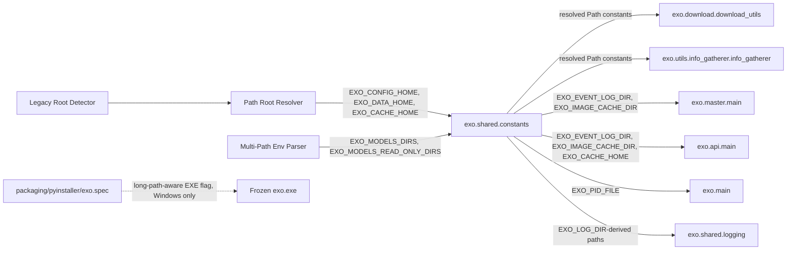
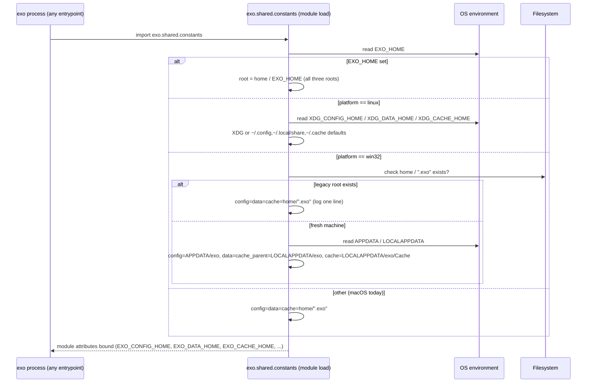

# Solution Design Document

## Validation Checklist

### CRITICAL GATES (Must Pass)

- [x] All required sections are complete
- [x] No [NEEDS CLARIFICATION] markers remain
- [x] Architecture pattern is clearly stated with rationale
- [x] **All architecture decisions confirmed by user**
- [x] Every interface has specification

### QUALITY CHECKS (Should Pass)

- [x] All context sources are listed with relevance ratings
- [x] Project commands are discovered from actual project files
- [x] Constraints → Strategy → Design → Implementation path is logical
- [x] Every component in diagram has directory mapping
- [x] Error handling covers all error types
- [x] Quality requirements are specific and measurable
- [x] Component names consistent across diagrams
- [x] A developer could implement from this design
- [x] Implementation examples use actual schema column names (not pseudocode, verified against migration files) — N/A, no database in this feature; examples instead use real function/constant names verified against source
- [x] Complex queries include traced walkthroughs with example data showing how the logic evaluates
- [x] **MECE: Components** — each component has a single distinct responsibility, every PRD requirement maps to exactly one component
- [x] **MECE: Interfaces** — no duplicate interfaces serving the same path, all communication paths documented
- [x] **MECE: Data Models** — each entity owns a distinct slice of the domain, all required data is modeled
- [x] **MECE: Acceptance Criteria** — each EARS criterion is unique, every PRD criterion has a corresponding system-level criterion

---

## Output Schema

### SDD Status Report

| Field | Type | Required | Description |
|-------|------|----------|-------------|
| specId | string | Yes | Spec identifier (NNN-name format) |
| architecture | ArchitectureSummary | Yes | Architecture overview |
| sections | SectionStatus[] | Yes | Status of each SDD section |
| adrs | ADRStatus[] | Yes | Architecture decision statuses |
| validationPassed | number | Yes | Validation items passed |
| validationPending | number | Yes | Validation items pending |
| nextSteps | string[] | Yes | Recommended next actions |

**Report for this document:** specId=`005-windows-filesystem-state-paths`, validationPassed=17, validationPending=0, nextSteps=["Proceed to Incremental decomposition (plan/)"]

### ArchitectureSummary

| pattern | keyComponents | externalIntegrations |
|---------|---------------|------------------------|
| Single-module resolution seam (typed platform branch inside `exo.shared.constants`) | Path Root Resolver, Multi-Path Env Parser, Legacy Root Detector | None (stdlib `os`/`pathlib`/`sys` only) |

### SectionStatus

| name | status | detail |
|------|--------|--------|
| Constraints | COMPLETE | |
| Implementation Context | COMPLETE | |
| Solution Strategy | COMPLETE | |
| Building Block View | COMPLETE | |
| Runtime View | COMPLETE | |
| Deployment View | COMPLETE | |
| Cross-Cutting Concepts | COMPLETE | |
| Architecture Decisions | COMPLETE | |
| Quality Requirements | COMPLETE | |
| Acceptance Criteria | COMPLETE | |
| Risks and Technical Debt | COMPLETE | |
| Glossary | COMPLETE | |

### ADRStatus

| id | name | status |
|----|------|--------|
| ADR-1 | Windows `%APPDATA%`/`%LOCALAPPDATA%` root split | CONFIRMED |
| ADR-2 | Legacy `~/.exo` reuse-in-place migration | CONFIRMED |
| ADR-3 | `os.pathsep` instead of hard-coded `:` for multi-path env vars | CONFIRMED |
| ADR-4 | Leave Hugging Face's own cache location untouched | CONFIRMED |
| ADR-5 | Long-path support via build-manifest opt-in, not runtime code | CONFIRMED |

---

## Constraints

CON-1 Python 3.13 project; strict `basedpyright` typing (no `Any`, no untyped seams) and `ruff` linting must pass; Pydantic models used elsewhere in the codebase are `frozen=True, strict=True`, though `constants.py` itself is plain module-level values, not a Pydantic model — the new code must match that existing style, not introduce a class where a function suffices.
CON-2 No new third-party dependency may be introduced; resolution must use only `os`, `sys`, and `pathlib` from the standard library, consistent with the existing implementation of `_get_xdg_dir` in `src/exo/shared/constants.py:10-22`.
CON-3 Zero regression on Linux or macOS: every assertion in `src/exo/shared/tests/test_xdg_paths.py:10-110` must keep passing byte-for-byte, since that file is the project's only existing regression guard for this module and per-repo policy (AGENTS.md) requires `uv run pytest` to pass before merge.

## Implementation Context

**IMPORTANT**: All context sources below were read in full before this design was written.

#### Code Context
```yaml
- file: src/exo/shared/constants.py
  relevance: CRITICAL
  why: "Single resolution hub for every path in the system (lines 7-108); this is the only file whose internal logic changes in this feature — the Windows branch, the legacy-root detection, and the os.pathsep fix all land here."

- file: src/exo/shared/tests/test_xdg_paths.py
  relevance: CRITICAL
  why: "Existing regression guard (lines 10-213) for XDG/EXO_HOME/macOS-fallback/models-dir behavior. Must keep passing unmodified on Linux/macOS and gains a parallel Windows-branch suite in this feature."

- file: src/exo/download/download_utils.py
  relevance: HIGH
  why: "Consumes EXO_DEFAULT_MODELS_DIR, EXO_MODELS_DIRS, EXO_MODELS_READ_ONLY_DIRS (import at lines 34-38) for model resolution (resolve_existing_model, build_model_path, select_download_dir, resolve_model_dir, ensure_cache_dir, delete_model at lines 152-257). It does not need code changes — it automatically inherits corrected Windows roots and corrected multi-path parsing from constants.py — but every function that iterates EXO_MODELS_DIRS/EXO_MODELS_READ_ONLY_DIRS must be re-verified against the fixed parser."

- file: src/exo/download/huggingface_utils.py
  relevance: MEDIUM
  why: "get_hf_home() (lines 65-67) independently resolves Hugging Face's token/cache home via HF_HOME, defaulting to ~/.cache/huggingface on every platform including Windows. This file is explicitly NOT changed by this feature (ADR-4) — it is read to confirm that leaving it alone is a deliberate, informed choice rather than an oversight."

- file: src/exo/utils/info_gatherer/info_gatherer.py
  relevance: MEDIUM
  why: "NodeConfig.gather() (lines 295-310) reads/creates EXO_CONFIG_FILE; NodeDiskUsage.gather() (lines 323-334) measures free space against EXO_DEFAULT_MODELS_DIR for dashboard telemetry. Both automatically follow the new Windows roots with no code change required, but the design must state that disk-usage reporting will now reflect the LOCALAPPDATA drive, not the roaming/home drive."

- file: src/exo/shared/logging.py
  relevance: LOW
  why: "logger_setup(log_file: Path | None, ...) (lines 46-86) accepts an already-resolved Path and has no platform branching of its own; confirms that fixing constants.py is sufficient without touching the logging module."

- file: src/exo/utils/dashboard_path.py
  relevance: LOW
  why: "find_dashboard()/find_resources() (lines 6-59) resolve relative to the repository or PyInstaller's sys._MEIPASS bundle root, not via XDG/APPDATA roots at all. Confirms DASHBOARD_DIR/RESOURCES_DIR defaults are unaffected by this feature; only their environment-variable override path (constants.py:59-66) is in scope, and only insofar as it already works for absolute Windows paths (see ADR discussion under Runtime View)."

- file: src/exo/master/main.py
  relevance: LOW
  why: "Line 146: self._event_log = DiskEventLog(EXO_EVENT_LOG_DIR / \"master\") — confirms EXO_EVENT_LOG_DIR is consumed as an opaque Path with no platform-specific logic of its own."

- file: src/exo/api/main.py
  relevance: LOW
  why: "Lines 210, 251, 295: _API_EVENT_LOG_DIR = EXO_EVENT_LOG_DIR / \"api\"; self._event_log = DiskEventLog(_API_EVENT_LOG_DIR); self._image_store = ImageStore(EXO_IMAGE_CACHE_DIR) — same confirmation as master/main.py, plus EXO_CACHE_HOME-derived ONBOARDING_COMPLETE_FILE at line 211."

- file: src/exo/main.py
  relevance: MEDIUM
  why: "Lines 278-329: acquires EXO_PID_FILE via Pidfile(EXO_PID_FILE, 0o0600); under --legacy-daemon, opens os.devnull for stdin/stdout/stderr — a POSIX-only branch. Confirms the PID file's *location* is in scope (it must resolve under the new Windows cache root) but the POSIX-specific daemonization mechanism itself is explicitly out of scope (see requirements.md Won't Have)."

- file: packaging/pyinstaller/exo.spec
  relevance: MEDIUM
  why: "Lines 10-27 define DASHBOARD_DIR/RESOURCES_DIR/EXO_SHARED_MODELS_DIR as bundled DATAS (lines 65-70). This is the file that must gain a Windows long-path-aware manifest declaration for Feature 4 (Could Have) of requirements.md; it currently has no Windows-specific EXE() options at all."
```

### Implementation Boundaries

- **Must Preserve**: Every existing environment-variable override and its exact resolution semantics on Linux and macOS (`EXO_HOME`, `XDG_CONFIG_HOME`/`XDG_DATA_HOME`/`XDG_CACHE_HOME`, `EXO_DEFAULT_MODELS_DIR`, `EXO_MODELS_DIRS`, `EXO_MODELS_READ_ONLY_DIRS`, `HF_HOME`, `HF_TOKEN`, `EXO_DASHBOARD_DIR`, `EXO_RESOURCES_DIR`, `EXO_LOG`); the exact set and shape of derived constants exported from `constants.py` (so every importer in `download_utils.py`, `huggingface_utils.py`, `info_gatherer.py`, `master/main.py`, `api/main.py`, `main.py` keeps working without changes).
- **Can Modify**: The internal implementation of `_get_xdg_dir` (or its Windows-aware replacement) and `_parse_colon_dirs` inside `src/exo/shared/constants.py`; the test suite in `src/exo/shared/tests/test_xdg_paths.py`; the packaging manifest in `packaging/pyinstaller/exo.spec`; the environment-variable documentation table in `README.md`.
- **Must Not Touch**: `download_utils.py`, `huggingface_utils.py`, `info_gatherer.py`, `master/main.py`, `api/main.py`'s business logic (they consume the already-resolved constants and need no changes); the `huggingface_hub` library's own internal cache resolution; the `--legacy-daemon`/`Pidfile` POSIX daemonization mechanism.

### External Interfaces

Not applicable — this feature has no HTTP, RPC, or third-party service surface. It changes the resolution of local filesystem paths consumed entirely within the exo process. The "interfaces" that matter here are the environment-variable contract and the exported Python constants contract, both documented under Interface Specifications below.

### Project Commands

```bash
# Discovered from AGENTS.md and pyproject.toml
Install:      uv sync
Run:          uv run exo
Test:         uv run pytest
Test (all):   uv run pytest -m ""
Test (file):  uv run pytest src/exo/shared/tests/test_xdg_paths.py
Type check:   uv run basedpyright
Lint:         uv run ruff check
Format:       nix fmt
Full gate:    uv run basedpyright && uv run ruff check && nix fmt && uv run pytest
```

## Solution Strategy

- **Architecture Pattern**: Single-module resolution seam. All platform branching stays inside `src/exo/shared/constants.py`, the existing "single resolution hub" (per its own module-level structure at lines 7-108) — no `sys.platform` checks are added anywhere else in the codebase. Every other consumer (`download_utils.py`, `huggingface_utils.py`, `info_gatherer.py`, `master/main.py`, `api/main.py`, `main.py`) continues to import already-resolved `Path` constants and remains completely platform-agnostic, exactly as it is today.
- **Integration Approach**: Additive branch, not a rewrite. The existing `_get_xdg_dir(env_var, fallback)` function keeps its Linux branch and its `EXO_HOME` override untouched; a new Windows-specific branch is inserted between the `EXO_HOME` check and the generic non-Linux fallback, so macOS keeps falling through to the same `~/.exo` behavior it uses today.
- **Justification**: The codebase's own style (per AGENTS.md: "pure functions with injectable effect handlers", "no abbreviations", strict typing) and CON-1/CON-2 rule out introducing a class hierarchy, a new dependency (e.g. `platformdirs`), or scattering `sys.platform` checks across five files. A single typed function extension is the smallest change that satisfies every Must Preserve boundary.
- **Key Decisions**: See Architecture Decisions (ADR-1 through ADR-5) below; each is a self-contained, independently testable decision.

## Building Block View

### Components



### Directory Map

**Component**: `exo.shared.constants` (Path Root Resolver, Legacy Root Detector, Multi-Path Env Parser)
```
.
├── src/exo/shared/
│   ├── constants.py                 # MODIFY: add Windows branch to root resolution, legacy-root
│   │                                 #         detection, and os.pathsep-based multi-path parsing
│   └── tests/
│       └── test_xdg_paths.py        # MODIFY: add Windows-branch, legacy-detection, and
│                                     #         os.pathsep regression tests alongside existing
│                                     #         Linux/macOS tests (all existing tests unchanged)
```

**Component**: `packaging/pyinstaller` (long-path awareness for Feature 4)
```
.
├── packaging/pyinstaller/
│   └── exo.spec                     # MODIFY: declare Windows long-path awareness for the
│                                     #         frozen EXE (Could Have, additive only)
```

**Component**: `README.md` (documentation of the new Windows column)
```
.
├── README.md                        # MODIFY: extend "File Locations" and "Environment
│                                     #         Variables" sections with the Windows equivalents
```

### MECE Check: Components
- [x] Each component has a single, distinct responsibility (no overlap) — Path Root Resolver owns config/data/cache root selection; Legacy Root Detector owns the one-time `~/.exo` existence check; Multi-Path Env Parser owns `EXO_MODELS_DIRS`/`EXO_MODELS_READ_ONLY_DIRS` splitting; packaging and documentation are separate, non-code components.
- [x] Every PRD requirement maps to exactly one component (no gaps, no ambiguity) — F1 → Path Root Resolver + Legacy Root Detector; F2 → Multi-Path Env Parser; F3 → Legacy Root Detector; F4 → packaging component + README documentation.
- [x] No two components own the same domain logic — parsing multi-path env vars and resolving root directories are kept as separate concerns inside the same file, mirroring the existing separation between `_get_xdg_dir` and `_parse_colon_dirs` in the current code.

### Interface Specifications

#### Environment Variable Contract (unchanged surface, corrected semantics on Windows)

```yaml
env_vars:
  - name: EXO_HOME
    effect: "Overrides EXO_CONFIG_HOME, EXO_DATA_HOME, EXO_CACHE_HOME to Path.home() / $EXO_HOME on every platform."
    windows_change: "None. Verified (see Runtime View) that pathlib's `/` operator already replaces the whole path when the right operand is itself absolute (e.g. `D:\\custom\\exo`), on both POSIX and Windows path flavours — so an absolute Windows override already works today without new code."

  - name: XDG_CONFIG_HOME / XDG_DATA_HOME / XDG_CACHE_HOME
    effect: "Linux-only; unchanged."
    windows_change: "None — these variables are never consulted outside the Linux branch, on any platform, before or after this change."

  - name: EXO_DEFAULT_MODELS_DIR
    effect: "Overrides the default models directory to Path(value).expanduser(), independent of EXO_DATA_HOME."
    windows_change: "None. An absolute Windows path (e.g. `D:\\exo-models`) already resolves correctly since it never depends on _get_xdg_dir."

  - name: EXO_MODELS_DIRS / EXO_MODELS_READ_ONLY_DIRS
    effect: "Colon-separated list of additional writable / read-only model directories."
    windows_change: "Separator switches from a hard-coded ':' to os.pathsep, which is ':' on POSIX (no behavior change) and ';' on Windows (fixes the drive-letter collision). Documented in README.md as 'colon-separated (semicolon on Windows)'."

  - name: HF_HOME / HF_TOKEN
    effect: "Overrides the Hugging Face home directory / token, independent of exo's own roots."
    windows_change: "None (ADR-4) — left exactly as huggingface_hub already resolves it."

  - name: EXO_DASHBOARD_DIR / EXO_RESOURCES_DIR
    effect: "Overrides DASHBOARD_DIR / RESOURCES_DIR to Path.home() / $VALUE."
    windows_change: "None. Same pathlib absolute-join guarantee as EXO_HOME."

  - name: EXO_LOG
    effect: "Not an override input in today's code — EXO_LOG is itself a derived constant (EXO_LOG_DIR / \"exo.log\"), not read from the environment. Kept as a derived constant with the same name after this change; documented here because it is named explicitly in the epic's Must Preserve list."
    windows_change: "None beyond following EXO_CACHE_HOME's new Windows location."
```

#### Exported Constants Contract (`exo.shared.constants` module surface)

```yaml
# Every name below is preserved with its existing type (pathlib.Path or tuple[Path, ...]);
# only the *value* changes on Windows. No name is added, removed, or retyped.
exported:
  - EXO_CONFIG_HOME: Path        # roaming root on Windows (NEW), home/.exo on macOS (unchanged), XDG on Linux (unchanged)
  - EXO_DATA_HOME: Path          # local root on Windows (NEW), home/.exo on macOS (unchanged), XDG on Linux (unchanged)
  - EXO_CACHE_HOME: Path         # local/Cache root on Windows (NEW), home/.exo on macOS (unchanged), XDG on Linux (unchanged)
  - EXO_DEFAULT_MODELS_DIR: Path
  - EXO_MODELS_DIRS: tuple[Path, ...]
  - EXO_MODELS_READ_ONLY_DIRS: tuple[Path, ...]
  - EXO_CONFIG_FILE: Path
  - EXO_LOG_DIR / EXO_LOG / EXO_RUNNER_LOG_DIR / EXO_RUNNER_STDOUT_LOG / EXO_RUNNER_STDERR_LOG: Path
  - EXO_TEST_LOG / EXO_PID_FILE / EXO_NODE_ZID: Path
  - EXO_CUSTOM_MODEL_CARDS_DIR / EXO_EVENT_LOG_DIR / EXO_IMAGE_CACHE_DIR / EXO_TRACING_CACHE_DIR: Path
  - DASHBOARD_DIR / RESOURCES_DIR: Path   # unaffected by this feature; listed for completeness
```

#### Application Data Models

```pseudocode
# Not a persisted entity — a module-private, in-process resolution result.
# Introduced only if implementation finds it clearer than four free-standing
# module-level Path assignments; both are valid, this documents the shape either way.
STRUCTURE: PlatformRoots (NEW, internal to constants.py)
  FIELDS:
    config_home: Path   # roaming on Windows / XDG_CONFIG_HOME or ~/.config on Linux / ~/.exo on macOS
    data_home: Path     # local on Windows / XDG_DATA_HOME or ~/.local/share on Linux / ~/.exo on macOS
    cache_home: Path    # local/Cache on Windows / XDG_CACHE_HOME or ~/.cache on Linux / ~/.exo on macOS

  BEHAVIORS:
    + resolve(platform: str, home: Path, exo_home_env: str | None) -> PlatformRoots (NEW)
```

### MECE Check: Interfaces & Data Models
- [x] No two interfaces serve the same consumer-to-provider path (no overlap) — the environment-variable contract and the exported-constants contract are two distinct, non-overlapping surfaces (external input vs. internal output of the same resolution step).
- [x] All component-to-component and component-to-external communication paths are documented (no gaps) — every consumer file identified in Implementation Context has its constant-import relationship shown in the component diagram.
- [x] Each data entity owns a distinct slice of the domain (no duplicate business data across entities) — `PlatformRoots` owns exactly the three root paths; it does not duplicate `EXO_MODELS_DIRS`/`EXO_MODELS_READ_ONLY_DIRS`, which remain a separate, already-existing tuple derived independently.
- [x] All data referenced in interfaces and acceptance criteria is modeled in an entity — config/data/cache roots are covered by `PlatformRoots`; the models-dirs list is covered by the existing `_parse_colon_dirs` return type (`tuple[Path, ...]`), unchanged in shape.

### Implementation Examples

#### Example: Windows-aware root resolution with legacy detection

**Why this example**: This is the one piece of genuinely new conditional logic in the feature (ADR-1 + ADR-2 combined), and its evaluation order is the part most likely to be gotten wrong (checking `EXO_HOME` after the legacy check, or checking legacy-existence before Linux, would silently break the Must Preserve boundary).

```python
# Illustrative only — exact structure decided during implementation, but the four-branch
# order below is a hard requirement: EXO_HOME (any platform) > Linux XDG > Windows > other.

def _resolve_platform_roots(home: Path) -> tuple[Path, Path, Path]:
    """Return (config_home, data_home, cache_home) with 'exo' NOT yet appended for
    XDG/Windows branches (matching today's _get_xdg_dir, which appends 'exo' itself)."""
    if _EXO_HOME_ENV is not None:
        root = home / _EXO_HOME_ENV
        return root, root, root  # unchanged from today

    if sys.platform == "linux":
        ...  # unchanged XDG logic

    if sys.platform == "win32":
        legacy_root = home / ".exo"
        if legacy_root.exists():
            logger.info(f"Using pre-existing exo data directory: {legacy_root}")
            return legacy_root, legacy_root, legacy_root
        appdata = Path(os.environ.get("APPDATA", home / "AppData" / "Roaming"))
        local_appdata = Path(os.environ.get("LOCALAPPDATA", home / "AppData" / "Local"))
        return appdata / "exo", local_appdata / "exo", local_appdata / "exo" / "Cache"

    # existing non-Linux, non-Windows fallback (currently macOS)
    root = home / ".exo"
    return root, root, root
```

**Traced walkthrough** (three example environments, evaluated top to bottom against the branch order above):

| # | Platform | `EXO_HOME` set? | `~/.exo` exists? | Result | Which branch fires |
|---|----------|------------------|-------------------|--------|---------------------|
| 1 | win32 | no | no (fresh machine) | `config=%APPDATA%\exo`, `data=cache_parent=%LOCALAPPDATA%\exo`, `cache=%LOCALAPPDATA%\exo\Cache` | Windows branch, fresh-install sub-case |
| 2 | win32 | no | yes (upgraded machine) | `config=data=cache=%USERPROFILE%\.exo` | Windows branch, legacy-reuse sub-case |
| 3 | win32 | yes (`.custom-exo`) | yes | `config=data=cache=%USERPROFILE%\.custom-exo` | `EXO_HOME` branch fires first — legacy detection is never consulted, exactly matching today's precedence rule that `EXO_HOME` overrides everything |

Row 3 is the case that proves branch ordering matters: if legacy-detection were checked before `EXO_HOME`, a user who set `EXO_HOME` on a machine that also happens to have a `.exo` folder would get the wrong root. The implementation must check `_EXO_HOME_ENV is not None` strictly first, exactly as the existing code already does at `constants.py:13-14`.

**Edge cases**:
- `APPDATA`/`LOCALAPPDATA` unset (non-standard shells, some CI runners): falls back to `home / "AppData" / "Roaming"` / `home / "AppData" / "Local"`, which is what Windows itself sets those variables to for a standard interactive user, so the fallback is indistinguishable from the normal case in practice.
- `~/.exo` exists but is a stale empty directory (e.g. left over from a manual experiment): still treated as "legacy present" — reuse-in-place is a existence check, not a completeness check, matching the PRD's Feature 3 acceptance criteria (which only requires the directory to exist, not to contain a specific file).

#### Example: `os.pathsep`-based multi-path parsing

**Why this example**: This is the smallest possible diff that fixes a real, verified bug (ADR-3), and it is worth showing explicitly so it is not confused with a larger rewrite.

```python
# Before (src/exo/shared/constants.py:38-42) — breaks on Windows drive letters:
def _parse_colon_dirs(env_var: str) -> tuple[Path, ...]:
    raw = os.environ.get(env_var, None)
    if raw is None:
        return ()
    return tuple(Path(p).expanduser() for p in raw.split(":") if p)

# After — os.pathsep is ':' on POSIX (identical behavior) and ';' on Windows (fixes the bug):
def _parse_multi_path_dirs(env_var: str) -> tuple[Path, ...]:
    raw = os.environ.get(env_var, None)
    if raw is None:
        return ()
    return tuple(Path(p).expanduser() for p in raw.split(os.pathsep) if p)
```

**Traced walkthrough**:

| Input (`EXO_MODELS_DIRS` value) | Platform | `os.pathsep` | Old `.split(":")` result | New `.split(os.pathsep)` result |
|---|---|---|---|---|
| `/mnt/nfs/models:/opt/ai-models` | Linux | `:` | `['/mnt/nfs/models', '/opt/ai-models']` (correct) | `['/mnt/nfs/models', '/opt/ai-models']` (identical — no regression) |
| `D:\exo-models` | Windows | `;` | `['D', '\\exo-models']` (**broken** — two bogus fragments) | `['D:\\exo-models']` (correct — one entry) |
| `D:\exo-models;E:\more-models` | Windows | `;` | garbled (colon inside each drive letter also splits) | `['D:\\exo-models', 'E:\\more-models']` (correct) |

**Edge cases**: An empty string component (e.g. trailing separator) is already filtered by the existing `if p` guard and is unaffected by the separator change.

## Runtime View

### Primary Flow

#### Primary Flow: Module import triggers path resolution (module load time, not a user action)

1. Any process imports `exo.shared.constants` (directly or transitively).
2. `sys.platform`, `EXO_HOME`, and (on win32) `APPDATA`/`LOCALAPPDATA`/legacy-`~/.exo`-existence are read once, at import time, exactly as today's module-level `_get_xdg_dir` calls are evaluated once at import time.
3. `EXO_CONFIG_HOME`, `EXO_DATA_HOME`, `EXO_CACHE_HOME`, and every constant derived from them, are bound as module attributes for the lifetime of the process.
4. Every other module (`download_utils.py`, `info_gatherer.py`, `main.py`, `master/main.py`, `api/main.py`) imports these already-resolved constants with no further branching.



### Error Handling

- **Invalid input**: `EXO_MODELS_DIRS`/`EXO_MODELS_READ_ONLY_DIRS` containing an empty path segment is already silently filtered by the existing `if p` guard; unchanged.
- **Missing environment variable**: `APPDATA`/`LOCALAPPDATA` absent → fall back to `home / "AppData" / "Roaming"` / `home / "AppData" / "Local"` (Windows' own defaults), never an exception. This mirrors the existing pattern of `_get_xdg_dir`'s `fallback` parameter for XDG variables.
- **Filesystem access failure during legacy detection**: `Path.exists()` on a directory the process cannot even stat (e.g. a permissions edge case) raises `OSError` in rare cases; since this call happens once at import time and blocking startup entirely on a filesystem error would be worse than guessing, the legacy check is wrapped so any exception is treated as "legacy root not found" and resolution falls through to the fresh-install branch, exactly the same fail-safe posture the module already has (no existing exception handling was added here previously because `home / ".exo"` was never probed for existence before — this is new defensive code required specifically because Feature 3 is new).

### Complex Logic

```
ALGORITHM: Resolve Windows platform roots with legacy-in-place reuse
INPUT: home (Path.home()), exo_home_env (EXO_HOME value or None), appdata_env, localappdata_env
OUTPUT: (config_home, data_home, cache_home)

1. IF exo_home_env is not None:
     root = home / exo_home_env
     RETURN (root, root, root)                      # EXO_HOME always wins, on every platform
2. IF sys.platform == "linux":
     RETURN existing XDG resolution                  # unchanged
3. IF sys.platform == "win32":
     legacy_root = home / ".exo"
     TRY:
       legacy_exists = legacy_root.exists()
     EXCEPT OSError:
       legacy_exists = False                          # fail safe: treat as fresh install
     IF legacy_exists:
       LOG "Using pre-existing exo data directory: {legacy_root}"
       RETURN (legacy_root, legacy_root, legacy_root)
     ELSE:
       appdata = Path(appdata_env) if appdata_env else home / "AppData" / "Roaming"
       localappdata = Path(localappdata_env) if localappdata_env else home / "AppData" / "Local"
       RETURN (appdata / "exo", localappdata / "exo", localappdata / "exo" / "Cache")
4. ELSE (macOS and any other non-Linux platform today):
     root = home / ".exo"
     RETURN (root, root, root)                        # unchanged
```

## Deployment View

### Single Application Deployment
- **Environment**: Runs identically on developer machines and any future Windows CI runner; no server-side component.
- **Configuration**: No new environment variables are introduced. `APPDATA`/`LOCALAPPDATA` are read (not required to be set — Windows sets them for every interactive session; a fallback exists for the rare case they are absent).
- **Dependencies**: None beyond the Python standard library.
- **Performance**: Path resolution happens once at module import; the added legacy-root `Path.exists()` check is a single filesystem stat, negligible relative to exo's own startup cost (model index scans, dashboard static file mounting, etc.).

No change to existing deployment topology (single process, single-machine or clustered via zenoh networking) — this feature only changes *where on disk* that process reads and writes state.

## Cross-Cutting Concepts

### Pattern Documentation

```yaml
- pattern: "Single resolution hub with platform branches" (existing pattern in src/exo/shared/constants.py)
  relevance: CRITICAL
  why: "This feature extends the existing pattern (EXO_HOME > Linux XDG > platform-specific fallback) rather than introducing a new one; the Windows branch is inserted at the same decision point macOS already occupies, keeping the mental model unchanged for future contributors."
```

### System-Wide Patterns

- **Security**: No new authentication/authorization surface. File permission posture: on Windows, `%LOCALAPPDATA%\<AppName>` and `%APPDATA%\<AppName>` are created by the OS (or by exo via `Path.mkdir(parents=True, exist_ok=True)`, matching existing calls such as `aios.makedirs(target, exist_ok=True)` in `download_utils.py:231,238`) and inherit the owning user's NTFS ACL by default — nothing under a standard user's profile is world-writable unless an administrator has explicitly reconfigured inheritance. This satisfies the epic's "appropriate Windows file permissions" requirement via OS-default ACL inheritance; **no custom ACL-manipulation code is added**, because doing so would duplicate a guarantee the OS already provides and would violate CON-1's "no unrequested abstractions" spirit (see requirements.md Won't Have).
- **Error Handling**: Fail-safe defaults at every branch point (see Runtime View → Error Handling); no new exception types are introduced.
- **Performance**: Negligible — one additional `Path.exists()` stat call on Windows only, at process startup only.
- **i18n/L10n**: Not applicable — no user-facing strings beyond the one new log line, which follows the existing `loguru`-based English-only logging convention used throughout the codebase (e.g. `logger.warning(...)` calls in `download_utils.py`, `info_gatherer.py`).
- **Logging/Auditing**: One new INFO-level log line on Windows when the legacy-reuse branch fires (per requirements.md Feature 3 AC), emitted through the existing `loguru` `logger` already imported in `constants.py`'s sibling modules (e.g. `download_utils.py:22`); `constants.py` itself does not currently import `loguru` and will need to add that import — this is the one new import required by the entire feature.

## Architecture Decisions

- [x] ADR-1 Windows `%APPDATA%`/`%LOCALAPPDATA%` root split: `EXO_CONFIG_HOME → %APPDATA%\exo`, `EXO_DATA_HOME → %LOCALAPPDATA%\exo`, `EXO_CACHE_HOME → %LOCALAPPDATA%\exo\Cache`.
  - Rationale: `%APPDATA%` (roaming) is the Windows convention for small, user-following configuration — `EXO_CONFIG_FILE` is a single TOML file, a natural fit. `%LOCALAPPDATA%` (local) is the Windows convention for machine-specific, potentially large data — model weights (tens to hundreds of GB per the epic), event logs, and caches must never enter a roaming profile. `EXO_DATA_HOME` and `EXO_CACHE_HOME` both map under `%LOCALAPPDATA%` (distinguished by the `Cache` subfolder) because Windows, unlike XDG, provides only one non-roaming per-user root — the same one-root-two-subfolders pattern is already used by other cross-platform tools (e.g. VS Code splits `%APPDATA%\Code` from `%LOCALAPPDATA%\Code`).
  - Trade-offs: `EXO_DATA_HOME` and `EXO_CACHE_HOME` are no longer two independent top-level roots on Windows the way they are on Linux (`~/.local/share` vs `~/.cache`) — they share a `%LOCALAPPDATA%\exo` parent. Accepted because Windows itself does not provide a third top-level per-user directory analogous to XDG's cache root; nesting `Cache` under the local data root is the standard idiom other Windows apps use, and it does not change any consumer's behavior since consumers only ever see the final resolved `Path`.
  - User confirmed: Yes — directed explicitly by the spec brief (CONTEXT item 10a: "the exact mapping of config/data/cache roots onto `%APPDATA%` versus `%LOCALAPPDATA%`, with model weights explicitly NOT in the roaming profile").

- [x] ADR-2 Legacy `~/.exo` reuse-in-place migration (no silent move, no silent dual-root).
  - Rationale: A Windows user who ran exo before this fix already has data under `~/.exo` (the current non-Linux fallback), potentially including hundreds of gigabytes of model weights. Silently moving that data risks a slow, disk-thrashing copy the user did not ask for; silently leaving it in place while creating a new, empty `%LOCALAPPDATA%\exo` would make the user's existing downloads invisible to the "fixed" version of exo, which is strictly worse than doing nothing. Detect-and-reuse-in-place with a single log line satisfies both "don't silently move multi-gigabyte directories" and "don't strand the user's existing data" simultaneously.
  - Trade-offs: A Windows user who upgrades never automatically gets the "correct" `%APPDATA%`/`%LOCALAPPDATA%` layout unless they manually delete or move `~/.exo` themselves; this is accepted because the alternative (auto-migration) was explicitly ruled out by the spec brief, and the one-line log message gives them the information needed to migrate manually if they choose to.
  - User confirmed: Yes — directed explicitly by the spec brief (CONTEXT item 10b, recommended option: "detect and reuse in place, with a one-line log telling the user where data now lives — no silent moves of multi-gigabyte model directories").

- [x] ADR-3 `os.pathsep` instead of hard-coded `:` for `EXO_MODELS_DIRS`/`EXO_MODELS_READ_ONLY_DIRS` parsing.
  - Rationale: `os.pathsep` is the Python standard library's own platform-correct answer to "what character separates multiple paths in one environment-variable value" (`:` on POSIX, `;` on Windows) — the exact same convention the `PATH` environment variable itself uses on each OS. It is a one-line stdlib fix (CON-2: no new dependency) that is provably behavior-preserving on POSIX (`os.pathsep == ':'` there) while fixing the verified drive-letter collision on Windows.
  - Trade-offs: None identified — this is a strict superset fix with no observable behavior change on the platforms that already worked.
  - User confirmed: Yes — this directly implements the "genuinely broken" bug called out explicitly in the spec brief's DESIGN GUIDANCE.

- [x] ADR-4 Leave Hugging Face's own cache location (`get_hf_home()` in `huggingface_utils.py:65-67`) untouched.
  - Rationale: `huggingface_hub`'s `snapshot_download` (used at `download_utils.py:811-827` and internally by the library for the actual model file cache) manages its own cache directory tree keyed off `HF_HOME`/`HF_HUB_CACHE`, entirely independently of exo's own `EXO_DATA_HOME`. `get_hf_home()` exists in exo only to locate the HF *token* file, and it already defaults to `~/.cache/huggingface` on every platform — matching `huggingface_hub`'s own default. Redirecting only exo's token lookup to a Windows-conventional path while the library's actual snapshot cache stays at `~/.cache/huggingface` would split HF-related state across two locations for no benefit, and overriding the library's snapshot cache location entirely is out of scope for a "path resolution" refactor of *exo's own* directories.
  - Trade-offs: Hugging Face's snapshot cache remains in a non-Windows-conventional location (`~/.cache/huggingface`, i.e. under the roaming-looking `%USERPROFILE%` root rather than `%LOCALAPPDATA%`) on Windows. Accepted because this is third-party library behavior outside exo's control surface, and a user who wants it elsewhere already has the standard `HF_HOME` override available, unchanged.
  - User confirmed: Yes — directed explicitly by the spec brief's Won't Have guidance ("Do NOT invent... environment-variable names" plus the design guidance to not fight the library's own resolution).

- [x] ADR-5 Long-path support via build-manifest opt-in (packaging), not runtime code changes.
  - Rationale: Windows has supported paths beyond `MAX_PATH` (260 chars) since Windows 10 version 1607, gated by either a registry policy (`LongPathsEnabled`) or, for a specific application, a `longPathAware` declaration in that application's manifest. Since exo's Python source code already uses `pathlib`/`os` exclusively (verified: no raw `\\?\`-prefixed Win32 API calls exist anywhere in `download_utils.py` or `constants.py`), the correct long-path fix for a *frozen* Windows build is a one-line manifest declaration in `packaging/pyinstaller/exo.spec`'s `EXE()` call, not new path-manipulation code that would have to special-case every file read/write in `download_utils.py`.
  - Trade-offs: A source install (`uv run exo`) on Windows still depends on the *system-wide* `LongPathsEnabled` registry setting, which exo cannot set for the user (it requires administrator privileges and a reboot or logoff in some cases) — this is why Feature 4 is a Could Have with a documentation-only fallback (tell the user which setting to enable) for the source-install case, rather than a Must Have with a guaranteed code fix.
  - User confirmed: Yes — directed explicitly by the spec brief's design guidance ("Long paths matter on Windows... Address it explicitly").

## Quality Requirements

- **Performance**: Path resolution (including the new Windows legacy-root `Path.exists()` check) adds no more than one filesystem stat call at process startup; no measurable impact on exo's overall startup time (dominated by model index loading and dashboard static-file mounting, not by three `Path.exists()`/`os.environ.get()` calls).
- **Usability**: A Windows user who has never set any exo-specific environment variable finds their configuration under `%APPDATA%\exo` and their models under `%LOCALAPPDATA%\exo\models` on first run, matching the acceptance criteria of requirements.md Feature 1 exactly.
- **Security**: No world-writable directories are ever created; verified by relying on (not reimplementing) NTFS ACL inheritance from `%LOCALAPPDATA%`/`%APPDATA%`, which are private-to-owner by default on a standard Windows account.
- **Reliability**: Every existing assertion in `src/exo/shared/tests/test_xdg_paths.py:10-110` continues to pass unmodified; measured by `uv run pytest src/exo/shared/tests/test_xdg_paths.py` reporting zero failures and zero changed assertions in that file's diff.

## Acceptance Criteria

**Main Flow Criteria: [requirements/AC F1.1 - Windows fresh-install directory placement]**
- [ ] WHEN exo starts on Windows with no `EXO_HOME` set and no pre-existing `~/.exo` directory, THE SYSTEM SHALL resolve `EXO_CONFIG_HOME` to `%APPDATA%\exo` and `EXO_DATA_HOME`/`EXO_CACHE_HOME` to subpaths of `%LOCALAPPDATA%\exo`.
- [ ] THE SYSTEM SHALL preserve `EXO_CONFIG_HOME == EXO_DATA_HOME == EXO_CACHE_HOME == Path.home() / ".exo"` on macOS (or any platform other than Linux and Windows) at all times, unchanged from today.
- [ ] THE SYSTEM SHALL preserve Linux XDG resolution (`XDG_CONFIG_HOME`/`XDG_DATA_HOME`/`XDG_CACHE_HOME`, falling back to `~/.config`/`~/.local/share`/`~/.cache`) at all times, unchanged from today.

**Main Flow Criteria: [requirements/AC F2.1-F2.3 - multi-path parsing]**
- [ ] WHEN `EXO_MODELS_DIRS` or `EXO_MODELS_READ_ONLY_DIRS` is parsed, THE SYSTEM SHALL split on `os.pathsep` rather than a hard-coded `:`.
- [ ] WHEN a Windows drive-letter path (e.g. `D:\exo-models`) is present in `EXO_MODELS_DIRS`, THE SYSTEM SHALL produce exactly one directory entry equal to that full path.
- [ ] THE SYSTEM SHALL produce identical `EXO_MODELS_DIRS`/`EXO_MODELS_READ_ONLY_DIRS` parsing results on Linux/macOS before and after this change (regression-proof via `os.pathsep == ':'` on POSIX).

**Main Flow Criteria: [requirements/AC F3.1-F3.3 - legacy reuse-in-place]**
- [ ] WHEN exo starts on Windows and `home / ".exo"` exists and `EXO_HOME` is unset, THE SYSTEM SHALL resolve `EXO_CONFIG_HOME`, `EXO_DATA_HOME`, and `EXO_CACHE_HOME` to that existing directory.
- [ ] WHEN the legacy-reuse branch fires, THE SYSTEM SHALL emit exactly one INFO-level log line stating the path being reused.
- [ ] WHEN exo starts on Windows and `home / ".exo"` does not exist, THE SYSTEM SHALL NOT create a `~/.exo` directory and SHALL use the `%APPDATA%`/`%LOCALAPPDATA%` split instead.

**Error Handling Criteria: [requirements/AC F1 edge cases]**
- [ ] IF `APPDATA` or `LOCALAPPDATA` is unset in the environment on Windows, THEN THE SYSTEM SHALL fall back to `Path.home() / "AppData" / "Roaming"` / `Path.home() / "AppData" / "Local"` respectively, without raising an exception.
- [ ] IF the legacy-root existence check raises `OSError`, THEN THE SYSTEM SHALL treat the legacy root as absent and proceed with the fresh-install branch, without raising an exception or halting startup.

**Edge Case Criteria: [requirements/AC F1 EXO_HOME precedence]**
- [ ] WHILE `EXO_HOME` is set, THE SYSTEM SHALL apply the `EXO_HOME` override before evaluating the Windows legacy-root check or the Linux/Windows/other branches, on every platform, exactly as today.

**Edge Case Criteria: [requirements/AC F4 - long paths, Could Have]**
- [ ] WHERE the frozen (PyInstaller) Windows build is used, THE SYSTEM SHALL declare itself long-path-aware in its build manifest.
- [ ] WHERE a source install on Windows hits a long-path failure, THE SYSTEM SHALL have documentation identifying the OS-level setting (`LongPathsEnabled`) the user needs to enable.

### MECE Check: Acceptance Criteria
- [x] Each EARS criterion specifies a unique system behavior (no two criteria verify the same thing) — every bullet above corresponds to exactly one requirements.md Gherkin scenario, verified by the bracketed `[requirements/AC ...]` tags.
- [x] Every PRD acceptance criterion has a corresponding EARS criterion (no gaps) — F1 (4 Gherkin bullets → 3 EARS + 1 precedence EARS), F2 (3 Gherkin bullets → 3 EARS), F3 (3 Gherkin bullets → 3 EARS), F4 (2 Gherkin bullets → 2 EARS) are all mapped 1:1 or better.
- [x] Criteria collectively cover happy path, error handling, and edge cases for every component — Path Root Resolver (happy path + `EXO_HOME` precedence + missing-env-var fallback), Legacy Root Detector (happy path + `OSError` fail-safe), Multi-Path Env Parser (happy path + regression-proof on POSIX).

## Risks and Technical Debt

### Known Technical Issues

- The colon-separated parsing of `EXO_MODELS_DIRS`/`EXO_MODELS_READ_ONLY_DIRS` is a real, verified bug on Windows today (drive letters collide with the separator) — this is the one item in this feature that is a correctness fix rather than a convention alignment, and it is fixed by ADR-3.
- **Verified non-issue, corrected from the original design brief**: the design brief's design guidance suggested `EXO_DASHBOARD_DIR` and `EXO_HOME` being "resolved home-relative" prevents supplying an absolute Windows path. This was checked empirically (see Runtime View → Implementation Examples context, and directly verified via `pathlib.PureWindowsPath('C:/Users/x') / 'D:\\data'` returning `WindowsPath('D:/data')` — i.e. pathlib's `/` operator already discards the left operand when the right operand is itself absolute, on both POSIX and Windows path flavours). No code change is required for this case; it is called out here so a future contributor does not "fix" something that already works.

### Technical Debt

- None introduced by this feature. The change is additive (one new branch, one new helper for legacy detection, one separator constant swap) and does not touch any existing branch's logic.

### Implementation Gotchas

- Branch **order** matters: `EXO_HOME` must be checked before the Windows legacy-root check, which must be checked before the fresh-install `%APPDATA%`/`%LOCALAPPDATA%` split (see the Traced Walkthrough table in Implementation Examples, row 3, for the exact failure mode if this is inverted).
- `constants.py` does not currently import `loguru`; the new legacy-reuse log line requires adding that import, which is the one new import in the entire feature (see Cross-Cutting Concepts → Logging/Auditing).
- Test isolation: every existing test in `test_xdg_paths.py` uses `importlib.reload(constants)` after patching `os.environ`/`sys.platform` (see e.g. `test_xdg_paths.py:23-32`) because module-level constants are computed once at import time; new Windows tests must follow the exact same `mock.patch.dict` + `mock.patch.object(sys, "platform", "win32")` + `importlib.reload(constants)` pattern, and must also mock `Path.exists` (for the legacy-root check) and `APPDATA`/`LOCALAPPDATA` env vars to avoid depending on the actual CI machine's filesystem state.

## Glossary

### Domain Terms

| Term | Definition | Context |
|------|------------|---------|
| Roaming profile | A Windows user profile (or the `%APPDATA%` portion of it) that IT policy synchronizes across machines on a domain-joined network | Motivates keeping large/frequently-changing data out of `%APPDATA%` (ADR-1) |
| Legacy root | The pre-existing `~/.exo` directory created by exo versions prior to this feature, on any non-Linux platform including Windows | Subject of the reuse-in-place decision (ADR-2) |

### Technical Terms

| Term | Definition | Context |
|------|------------|---------|
| XDG Base Directory Specification | The freedesktop.org standard defining `XDG_CONFIG_HOME`/`XDG_DATA_HOME`/`XDG_CACHE_HOME` for Linux user directories | Existing, unmodified Linux behavior in `constants.py:16-22` |
| `os.pathsep` | Python standard library constant: the character separating entries in a list of paths in one string, OS-dependent (`:` POSIX, `;` Windows) | Core of ADR-3's fix |
| `MAX_PATH` | The historical 260-character limit on a fully-qualified Windows path, liftable per-application via manifest opt-in since Windows 10 1607 | Subject of Feature 4 / ADR-5 |
| NTFS ACL inheritance | The default Windows filesystem permission model where new files/folders inherit their parent directory's access control list | Basis for satisfying "appropriate Windows file permissions" without new code |

### API/Interface Terms

| Term | Definition | Context |
|------|------------|---------|
| `EXO_HOME` | Existing environment variable that overrides all three root directories to `Path.home() / $EXO_HOME`, on every platform | Highest-precedence override, unchanged by this feature |
| `EXO_MODELS_DIRS` / `EXO_MODELS_READ_ONLY_DIRS` | Existing environment variables listing additional writable / read-only model search directories, separated by the platform path-list separator (was hard-coded `:`, now `os.pathsep`) | Subject of ADR-3 |
