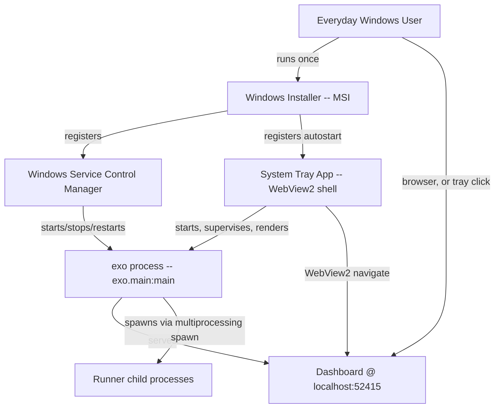
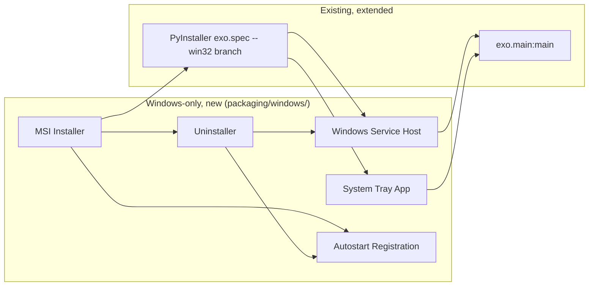
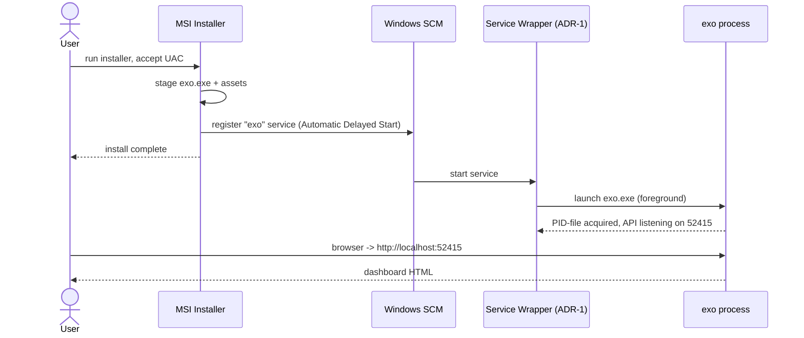
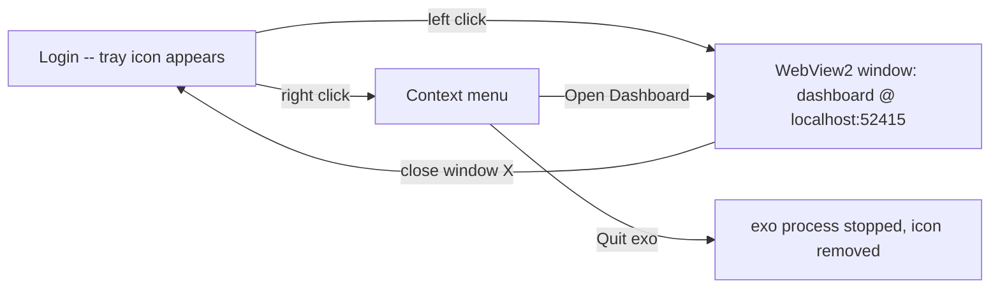
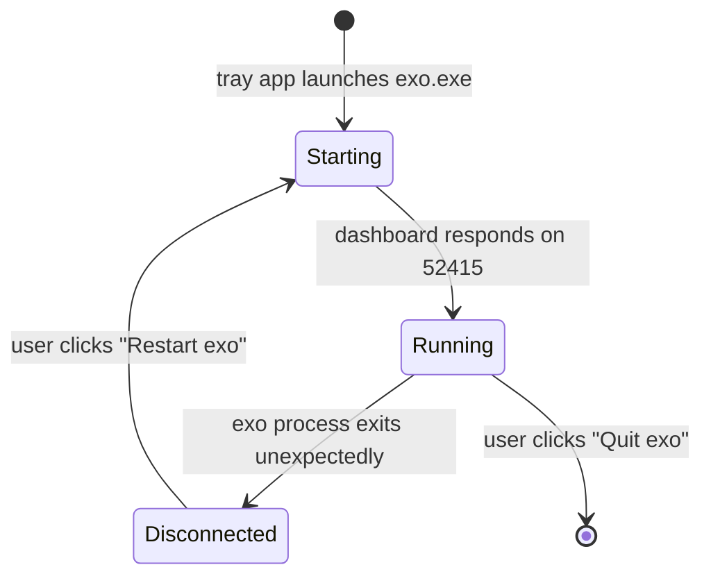

# Solution Design Document

## Validation Checklist

### CRITICAL GATES (Must Pass)

- [x] All required sections are complete
- [x] No [NEEDS CLARIFICATION] markers remain
- [x] Architecture pattern is clearly stated with rationale
- [x] **All architecture decisions confirmed by user** — see README.md Decisions Log; ADRs below are the scope decisions the requester (item 10) explicitly asked to be made and logged.
- [x] Every interface has specification

### QUALITY CHECKS (Should Pass)

- [x] All context sources are listed with relevance ratings
- [x] Project commands are discovered from actual project files
- [x] Constraints → Strategy → Design → Implementation path is logical
- [x] Every component in diagram has directory mapping
- [x] Error handling covers all error types
- [x] Quality requirements are specific and measurable
- [x] Component names consistent across diagrams
- [x] A developer could implement from this design
- [x] Implementation examples use actual schema column names (not pseudocode) — N/A, no database schema in this feature; see note in Data Storage Changes.
- [x] Complex queries include traced walkthroughs — N/A, no query logic in this feature.
- [x] **MECE: Components** — each component has a single distinct responsibility, every PRD requirement maps to exactly one component
- [x] **MECE: Interfaces** — no duplicate interfaces serving the same path, all communication paths documented
- [x] **MECE: Data Models** — each entity owns a distinct slice of the domain, all required data is modeled
- [x] **MECE: Acceptance Criteria** — each EARS criterion is unique, every PRD criterion has a corresponding system-level criterion

---

## Output Schema

### SDD Status Report

| Field | Value |
|-------|-------|
| specId | 006-windows-daemonization-packaging |
| architecture | see ArchitectureSummary below |
| sections | all COMPLETE |
| adrs | ADR-1..ADR-5, all CONFIRMED |
| validationPassed | all checklist items above |
| validationPending | 0 |
| nextSteps | Proceed to Factory decomposition (manifest.md, units/, scenarios/) |

### ArchitectureSummary

| Field | Value |
|-------|-------|
| pattern | Supervised-foreground-process, platform-native host shell (no in-process daemonization on Windows) |
| keyComponents | Windows Service Host, System Tray Application, PyInstaller Windows Build, MSI Installer, Autostart Registration, Uninstaller |
| externalIntegrations | Windows Service Control Manager (SCM), Microsoft Edge WebView2 Runtime, WiX Toolset (build-time only) |

### ADRStatus

| id | name | status |
|----|------|--------|
| ADR-1 | Service host implementation: off-the-shelf wrapper vs. purpose-built | CONFIRMED |
| ADR-2 | Default delivery mode: System Tray (Must-Have) vs. Windows Service (Should-Have) | CONFIRMED |
| ADR-3 | Installer format and install scope | CONFIRMED |
| ADR-4 | Autostart mechanism per delivery mode | CONFIRMED |
| ADR-5 | PyInstaller Windows extension strategy | CONFIRMED |

---

## Constraints

CON-1 exo's console entrypoint is `exo = "exo.main:main"` (`pyproject.toml:32-33`); Windows delivery mechanisms must invoke this entrypoint (or the frozen executable built from `src/exo/__main__.py` via `packaging/pyinstaller/exo.spec:12`) rather than reimplementing startup logic.

CON-2 `python-daemon` (`pyproject.toml:29`) and the `--legacy-daemon` double-fork path (`src/exo/main.py:290-319`) are POSIX-only (`DaemonContext`, `os.devnull`-backed FDs) and must not be used or extended for Windows; Windows daemonization is host-process-external, not a `main.py` code path.

CON-3 Multiprocessing uses `spawn` (`src/exo/main.py:337`), which on Windows re-executes the frozen entrypoint for every child runner process (`src/exo/worker/runner/supervisor.py:214-224`, `AsyncProcess`); the Windows entrypoint must call `multiprocessing.freeze_support()` before any spawning occurs, or child runner processes will fail to start under a frozen build.

CON-4 PyInstaller is the only sanctioned freezing tool (`packaging/pyinstaller/exo.spec`); it already branches on `sys.platform == "darwin"` for `macmon` bundling (`exo.spec:72-84`), establishing the pattern this spec's Windows branch follows — no second freezing/packaging tool for the Python payload.

CON-5 The dashboard has no separate runtime process — it is served in-process by FastAPI from `DASHBOARD_DIR` (`src/exo/api/main.py:279-286`), resolved via `find_dashboard()` (`src/exo/utils/dashboard_path.py:34-59`), which already understands `sys._MEIPASS` for frozen builds. Any Windows host (service or tray) only needs to keep one `exo` process alive; it must not attempt to serve or bundle the dashboard a second time.

CON-6 State paths (log dir, PID file, node identity, event log — `src/exo/shared/constants.py:68-94`) are owned by spec 005 on Windows; this spec's service/tray host must be able to read/write whatever locations spec 005 resolves, but must not hardcode or duplicate that path logic.

CON-7 The firewall rule for exo's ports (API 52415, Zenoh 52414, discovery 52413) is owned by spec 003; this spec's uninstaller removes that rule but does not create it.

## Implementation Context

### Required Context Sources

#### Documentation Context
```yaml
- doc: README.md
  relevance: HIGH
  why: "Lines 211-215 document --legacy-daemon and the existing precedent that systemd/launchd should run exo in the FOREGROUND — the same precedent this spec follows for the Windows Service."
```

#### Code Context
```yaml
- file: src/exo/main.py
  relevance: HIGH
  why: "Owns the process entrypoint (main/main_inner), PID-file locking (Pidfile at line 284), and the POSIX-only --legacy-daemon path (lines 290-319) that Windows must not use; the Windows host launches this same entrypoint as a supervised foreground process."

- file: pyproject.toml
  relevance: HIGH
  why: "Console entry point `exo = \"exo.main:main\"` (lines 32-33), project version (line 3) used for installer versioning, and python-daemon dependency (line 29) that is POSIX-only and must not gate Windows behavior."

- file: packaging/pyinstaller/exo.spec
  relevance: HIGH
  why: "Existing PyInstaller freeze configuration with a sys.platform == 'darwin' branch (lines 72-84) that establishes the pattern for adding a sys.platform == 'win32' branch rather than a second packaging tool."

- file: packaging/dmg/create-dmg.sh
  relevance: MEDIUM
  why: "Precedent for a scripted, platform-specific installer build pipeline (staging, packaging, layout) that the Windows MSI build script mirrors in shape."

- file: src/exo/utils/dashboard_path.py
  relevance: HIGH
  why: "find_dashboard()/find_resources() already resolve sys._MEIPASS for frozen builds (lines 24-31, 52-59); the Windows frozen executable relies on this unchanged, confirming no new dashboard-resolution code is needed."

- file: src/exo/shared/constants.py
  relevance: HIGH
  why: "Defines EXO_LOG_DIR, EXO_PID_FILE, EXO_NODE_ZID, EXO_EVENT_LOG_DIR, EXO_CACHE_HOME (lines 68-94) that the service/tray host and its running service account must be able to read and write; on Windows these paths are relocated by spec 005."

- file: src/exo/api/main.py
  relevance: MEDIUM
  why: "Confirms the dashboard is mounted in-process via StaticFiles at '/' (lines 279-286) — proof there is no separate Node server for the tray app to host; it only needs to render http://localhost:52415."

- file: src/exo/worker/runner/supervisor.py
  relevance: HIGH
  why: "RunnerSupervisor.run()/create() (lines 202-274) spawns child runner processes via AsyncProcess and tears them down in a finally block on shutdown; the Windows Service host must give exo's own process enough time and the correct termination signal for this teardown path to run before hard-killing anything."

- file: app/EXO/Services/NetworkSetupHelper.swift
  relevance: MEDIUM
  why: "Closest existing precedent (line 13, lines 110-243) for installer-time privileged daemon registration (a LaunchDaemon plist) that the Windows Service install script mirrors conceptually (SCM service registration at install time)."

- file: app/EXO/uninstall-exo.sh
  relevance: HIGH
  why: "Sets the completeness bar for the Windows uninstaller: stop daemon/service, remove registration file, remove logs, remove related state, and explicitly enumerate what was and wasn't removed (lines 85-129, 154-168, 194-202)."
```

### Implementation Boundaries

- **Must Preserve**: `exo.main:main`'s existing argument parsing, PID-file locking, and `main_inner()` startup sequence on all platforms; the FastAPI-mounted dashboard; the existing `--legacy-daemon` behavior on Linux (unchanged, still POSIX-only, not extended to Windows).
- **Can Modify**: `packaging/pyinstaller/exo.spec` (add a `win32` branch); `src/exo/main.py` (add a guard so `--legacy-daemon` fails fast with a clear error on Windows instead of crashing on a missing POSIX API); add new files under `packaging/windows/`.
- **Must Not Touch**: spec 005's path-relocation logic, spec 003's firewall-rule provisioning code, spec 002's telemetry code, spec 001's inference-backend abstraction — this spec only consumes their outputs.

### External Interfaces

#### System Context Diagram



#### Interface Specifications

```yaml
inbound:
  - name: "Everyday user -> Dashboard (browser or WebView2)"
    type: HTTP
    format: HTML/JSON (existing exo API + dashboard, unchanged)
    authentication: none (unchanged from current exo behavior)
    data_flow: "User views/operates the cluster dashboard already served by the exo API."

  - name: "SCM -> Windows Service Host"
    type: Windows Service control protocol (StartService/ControlService)
    format: native Win32 SCM calls
    authentication: LocalSystem or dedicated service account, Windows-managed
    data_flow: "Boot-time start, and Start/Stop/Restart commands issued from services.msc or `sc.exe`."

  - name: "Windows user session -> Tray Application"
    type: local process launch (Startup shortcut / Run key at logon)
    format: native Win32 process creation
    authentication: current user session
    data_flow: "Tray app launches in the user's own session at login, inheriting the user's GPU/profile access."

outbound:
  - name: "Windows Service Host -> exo process"
    type: local process supervision (create, monitor exit code, terminate)
    format: native Win32 process APIs (via the chosen service wrapper, ADR-1)
    authentication: n/a (same machine, same or child security context)
    data_flow: "Launches `exo.exe` (frozen entrypoint) as a child process, redirects its stdout/stderr to the spec-005 log location, restarts it on crash with backoff."
    criticality: HIGH

  - name: "Tray Application -> exo process"
    type: local process supervision (create, monitor exit code, terminate) + WebView2 navigation
    format: native Win32 process APIs + WebView2 COM API
    authentication: n/a (same user session)
    data_flow: "Launches `exo.exe` as a child process on first tray start (or connects to an already-running instance via the PID-file lock), and renders http://localhost:52415 in a WebView2 window on user click."
    criticality: HIGH

  - name: "Uninstaller -> SCM / Registry / Firewall"
    type: native Win32 APIs (service control, registry, firewall COM/netsh)
    format: n/a
    authentication: elevated (Administrator), same as install
    data_flow: "Stops and deletes the service, removes autostart entries, and removes the firewall rule provisioned per spec 003."
    criticality: HIGH

data:
  - name: "exo state directories (log, PID, node identity, event log)"
    type: filesystem
    connection: direct file I/O by the exo process itself (unchanged code path — `src/exo/shared/constants.py`)
    data_flow: "The Windows Service/Tray host does not write these paths itself; it only needs the account it launches exo under to have read/write access to whatever spec 005 resolves for EXO_CACHE_HOME/EXO_DATA_HOME on Windows."
```

### Cross-Component Boundaries

- **API Contracts**: The exo HTTP API and dashboard routes are an existing public contract (owned by other specs/components) and are not modified by this spec — the Windows host is a pure consumer of `http://localhost:52415`.
- **Team Ownership**: This spec owns everything under `packaging/windows/` and the Windows-only branch of `packaging/pyinstaller/exo.spec`; it does not own `src/exo/api`, `src/exo/worker`, or the dashboard frontend.
- **Shared Resources**: The PID file (`EXO_PID_FILE`) is the single-instance lock shared between "started from a terminal", "started by the Service", and "started by the Tray app" — all three go through the same `Pidfile` acquisition in `src/exo/main.py:284`, so only one can hold the exo process at a time.
- **Breaking Change Policy**: N/A — this spec adds new platform support; it must not change existing macOS/Linux packaging or daemonization behavior.

### Project Commands

```bash
# Core Commands (discovered from pyproject.toml and AGENTS.md)
Install: uv sync --extra mlx-cpu   # or mlx / mlx-cuda12 / mlx-cuda13 depending on platform
Dev:     uv run exo
Test:    uv run pytest
Lint:    uv run ruff check
Build:   uv run pyinstaller packaging/pyinstaller/exo.spec   # existing macOS/Linux freeze entrypoint this spec extends for win32
Typecheck: uv run basedpyright

# Windows-specific (new, added by this spec — see Directory Map)
Build MSI:        packaging\windows\installer\build-msi.ps1
Install Service:  packaging\windows\service\install-service.ps1
Uninstall:        packaging\windows\installer\uninstall.ps1
```

## Solution Strategy

- **Architecture Pattern**: Supervised-foreground-process. exo's own process never self-daemonizes on Windows (no double-fork, no service code inside `main.py` beyond a platform guard); instead, an external host — either the Windows SCM via a service wrapper, or the tray application — launches the existing `exo` entrypoint as a normal foreground child process, watches it, restarts it on crash, and terminates it cleanly on stop. This is the same shape `README.md:211-215` already documents for systemd/launchd on Linux, applied natively to Windows.
- **Integration Approach**: Two independent, parallel-buildable host shells (Windows Service, System Tray) both wrap the same frozen `exo.exe` produced by a Windows branch of the existing PyInstaller spec (CON-4). A single MSI installer packages both, lets the installer choose which is installed as the default background mode, and a shared uninstaller script removes whichever was installed.
- **Justification**: Building a second daemonization mechanism inside `main.py` (the POSIX approach) would fight the Windows process model (no `fork`, session 0 restrictions, no `/dev/null`-equivalent semantics for `DaemonContext`). Keeping exo itself simple (foreground process + PID lock, unchanged) and pushing all Windows-specific lifecycle management into a thin external host is the smaller, more maintainable diff, and matches the constraint that `python-daemon` must stay POSIX-only (CON-2).
- **Key Decisions**: (1) don't extend `--legacy-daemon` to Windows — add a fast, clear failure instead (see Risks); (2) reuse PyInstaller rather than introduce a second freezing tool; (3) make System Tray the Must-Have default, Windows Service the Should-Have alternative (ADR-2); (4) use an off-the-shelf, battle-tested Windows service wrapper rather than hand-rolling SCM integration in Rust/C# (ADR-1).

## Building Block View

### Components



### Directory Map

**Component**: Windows Service Host
```
.
├── packaging/
│   └── windows/
│       └── service/
│           ├── exo-service.xml        # NEW: service wrapper config (executable path, restart/backoff policy, log redirection to spec-005 log dir)
│           └── install-service.ps1    # NEW: registers the Windows Service with SCM at install time (Automatic Delayed Start)
├── src/
│   └── exo/
│       └── main.py                    # MODIFY: guard --legacy-daemon behind sys.platform != "win32" with a clear SystemExit message
```

**Component**: System Tray Application
```
.
├── packaging/
│   └── windows/
│       └── tray/
│           └── exo_tray/
│               ├── __main__.py        # NEW: WebView2 shell entrypoint — launches/attaches to exo.exe, renders http://localhost:52415, tray icon + menu
│               └── icon.ico           # NEW: tray icon asset
```

**Component**: PyInstaller Windows Build (extends existing spec)
```
.
├── packaging/
│   └── pyinstaller/
│       └── exo.spec                   # MODIFY: add `if sys.platform == "win32":` branch (icon resource, windowed console=False variant for the tray build, console=True variant for the service-hosted build)
```

**Component**: MSI Installer
```
.
├── packaging/
│   └── windows/
│       └── installer/
│           ├── exo.wxs                # NEW: WiX source — features for Service and Tray, per-machine install scope, upgrade code
│           └── build-msi.ps1          # NEW: invokes the WiX toolset to produce the .msi from the PyInstaller COLLECT output
```

**Component**: Autostart Registration
```
.
├── packaging/
│   └── windows/
│       └── installer/
│           └── register-autostart.ps1 # NEW: sets SCM Startup Type = Automatic (Delayed Start) for Service mode, or writes a per-user Startup-folder shortcut for Tray mode
```

**Component**: Uninstaller
```
.
├── packaging/
│   └── windows/
│       └── installer/
│           └── uninstall.ps1          # NEW: mirrors app/EXO/uninstall-exo.sh — stops service/tray process, deletes service registration, removes autostart entry, removes the spec-003 firewall rule, removes Start Menu shortcuts
```

### MECE Check: Components
- [x] Each component has a single, distinct responsibility (no overlap) — Service and Tray are the two delivery modes; MSI Installer packages both; Autostart Registration and Uninstaller are the two install-time/removal-time cross-cutting concerns shared by both modes.
- [x] Every PRD requirement maps to exactly one component (no gaps, no ambiguity) — Feature 1 (background install) → MSI Installer; Feature 2 (tray) → System Tray Application; Feature 3 (service) → Windows Service Host; Feature 4 (uninstall) → Uninstaller; Feature 5 (autostart toggle) → Autostart Registration.
- [x] No two components own the same domain logic — only the PyInstaller spec branch is shared infrastructure, and it is called out as its own component rather than folded silently into Service or Tray.

### Interface Specifications

#### Data Storage Changes

Not applicable — this feature introduces no database, no new persisted schema, and no changes to any existing data model. It only reads/writes filesystem paths that spec 005 already owns (log files, PID file, service registration data held by the Windows SCM itself, not by exo).

#### Internal API Changes

Not applicable — this feature adds no new HTTP endpoints to the exo API. It is a packaging/lifecycle-management layer that sits outside the API and consumes the existing `http://localhost:52415` surface unchanged.

#### Application Data Models

```pseudocode
# No new application-level entities. The only "state" introduced by this
# feature lives in Windows-native stores, not in exo's own data model:
ENTITY: WindowsServiceRegistration (Windows-native, NEW)
  FIELDS:
    service_name: "exo"                         # SCM service name
    binary_path: path to exo.exe + wrapper args
    start_type: AUTO_START_DELAYED | MANUAL | DISABLED
    account: LocalSystem | dedicated service account (ADR-1)
  BEHAVIORS:
    install(): registers with SCM
    start() / stop() / restart(): delegated to SCM + wrapper's on-failure policy

ENTITY: TrayAutostartEntry (Windows-native, NEW)
  FIELDS:
    shortcut_path: "%APPDATA%/Microsoft/Windows/Start Menu/Programs/Startup/exo.lnk"
    target: path to exo_tray executable
  BEHAVIORS:
    enable() / disable(): create/remove the Startup-folder shortcut (or HKCU Run key, per ADR-4)
```

#### Integration Points

```yaml
# Inter-Component Communication
- from: MSI Installer
  to: Windows Service Host / System Tray Application
    - protocol: filesystem (COLLECT output copied to install dir) + SCM registration call
    - data_flow: "Installer stages the PyInstaller COLLECT output, then calls install-service.ps1 and/or register-autostart.ps1 depending on the chosen feature selection."

- from: Windows Service Host / System Tray Application
  to: exo process (exo.main:main)
    - protocol: local process creation + stdio/log redirection
    - data_flow: "Host launches the frozen exo.exe entrypoint as a foreground child process and supervises its lifecycle; no network protocol involved — same-machine only."

- from: Uninstaller
  to: Windows Service Host, Autostart Registration, spec-003 firewall rule
    - protocol: SCM delete call, registry/shortcut deletion, `netsh advfirewall` (or equivalent) rule deletion
    - data_flow: "Reverses everything the installer/autostart registration created, matching the app/EXO/uninstall-exo.sh completeness bar."

# External System Integration
Microsoft_Edge_WebView2_Runtime:
  - doc: https://learn.microsoft.com/microsoft-edge/webview2/
  - integration: "Tray app hosts a WebView2 control navigated to http://localhost:52415; requires either the Evergreen Bootstrapper (downloads/installs the shared runtime on first run) or bundling a Fixed Version runtime with the installer (ADR-3 covers installer size/offline trade-off)."
  - critical_data: [none — purely a rendering surface for the existing dashboard]
```

### MECE Check: Interfaces & Data Models
- [x] No two interfaces serve the same consumer-to-provider path (no overlap) — Service supervision and Tray supervision are distinct per-mode paths; the shared PID-file lock (CON-5/Cross-Component Boundaries) prevents both from controlling the same exo process at once.
- [x] All component-to-component and component-to-external communication paths are documented (no gaps).
- [x] Each data entity owns a distinct slice of the domain (WindowsServiceRegistration vs. TrayAutostartEntry — no overlap, exactly one applies per chosen delivery mode).
- [x] All data referenced in interfaces and acceptance criteria is modeled in an entity or explicitly marked as delegated to an existing spec (005/003).

### Implementation Examples

#### Example: Windows entrypoint must call freeze_support() before spawning

**Why this example**: CON-3 is a real, non-obvious failure mode — frozen Windows executables using `multiprocessing` with the `spawn` start method (already forced by `src/exo/main.py:337`) will silently fail to launch child runner processes, or launch an infinite loop of new top-level windows, unless `multiprocessing.freeze_support()` runs first in the entrypoint module.

```python
# packaging: the Windows-frozen entrypoint (src/exo/__main__.py, already the
# PyInstaller Analysis target per exo.spec:12) must guard multiprocessing
# re-execution on win32 before anything else imports/runs main().
import sys
import multiprocessing as mp

if __name__ == "__main__":
    if sys.platform == "win32":
        # Required for frozen (PyInstaller) builds on Windows: without this,
        # every spawned runner subprocess re-executes the whole entrypoint
        # and multiprocessing.set_start_method("spawn", force=True) at
        # src/exo/main.py:337 will fail to bootstrap child processes correctly.
        mp.freeze_support()
    from exo.main import main
    main()
```

#### Example: --legacy-daemon must fail fast, not silently misbehave, on Windows

**Why this example**: `src/exo/main.py:290-306` opens `os.devnull` and constructs a `daemon.DaemonContext`, both of which either behave differently or raise unhelpful low-level errors on Windows. CON-2 requires a clear, intentional failure instead.

```python
# src/exo/main.py, inside main(), before the existing `if args.legacy_daemon:`
# branch at line 290 — smallest possible guard, no new dependency:
if args.legacy_daemon and sys.platform == "win32":
    print(
        "--legacy-daemon is not supported on Windows (python-daemon's "
        "DaemonContext is POSIX-only). Install exo as a Windows Service or "
        "run the System Tray app instead — see packaging/windows/.",
        file=sys.stderr,
    )
    raise SystemExit(1)
```

## Runtime View

### Primary Flow: Background Install → Reboot → Reachable Dashboard (Windows Service mode)

1. User double-clicks the exo MSI installer and accepts the UAC elevation prompt.
2. Installer copies the PyInstaller COLLECT output (built from the `win32` branch of `exo.spec`) to `Program Files\exo\`.
3. Installer runs `install-service.ps1`, which registers "exo" as a Windows Service (Automatic Delayed Start) wrapping `exo.exe` via the chosen service host (ADR-1), configured to redirect stdout/stderr to the spec-005 log directory.
4. Installer finishes; the service is started immediately (or at next boot).
5. SCM launches the service wrapper, which launches `exo.exe` as a foreground child process. `exo.main:main` acquires the PID-file lock (`src/exo/main.py:284`), runs `main_inner()`, and the FastAPI API starts serving the dashboard on port 52415.
6. User restarts the PC. SCM starts the service again automatically before any login. `http://localhost:52415` responds once `main_inner()` completes startup — no user action required.



### Primary Flow: Tray Click → Dashboard Window (System Tray mode)

1. User logs into Windows; the Startup-folder shortcut (or HKCU Run key, ADR-4) launches `exo_tray.exe`.
2. `exo_tray` checks whether an exo process already holds the PID-file lock; if not, it launches `exo.exe` as a child process (foreground, same as the service flow) and shows a tray icon.
3. User clicks the tray icon; `exo_tray` opens (or focuses) a WebView2 window navigated to `http://localhost:52415`.
4. User right-clicks the tray icon and selects "Quit exo"; `exo_tray` sends a graceful termination signal to the `exo.exe` child process, waits for it to exit, then removes the tray icon and exits itself.

### Error Handling

- Invalid/missing WebView2 Runtime: `exo_tray` detects this at startup (WebView2 environment creation failure) and either triggers the Evergreen Bootstrapper download (if the installer chose that option per ADR-3) or shows a clear, non-crashing message box directing the user to install WebView2 Runtime, rather than crashing silently.
- exo process fails to acquire the PID-file lock (already running from another source): the Service Host / Tray app treats this as "another instance is already serving the dashboard" — the Service reports a start failure to SCM (visible in Event Viewer, not a silent retry loop); the Tray app detects the existing instance and simply attaches its UI to it instead of launching a duplicate.
- exo process crashes unexpectedly: the Service Host restarts it automatically with backoff (ADR-1); the Tray app shows the tray icon in a "disconnected" state and offers a manual "Restart exo" menu item, since a logged-in user is present to notice and act.
- Uninstall run while the service/tray process is running: `uninstall.ps1` stops the process/service first (graceful termination, falling back to a forced stop after a timeout) before removing any registration, so the removal never orphans a running process.

## Deployment View

### Single Application Deployment
- **Environment**: End-user Windows 10 (21H2+) / Windows 11 desktop or server-class PC, installed per-machine (ADR-3).
- **Configuration**: No new environment variables beyond what spec 005 already defines for Windows path relocation; the service wrapper's config file (`exo-service.xml`) is the only new configuration surface, and it is installer-managed, not user-edited.
- **Dependencies**: Microsoft Edge WebView2 Runtime (Tray mode only — see ADR-3 for bootstrapper choice); no additional Windows Service dependencies beyond the SCM itself and the chosen wrapper (ADR-1).
- **Performance**: Installer completes in well under a minute on typical hardware (matches the macOS DMG's user-perceived install time); the dashboard must become reachable within a bounded, documented window after service start/tray launch (see Quality Requirements) — this is a startup-latency bound on exo's own `main_inner()`, not a new requirement introduced by the Windows host itself.

## Cross-Cutting Concepts

### Pattern Documentation

```yaml
- pattern: README.md foreground-supervision precedent (lines 211-215)
  relevance: CRITICAL
  why: "Establishes that background-run != self-daemonizing; an external supervisor (systemd/launchd today, SCM/tray on Windows) owns the 'runs invisibly' behavior while exo itself stays a normal foreground process."

- pattern: app/EXO/uninstall-exo.sh completeness bar (NEW pattern applied to Windows)
  relevance: HIGH
  why: "Defines what 'clean uninstall' means for exo on any platform: stop the daemon, remove its registration, remove its logs, remove related state, and explicitly report what was/wasn't removed."
```

### User Interface & UX

**Information Architecture:**
- Navigation: A single system tray icon is the entire "app surface" for Tray mode; clicking opens the existing dashboard (no new navigation is introduced — the dashboard's own information architecture, owned elsewhere, is unchanged).
- Content Organization: The tray right-click menu is a flat, 3-4 item list (Open Dashboard, Start with Windows toggle, Restart exo, Quit exo) — no submenus, matching the "everyday user" bar.
- User Flows: Install → (Service: reboot, nothing else to do) or (Tray: log in, click icon) → Dashboard. Uninstall → Settings → Apps → Uninstall exo, one confirmation dialog, done.

**Design System:**
- Components: The WebView2 window renders the existing Svelte 5 dashboard unchanged — no new design-system components are introduced by this spec.
- Tokens: The tray icon uses exo's existing brand mark (see `docs/imgs/exo-logo-transparent.png` used elsewhere in the repo) rendered as a `.ico`; no new color/typography tokens.
- Patterns: Standard Win32 tray-icon-with-context-menu pattern (as used by Discord, Dropbox, OneDrive) — deliberately unoriginal so the everyday user already knows how to use it.

**Interaction Design:**
- State Management: The tray icon has three visual states — Running (dashboard reachable), Starting (exo launched but not yet reachable), Disconnected (crashed / not running) — reflected by icon variant, not by a separate UI surface.
- Feedback: Clicking "Open Dashboard" while still in the Starting state shows a lightweight loading state in the opened WebView2 window (the dashboard's own loading UI, unchanged) rather than a blank/error page.
- Accessibility: Tray context menu items use standard Win32 menu accessibility (keyboard navigable, screen-reader labeled) provided by the OS tray API; the WebView2-hosted dashboard's own accessibility is owned by the dashboard codebase, not this spec.

#### UI Visualization Guide

**Entry Point** — the system tray icon and its context menu:
```
┌──────────────────────────────────────────┐
│  Windows Taskbar Tray                     │
│  ...  [wifi] [volume] [🟢 exo] [clock]    │
└──────────────────────────────────────────┘
        right-click on [🟢 exo]
┌────────────────────────────────────┐
│  Open Dashboard                     │
│  ──────────────────────────────     │
│  ☑ Start with Windows               │
│  Restart exo                        │
│  ──────────────────────────────     │
│  Quit exo                           │
└────────────────────────────────────┘
```

**Screen Flow** — from tray icon to dashboard:


**Tray Icon State** — Running / Starting / Disconnected:


### System-Wide Patterns
- Security: The installer requires Administrator/UAC elevation (writing to `Program Files`, registering a service, and — via spec 003 — a firewall rule all require elevation); the Tray app itself runs unelevated in the user's own session, matching least-privilege.
- Error Handling: Failures at every stage (install, service start, WebView2 init, uninstall) surface a clear, human-readable message rather than a silent failure or a raw stack trace — matching the "everyday user, not a developer" persona.
- Performance: No new performance-sensitive code path is introduced; the Windows host is a thin process-supervision + rendering shell around the existing exo API and dashboard.
- i18n/L10n: Out of scope for this spec — tray menu strings ship in English only, matching the existing dashboard's current localization state.
- Logging/Auditing: The service wrapper redirects exo's stdout/stderr to the spec-005 log location (not a new log destination); Windows Event Viewer receives only service lifecycle events (start/stop/crash-restart) from the SCM/wrapper itself, not exo's own application logs.

## Architecture Decisions

- [x] ADR-1 Service host implementation: off-the-shelf wrapper, not a purpose-built Rust/C# service
  - Rationale: A generic, widely-used Windows service wrapper (in the shape of WinSW — XML-configured, runs an arbitrary executable as a service, supports on-failure restart-with-backoff, and stdout/stderr redirection) already provides everything Feature 3 requires (SCM start/stop/restart, crash restart with backoff, log redirection) with zero new native code to build, review, or maintain. A purpose-built Rust/C# wrapper would duplicate that functionality for no behavioral gain, at real ongoing maintenance cost, and this project already avoids adding dependencies for what an existing, off-the-shelf tool solves (see AGENTS.md's YAGNI-aligned code style).
  - Trade-offs: Depends on a third-party (open-source) executable being vendored/downloaded at packaging time rather than exo owning 100% of its own service-hosting code; acceptable because the wrapper's job (start this exe, restart it, redirect its output) is narrow and swappable without touching `exo.main`.
  - User confirmed: Yes — see README.md Decisions Log.

- [x] ADR-2 Default delivery mode: System Tray is Must-Have default, Windows Service is Should-Have
  - Rationale: A Windows Service runs under a service account (commonly `LocalSystem` or a dedicated service account) whose profile and `%LOCALAPPDATA%` differ from the logged-in user's — this directly collides with spec 005's per-user model-cache location and with per-user GPU driver/session access needed for inference performance. The System Tray app runs in the user's own logon session, so it inherits the correct GPU access and the correct per-user paths with zero extra configuration, matching what most everyday users (a single-user daily-driver PC) actually need. The Windows Service remains available and fully specified (Feature 3, Must-Have feature in the PRD) for the secondary case of an always-on, no-login machine, but is not the installer's default choice.
  - Trade-offs: Tray mode requires a login to start exo, so it does not cover the "always-on headless PC" case as well as the Service does; that case is explicitly served by offering Service as the Should-Have alternative, not by making it the default.
  - User confirmed: Yes — recorded in README.md Decisions Log per task item 10(a).

- [x] ADR-3 Installer format: WiX-built MSI, per-machine install scope
  - Rationale: The Windows Service (Must-Have Feature 3) requires elevated, per-machine registration with the SCM regardless of which mode is chosen as default, so the installer itself must run elevated and per-machine; MSI via the WiX Toolset gives the most auditable, scriptable, CI-friendly build (mirrors the existing scripted `create-dmg.sh` pipeline in shape) and integrates natively with "Apps & Features" for discovery and uninstall (Feature 4), which NSIS/MSIX do not provide as cleanly for a service-registering installer. MSIX's app-container sandboxing is incompatible with installing an unsandboxed Windows Service and is explicitly excluded (PRD Won't Have: no Store/MSIX distribution). A winget manifest can be published later as a thin wrapper around this same MSI without changing the MSI itself.
  - Trade-offs: Per-machine MSI install requires UAC elevation even for users who only ever want Tray mode (which itself doesn't strictly need elevation) — accepted because the Windows Service option must remain available from the same installer without a second install path, and per-machine + elevated matches the existing precedent of the macOS `.dmg`/`/Applications` install and `app/EXO/uninstall-exo.sh` requiring `sudo`.
  - User confirmed: Yes — recorded in README.md Decisions Log per task item 10(b).

- [x] ADR-4 Autostart mechanism differs by delivery mode
  - Rationale: Windows Service autostart is natively handled by the SCM's Startup Type (set to Automatic, Delayed Start, at install time by `install-service.ps1`) — no additional mechanism is needed or appropriate. Tray mode autostart uses a per-user Startup-folder shortcut (`%APPDATA%\Microsoft\Windows\Start Menu\Programs\Startup\exo.lnk`), which is simpler and more transparent to an everyday user (visible in Settings → Apps → Startup, toggleable there, and directly explorable in File Explorer) than an equivalent HKCU Run key, satisfying Feature 5's "no registry editing" requirement.
  - Trade-offs: A Startup-folder shortcut can be deleted by antivirus/cleanup tools without exo's knowledge, unlike a Scheduled Task; accepted as the standard, well-understood trade-off every consumer tray app on Windows already makes (Discord, Dropbox, etc. use the same mechanism).
  - User confirmed: Yes — see README.md Decisions Log.

- [x] ADR-5 PyInstaller Windows extension: extend `exo.spec` with a `win32` branch, two EXE targets
  - Rationale: Keeping one `Analysis`/`COLLECT` pipeline and adding a `win32`-specific `EXE()` variant (or two: `exo.exe` with `console=True` for the service-hosted case where log redirection is handled by the wrapper, and `exo_tray.exe` with `console=False` for the windowless tray shell) is the smallest change to the existing, already-cross-platform spec file (CON-4), avoiding a second build tool.
  - Trade-offs: The `win32` branch needs its own hidden-import/binary handling for WebView2 interop (analogous to the existing `darwin`-only `macmon` binary handling at `exo.spec:72-84`); scoped narrowly to Windows only, exactly as the macmon branch is scoped to Darwin only.
  - User confirmed: Yes — see README.md Decisions Log.

## Quality Requirements

- Performance: After a Windows Service start or Tray-triggered launch, `http://localhost:52415` must become reachable within the same startup-latency bound exo already exhibits on macOS/Linux for an equivalent machine — this spec introduces no additional startup delay beyond the supervisor's own process-launch overhead (sub-second).
- Usability: Zero terminal/console windows visible during normal operation (install, run, and use) for both delivery modes — directly testable via the Feature 1 acceptance criteria.
- Security: Installer and uninstaller require and correctly request Administrator elevation (UAC) for every operation that needs it (service registration, firewall rule removal, `Program Files` writes); the Tray app itself never requests elevation.
- Reliability: Windows Service crash-restart must succeed within a bounded backoff window (documented in the service wrapper's `exo-service.xml`, e.g., restart attempts with increasing delay, capped rather than infinite/instant retry) — directly testable via Feature 3's crash-restart acceptance criterion.

## Acceptance Criteria

**Main Flow Criteria: [PRD/Feature 1 — Background install, no terminal]**
- [x] WHEN the MSI installer completes, THE SYSTEM SHALL leave no terminal or console window visible on the desktop.
- [x] WHEN the PC is rebooted after a Windows Service install, THE SYSTEM SHALL make `http://localhost:52415` reachable without any user action.
- [x] THE SYSTEM SHALL expose the running exo process as a clearly labeled "exo" entry in the Windows Services console (Service mode) or as a "exo" tray icon (Tray mode).

**Main Flow Criteria: [PRD/Feature 2 — System Tray Application]**
- [x] WHEN the user logs into Windows after installing Tray mode, THE SYSTEM SHALL show the exo tray icon automatically, with no manual launch step.
- [x] WHEN the user left-clicks the tray icon, THE SYSTEM SHALL open a WebView2 window rendering `http://localhost:52415`, with no separate browser or console window.
- [x] WHEN the user selects "Quit exo" from the tray menu, THE SYSTEM SHALL stop the exo process and remove the tray icon.

**Main Flow Criteria: [PRD/Feature 3 — Windows Service]**
- [x] WHILE nobody is logged in after boot, THE SYSTEM SHALL keep the Windows-Service-hosted exo process running and `http://localhost:52415` reachable from the network.
- [x] WHEN the user stops the "exo" service via `services.msc`, THE SYSTEM SHALL terminate the exo process and all of its runner child processes, and `http://localhost:52415` SHALL stop responding.
- [x] IF the exo process crashes, THEN THE SYSTEM SHALL restart it automatically within a bounded, backed-off time window without user action.

**Main Flow Criteria: [PRD/Feature 4 — Clean uninstall]**
- [x] WHEN the user uninstalls exo via Settings → Apps, THE SYSTEM SHALL stop any running exo process/service as part of the uninstall.
- [x] WHEN uninstall completes, THE SYSTEM SHALL leave no exo entries in Services, Task Scheduler/Startup Apps, or the Windows Defender Firewall allowed-apps list.

**Main Flow Criteria: [PRD/Feature 5 — Autostart toggle]**
- [x] WHERE Tray mode is installed, THE SYSTEM SHALL provide a "Start with Windows" toggle in the tray menu reflecting current autostart state.
- [x] WHEN the user disables "Start with Windows", THE SYSTEM SHALL NOT launch exo automatically at the next login, while still allowing manual launch from the Start Menu.

**Error Handling Criteria: [PRD/Feature 2 — WebView2 availability]**
- [x] IF the WebView2 Runtime is unavailable at Tray app first launch, THEN THE SYSTEM SHALL either bootstrap it automatically (Evergreen) or show a clear, non-crashing message directing the user to install it.
- [x] WHEN a second exo instance attempts to start while the PID-file lock is already held, THE SYSTEM SHALL fail that second start cleanly (Service: reported start failure; Tray: attach to the existing instance instead of duplicating it) rather than corrupting shared state.

**Error Handling Criteria: [PRD/Feature 3 — Crash handling]**
- [x] IF the exo process crashes repeatedly within a short window, THEN THE SYSTEM SHALL apply increasing backoff between restart attempts rather than restart-looping at full speed.

**Edge Case Criteria: [PRD/Detailed Feature Spec — legacy-daemon on Windows]**
- [x] IF `--legacy-daemon` is passed on Windows, THEN THE SYSTEM SHALL exit immediately with a clear error message rather than attempting POSIX-only daemonization.

**Edge Case Criteria: [PRD/Constraints — frozen multiprocessing spawn]**
- [x] WHILE running as a PyInstaller-frozen Windows executable, THE SYSTEM SHALL call `multiprocessing.freeze_support()` before any runner subprocess is spawned, so that child runner processes start correctly under `spawn`.

### MECE Check: Acceptance Criteria
- [x] Each EARS criterion specifies a unique system behavior (no two criteria verify the same thing).
- [x] Every PRD acceptance criterion has a corresponding EARS criterion (no gaps) — all five PRD Features are represented above.
- [x] Criteria collectively cover happy path (Main Flow), error handling, and edge cases for every component (Service, Tray, Installer/Uninstaller, frozen-build entrypoint).

## Risks and Technical Debt

### Known Technical Issues
- No existing Windows packaging or daemonization code exists in the repository today (`packaging/pyinstaller/exo.spec` has no `win32` branch; there are no `packaging/windows/` assets) — this is greenfield work, not a modification of a partially-working Windows path.
- `src/exo/main.py:290-306`'s `--legacy-daemon` path will raise an unhelpful low-level error if invoked as-is on Windows (`os.devnull`/`DaemonContext` behavior is undefined/broken cross-platform); CON-2 and the corresponding Edge Case acceptance criterion require converting that into a clear, intentional failure.

### Technical Debt
- None introduced by this spec's design itself; the nearest analog to "debt" is the deliberate choice (ADR-1) to depend on a vendored third-party service-wrapper executable rather than first-party code — tracked as an explicit, reviewed trade-off, not an accidental shortcut.

### Implementation Gotchas
- Multiprocessing `spawn` + PyInstaller-frozen entrypoint on Windows requires `multiprocessing.freeze_support()` ahead of any process spawning (CON-3) — omitting it silently breaks `RunnerSupervisor`'s child-process model (`src/exo/worker/runner/supervisor.py:214-224`) with confusing failures (either no runner starts, or an explosion of duplicate top-level processes).
- Windows Services run in Session 0, which has no interactive desktop — any GPU/driver access that implicitly depends on an interactive session (rather than a documented headless/service-compatible driver path) may behave differently for Service-hosted exo than for Tray-hosted exo; this is exactly the trade-off ADR-2 makes explicit and is why Tray, not Service, is the default.
- The shared PID-file lock (`src/exo/main.py:284`) is the only mechanism preventing two Windows hosts (e.g., Service AND Tray both installed and both trying to launch exo) from double-starting; the installer's feature selection (ADR-3) should make choosing both delivery modes for the *same* running instance an explicit, understood configuration rather than an accident, and both hosts must treat "PID lock already held" as an expected, non-error condition when attaching to an existing instance.

## Glossary

### Domain Terms

| Term | Definition | Context |
|------|------------|---------|
| Delivery mode | Whether exo is installed to run as a Windows Service or a System Tray application | Chosen at install time (ADR-2/ADR-3); determines which host component supervises the exo process |
| Everyday user | This spec's persona: a non-developer Windows user comfortable with installers and tray icons but not PowerShell/registry editing | Drives every UX and error-message decision in this spec |

### Technical Terms

| Term | Definition | Context |
|------|------------|---------|
| SCM | Windows Service Control Manager — the OS component that starts, stops, and monitors registered services | Owns the Windows Service delivery mode's lifecycle |
| Session 0 | The isolated Windows session in which services run, with no interactive desktop | Explains why a Windows Service cannot show UI and why GPU/profile access differs from a logged-in user session |
| WebView2 | Microsoft's Chromium-based embeddable browser control for Windows apps | Used by the Tray app to render the existing dashboard without shipping a second browser |
| Evergreen Bootstrapper | A small WebView2 installer that downloads/installs the shared, auto-updating WebView2 Runtime at first run | One of the two WebView2 delivery options weighed in ADR-3 |
| Fixed Version runtime | A specific WebView2 Runtime version bundled directly with the installer, not shared/auto-updating | The other WebView2 delivery option weighed in ADR-3 (larger installer, no runtime dependency) |
| WiX Toolset | An open-source toolset for building Windows Installer (MSI) packages from XML source | Chosen build tool for this spec's installer (ADR-3) |
| Spawn (multiprocessing) | Python's `multiprocessing` start method that launches a fresh interpreter process for each child, re-executing the entrypoint module | Already forced on all platforms (`src/exo/main.py:337`); has Windows-specific frozen-build implications (CON-3) |

### API/Interface Terms

| Term | Definition | Context |
|------|------------|---------|
| PID file / Pidfile | The single-instance lock file (`EXO_PID_FILE`) acquired via `Pidfile(...)` in `src/exo/main.py:284` | Shared by every way of starting exo (terminal, Service, Tray) to guarantee only one instance runs at a time |
| `DASHBOARD_DIR` | The resolved filesystem path FastAPI mounts as the dashboard's static root (`src/exo/api/main.py:279-286`) | Confirms the Windows host renders an existing in-process HTTP surface, not a second server |
